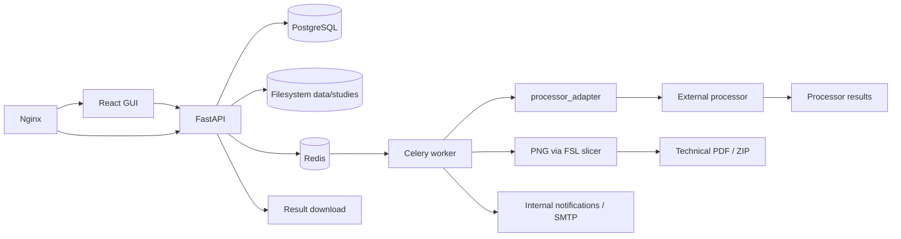

# stroke-server

> "stroke-server" is the working name of this project; it is a placeholder and may change.

This repository contains a web platform for processing magnetic resonance imaging studies and producing automatic technical reports. It started as a master's thesis prototype ("Design and implementation of an MRI processing service for the automatic generation of clinical reports in neurorehabilitation") and is now the base for the platform described in `docs/plan/IMPLEMENTATION_PLAN.md`.

The platform lets users upload anonymised studies from a web GUI, records the upload, prepares a per-study BIDS structure, launches asynchronous processing through an external processor treated as an isolated component, stores states, sends internal/email notifications and offers a technical PDF and, when applicable, a ZIP of results for download.

The PDF generated in this version is a **technical report of processing artefacts**. It does not interpret images, contains no medical conclusions and is not a validated clinical report.

## Architecture Summary



## Requirements

- Docker and Docker Compose.
- Optionally Make for convenience commands.
- Initial use with anonymised data only.

## Quick Start

```bash
cp .env.example .env
make up
make create-admin EMAIL=admin@example.org
```

Open `http://localhost` for the GUI and `http://localhost/api/docs` for Swagger/OpenAPI.

## Main Commands

```bash
make up       # start services; WORKER_REPLICAS=N scales workers
make down     # stop services
make logs     # follow logs
make frontend-rebuild # rebuild/recreate only the Docker frontend
make rebuild  # rebuild/recreate all Docker services
make test     # run local Python tests
make lint     # ruff check
make format   # ruff format
make migrate  # apply migrations in the api container
make create-admin EMAIL=admin@example.org # create/update the initial admin
make backup   # create a local backup of PostgreSQL and data/studies
make retention-dry-run DAYS=90  # list studies that are retention candidates without deleting
make restore BACKUP_DIR=backups/<timestamp> CONFIRM_RESTORE=YES_I_UNDERSTAND # restore a local backup
make seed     # create a local test file
make smoke    # check the healthcheck through the proxy
make clean    # delete local volumes and studies
```

To allow more simultaneous processing runs with `compneuro`, keep `MAX_CONCURRENT_PROCESSING_JOBS=1` and scale worker containers, for example `make up WORKER_REPLICAS=2`.
You can also leave `WORKER_REPLICAS=2` in `.env`; `make up` picks it up automatically when it is not passed on the command line.

When the frontend is modified and the Docker/Nginx deployment is used, run `make frontend-rebuild` to regenerate the static bundle and recreate the container. `make down && make up` may reuse an old image; use `make clean` only if you want to delete local volumes and studies.

## Functional Flow

1. The user logs in with a local account.
2. The user uploads a file from the GUI.
3. FastAPI validates permissions, storage quota and extension, sanitises the file name and stores the file in `data/studies/{study_id}/input`.
4. A `Study` with an owner, a `ProcessingJob` and audit events are created.
5. FastAPI enqueues a Celery task in Redis.
6. The worker runs `processor_adapter`.
7. The adapter runs the command for the configured backend.
8. In `dummy` mode, `PROCESSOR_COMMAND` is used; in `compneuro` mode, `COMPNEURO_COMMAND` is used.
9. The dummy processor generates a development PDF, or `compneuro-anatproc` generates `Preproc/BET` and `Preproc/ProbTissue`.
10. The worker detects results, renders NIfTI to PNG with FSL `slicer`, generates a technical PDF and optionally a ZIP.
11. The worker records internal notifications and, if SMTP is configured, sends emails without attachments on completion or failure.
12. The GUI lets researchers view details/logs, cancel queued or running jobs, retry failed ones, delete permitted studies, check their quota and download the PDF/ZIP if they have permission.
13. The study owner and administrators can mark results as `technical_only`, `reviewed` or `validated`; the admin panel also manages users, soft deletion and quotas, without running pipelines from the panel.

## Notifications

The platform records internal notifications when a processing run finishes successfully or fails. By default Docker Compose starts Mailpit as a local SMTP server and emails are visible at `http://localhost:8025`; they do not leave the machine. In production the SMTP variables must be replaced with a real server. Emails contain only text and a link to the platform, never PDF, ZIP or heavy data.

Main variables:

```env
APP_PUBLIC_BASE_URL=http://<server-host>
NOTIFICATIONS_EMAIL_ENABLED=true
SMTP_HOST=mailpit
SMTP_PORT=1025
SMTP_USERNAME=
SMTP_PASSWORD=
SMTP_FROM_EMAIL=noreply@example.org
SMTP_USE_TLS=false
```

Each user can enable or disable emails for completed and failed studies from the GUI. Internal notifications are kept for diagnostics even if email is disabled or fails.

## Processors

The processing backend is selected with `PROCESSOR_BACKEND`.

| Backend | Use | Command executed |
| --- | --- | --- |
| `dummy` | Development and quick tests without a real pipeline. | `PROCESSOR_COMMAND` |
| `compneuro` | Real integration with `compneuro-anatproc` for T1w `.nii.gz`. | `COMPNEURO_COMMAND` |

`PROCESSOR_COMMAND` is a template for the development processor. It allows changing the dummy script without touching FastAPI or Celery:

```env
PROCESSOR_COMMAND=python /app/external_processor/dummy_processor.py --input {input_dir} --output {output_dir} --study-id {study_id}
```

Available placeholders: `{input_dir}`, `{output_dir}`, `{study_id}`, `{logs_dir}`.

For `compneuro`, the worker must be built with `WORKER_DOCKERFILE=worker/Dockerfile.compneuro` and `PROCESSOR_BACKEND=compneuro`. In this mode the relevant command is:

```env
COMPNEURO_COMMAND=bash /app/src/apreproc_launcher.sh
```

Docker-in-Docker is not used: Celery runs inside an image derived from `compneurobilbaolab/compneuro-anatproc:1.1`, runs `src/apreproc_launcher.sh` and then uses FSL `slicer` to create technical PNGs from the generated NIfTI files.

## Layout

```text
backend/              FastAPI API, models, migrations
frontend/             React/Vite GUI
worker/               Celery tasks
processor_adapter/    decoupled CLI adapter
external_processor/   development dummy processor
infra/reverse-proxy/  Nginx
docs/                 documentation and operations
scripts/              operations and validation scripts
tests/                basic tests
data/studies/         local storage ignored by Git
```

Each top-level folder includes its own `README.md` explaining what it is for and how its code or content is organised.

## Initial Limitations

- No integrated DICOM anonymisation.
- No formal clinical review; results can be marked as technical only, reviewed or validated for internal traceability.
- Initial data retention is handled via CLI/configuration, real deletion is disabled by default and there is no GUI screen for it in this version.
- No multiple upload or batches.
- No MinIO/S3 in this version.
- The dummy processor has no clinical validity.
- The initial `compneuro-anatproc` integration only runs `src/apreproc_launcher.sh`; `brainmeasures.sh` is a future improvement.
- The PDF from the real integration is a technical processing summary with PNGs rendered from NIfTI results; it is not a clinical report.

## Roadmap

The forward-looking plan is `docs/plan/IMPLEMENTATION_PLAN.md`. The older phase-based roadmap in `docs/roadmap.md` is superseded by it and kept for reference; its **Phase 6 — Notifications** already added internal notices and configurable SMTP without heavy attachments.

Left for later: Google/OIDC, ORCID, multiple uploads, an advanced admin retention screen, configurable processing flows and institutional integration.
