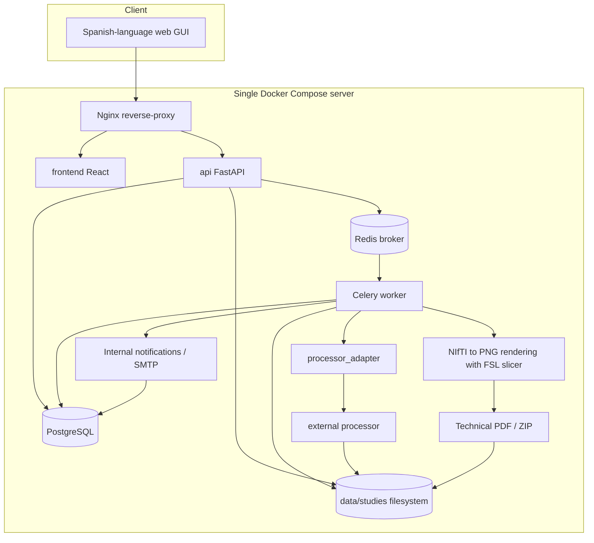
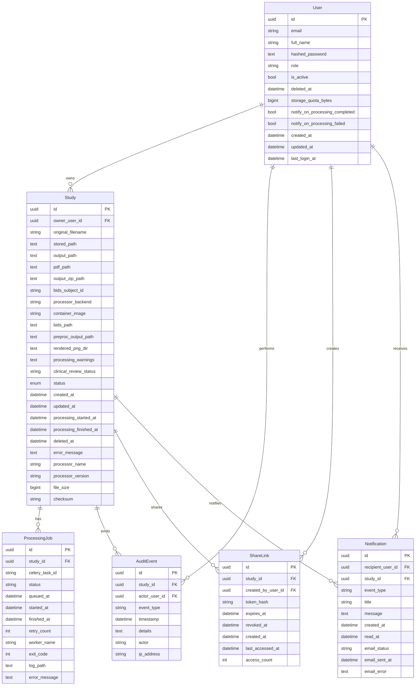
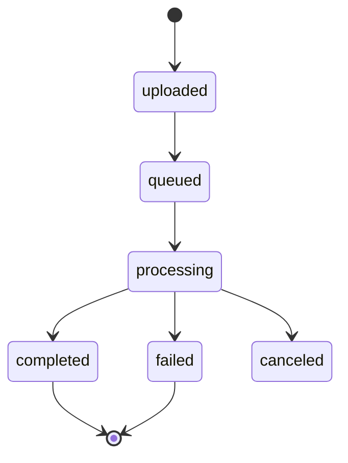

# Architecture

The system uses a decoupled architecture so that the web API does not depend on the specific processing algorithm. The external processor is invoked through `processor_adapter` as an isolated component and can be selected by configuration (`dummy` or `compneuro`). When a processing run closes, the worker records internal notifications and optionally sends emails over SMTP without attaching results.



For `compneuro-anatproc`, the `worker` service can be built with `worker/Dockerfile.compneuro`, derived from `compneurobilbaolab/compneuro-anatproc:1.1`. Docker-in-Docker is not used: Celery, the external launcher and FSL `slicer` live in the same worker container.

There is no `compneuro-anatproc` container nested inside the `worker`. The `worker` is an image derived from `compneurobilbaolab/compneuro-anatproc:1.1`; it therefore runs the neuroimaging scripts and tools directly inside the same container.

This decision does not force the use of that image or that launcher forever. The maintainable boundary is `processor_adapter`: a future processor can use another script or a worker built from another image as long as it respects the expected input and output interface and leaves traceability, the technical PDF and the downloadable ZIP to the platform.

## Components

- `frontend`: simple interface for upload, listing, status and download.
- `api`: validates inputs, records studies, prepares BIDS, exposes OpenAPI, serves PDF/ZIP downloads and serves notifications/preferences.
- `worker`: runs long tasks outside the HTTP cycle and triggers notifications when finished.
- `processor_adapter`: stable interface with the external processor and per-backend strategy.
- `postgres`: relational persistence.
- `redis`: task queue.
- `filesystem`: initial storage, replaceable by S3/MinIO in the future.
- `reverse-proxy`: HTTP entry point.

## ER Model

The following model reflects the currently implemented state, including local authentication, per-study owner, temporary PDF sharing links and notifications.



## Multi-User Architecture

The API applies authentication and authorisation before operating on studies. The worker knows nothing about sessions or roles: it receives study IDs already validated by the API and keeps the boundary with `processor_adapter`.

Implemented rules:

- `admin` can see all studies, create users, soft-delete users and define per-user storage quotas.
- `admin` can view an administrative dashboard focused on users, studies and storage; the panel exposes no actions to run pipelines.
- `admin` can mark outputs as `technical_only`, `reviewed` or `validated` on any visible study. The initial value is `technical_only` because the PDF is not a clinical report.
- `researcher` can upload studies, see their own history, check their quota, download their own results and mark their outputs as `technical_only`, `reviewed` or `validated`.
- `admin` and the owner can create/revoke temporary links to share only the technical PDF of completed studies.
- External recipients download via an opaque token without an account, with no access to the ZIP, logs, details or study enumeration.
- The owner receives internal notifications when a processing run completes or fails; active admins receive an internal notice on failures.
- Emails use a local Mailpit by default in Docker Compose (`noreply@example.org`) or a real SMTP server through configuration; they never attach PDF, ZIP or logs.
- Initial users are created by an admin; there is no open public registration.
- The initial admin user is created with `make create-admin EMAIL=...`.
- The processing flow remains isolated behind `processor_adapter`; authentication and permissions belong to the API layer.

Later evolution:

- A complete `viewer` role is not part of the current implementation. Current sharing is limited to the technical PDF through a temporary opaque token, expiry, revocation and auditing.
- Google/OIDC and ORCID must be linked to existing or provisioned internal users, without replacing the platform's own permission model.
- Backups, local restore and initial retention are covered as CLI operations; an advanced admin retention screen is left for a later phase.

## States



Clinical review does not change the processing state: it is recorded separately as `technical_only`, `reviewed` or `validated` so that the technical PDF is not presented as a clinical report.

The implemented cancellation uses the `canceled` state for both queued and running jobs. For queued jobs the pending task is revoked; during processing the API asks Celery to terminate the task and the adapter runs the external processor in its own process group to propagate the signal to FSL or `compneuro` scripts/children.

No `bids_prepared` state is added in the first integration: BIDS preparation happens before enqueueing and is traced through fields and auditing. If it fails, the upload responds with an error and no processable study is created.

## Compneuro Worker

```mermaid
flowchart LR
  API[FastAPI] --> Data[(data/studies)]
  API --> Redis[(Redis)]
  Redis --> Worker[Celery worker compneuro]
  Worker --> Adapter[CompneuroAnatprocAdapter]
  Adapter --> Project[/project managed symlink]
  Project --> BIDS[bids_project/data]
  Project --> Preproc[output/Preproc]
  Adapter --> Launcher[src/apreproc_launcher.sh]
  Launcher --> Preproc
  Worker --> PNG[output/rendered_png]
  PNG --> PDF[output/reports/technical_report.pdf]
  Worker --> ZIP[output/outputs.zip]
```

No local copy of `compneuro-anatproc/` is kept as a project dependency. The real worker starts from the published Docker image and, during the build, copies only the versioned scripts needed to run `src/apreproc_launcher.sh`.

To replace the processor, neither FastAPI nor the GUI need to be modified if the expected interface is kept. The intended extension point is to create or adjust an adapter, change `PROCESSOR_BACKEND`/the command, and build a worker that includes the necessary tools.

## Architecture Decisions

- The API does not run neuroimaging processing; it validates, prepares data, records the study and enqueues the task.
- Celery runs the long processing outside the HTTP cycle to avoid blocking and to allow state traceability.
- `processor_adapter` keeps the external processor as an isolated component and avoids coupling FastAPI to the specific neuroimaging processing flow.
- Technical post-processing runs in the same worker because FSL is already available and additional containers, volumes and synchronisation are avoided.
- Safe concurrency with `compneuro` is achieved by scaling replicas of the `worker` service; each container keeps `MAX_CONCURRENT_PROCESSING_JOBS=1` so that its internal `/project` is not shared between simultaneous processes.
- The generated PDF is technical and contains no image interpretation or medical conclusions.
