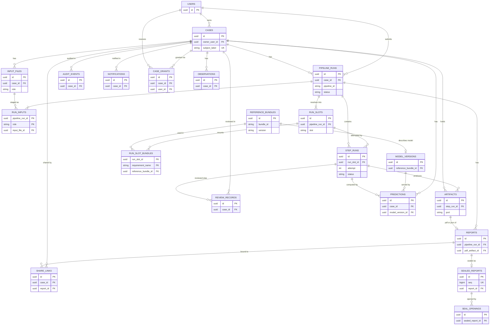
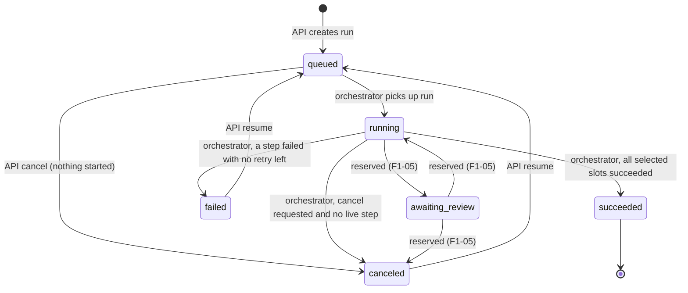
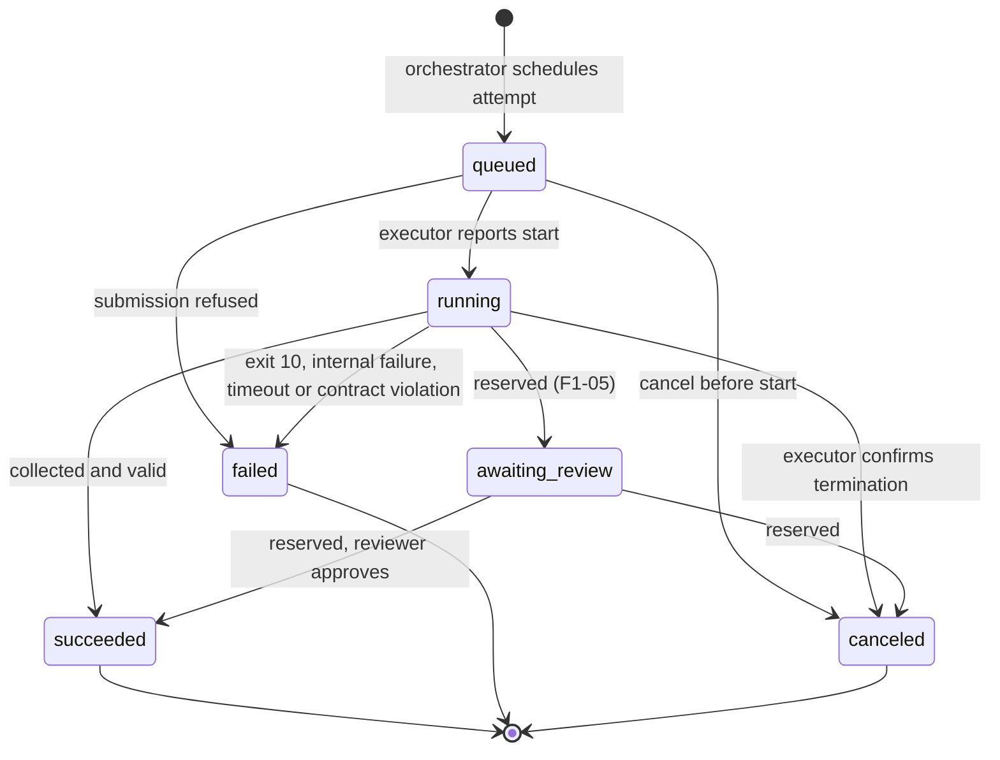

# Data model

Status: design, proposed for approval ([ADR-0016](adr/0016-data-model-design.md)). Plan reference: decision D4 (also D5, D8, D9, D10, D15), card F0-11. Implemented by card F0-12 (Phase 0 tables and migration) and by the later cards named per entity.

This document is the detailed design behind [ADR-0004](adr/0004-data-model.md). It respects the constraints that the step contract 1.0 fixes for the data model ([docs/contracts/](contracts/README.md)): input roles are pipeline input names, case metadata renders as `case.sex` and `case.age_band`, provenance is two-level, `executor: external` is reserved for uploaded results, and runs carry an accounting record.

Contents:

1. [Scope and phasing](#1-scope-and-phasing)
2. [Conventions](#2-conventions)
3. [Entity-relationship diagram](#3-entity-relationship-diagram)
4. [Phase 0 entities](#4-phase-0-entities-created-by-f0-12)
5. [Later entities](#5-later-entities-created-by-later-cards)
6. [Existing tables](#6-existing-tables)
7. [State machines](#7-state-machines)
8. [Slot choice, parameters, bundles, accounting and provenance](#8-slot-choice-parameters-bundles-accounting-and-provenance)
9. [Permission matrix](#9-permission-matrix)
10. [Migration from `Study` and `ProcessingJob`](#10-migration-from-study-and-processingjob)
11. [Decisions taken beyond the plan](#11-decisions-taken-beyond-the-plan)
12. [Open points for the project owner](#12-open-points-for-the-project-owner)

---

## 1. Scope and phasing

| Entity (class) | Table | Created by | Phase |
|---|---|---|---|
| `Case` | `cases` | F0-12 (migration 0011) | 0 |
| `InputFile` | `input_files` | F0-12 | 0 |
| `PipelineRun` | `pipeline_runs` | F0-12 | 0 |
| `RunInput` | `run_inputs` | F0-12 | 0 |
| `RunSlot` | `run_slots` | F0-12 | 0 |
| `RunSlotBundle` | `run_slot_bundles` | F0-12 | 0 |
| `StepRun` | `step_runs` | F0-12 | 0 |
| `Artifact` | `artifacts` | F0-12 | 0 |
| `ReferenceBundle` | `reference_bundles` | F0-12 (rows written by the bundle registry, F0-18) | 0 |
| `Report` | `reports` | F0-12 | 0 |
| `SlotImplementationSetting` | `slot_implementation_settings` | F0-12 (rows written by admin endpoints, F0-30) | 0 |
| `CaseGrant` | `case_grants` | F1-03 | 1 |
| `ModelVersion` | `model_versions` | F1-08 | 1 |
| `ReviewRecord` | `review_records` | F1-04 | 1 |
| `Prediction` | `predictions` | F1-10 | 1 |
| `Observation` | `observations` | E2-3 | 2 |
| `SealedReport`, `SealOpening` | `sealed_reports`, `seal_openings` | E2-6 | 2 |

Section 4 is normative for F0-12. Section 5 fixes the shape of later entities so that Phase 0 tables do not need to change when they arrive; the cards that create them may add columns (additive) but MUST NOT change the Phase 0 tables without a new ADR.

## 2. Conventions

These rules apply to every new table. Existing tables keep their current conventions until they are migrated (section 6).

1. **Primary keys** are `uuid`, generated by the application (`uuid4`) unless section 10 says the value is derived. Column name `id`.
2. **Timestamps** are `timestamptz` (`DateTime(timezone=True)`), always written in UTC by the application. Columns end in `_at`. Legacy tables keep naive UTC `timestamp`; when copying, legacy values are interpreted as UTC.
3. **Enumerations** are `varchar` columns with a `CHECK (col IN (...))` constraint named `ck_<table>_<column>`, not PostgreSQL `ENUM` types (adding a value then needs only a constraint swap, and the same constraint works on SQLite, which the test suite uses through `create_all`). Python side: `str` enums.
4. **Format checks.** Hashes, digests, identifiers and the age band have format rules (below). They are enforced in Pydantic schemas and model validators in all environments; migration 0011 additionally adds them as PostgreSQL-only regex `CHECK`s (`~`), which are not declared on the ORM models because SQLite does not support them.
   - `sha256hex`: `varchar(64)`, `^[0-9a-f]{64}$`.
   - `digest`: `varchar(71)`, `^sha256:[0-9a-f]{64}$`.
   - `image_ref`: `varchar(300)`, fully qualified repository plus `@sha256:<64 hex>` (as pinned in `pipeline.yaml`).
   - `kebab`: `varchar(64)`, `^[a-z][a-z0-9]*(-[a-z0-9]+)*$` (slot names, step names, pipeline ids, bundle ids and types, implementation ids).
   - `snake`: `varchar(64)`, `^[a-z][a-z0-9]*(_[a-z0-9]+)*$` (input roles, port names, artefact type names, requirement names, error codes).
   - `semver`: `varchar(64)`, the SemVer pattern of the contract schemas.
5. **JSON** columns are `jsonb` on PostgreSQL (`sa.JSON().with_variant(postgresql.JSONB(), "postgresql")`).
6. **Partial unique indexes** are declared with both `postgresql_where` and `sqlite_where`.
7. **Paths** to files in the case store are stored **relative** to the configured storage root (`Settings.storage_root`), using `/`, never containing `..`. Absolute host paths are not stored in new tables.
8. **Foreign keys** are `ON DELETE RESTRICT` (the default) unless stated. Rows that describe what happened (runs, step runs, artefacts, reports, audit) are never hard-deleted in normal operation; deletion of a case is a soft delete plus removal of its files (section 4.1). The exceptions are composition children of a run (`run_inputs`, `run_slots`, `run_slot_bundles`, `step_runs`, `artifacts`), which use `ON DELETE CASCADE` from `pipeline_runs` so that a deliberate purge or a test fixture can remove a run in one statement.
9. **No identifying data.** New tables hold no patient names, dates of birth, dates of events, free-text identifiers or user-chosen file names. The only case metadata is `sex` and `age_band`. Users' own e-mail and name stay in `users` as today.
10. **Naming.** Tables are plural snake_case, indexes `ix_<table>_<columns>`, unique constraints `uq_<table>_<columns>`, foreign keys `fk_<table>_<column>_<target>`. The entity is spelled `Artifact` in code, as in the plan; the column holding the registry type is `artefact_type`, as in the contract.

## 3. Entity-relationship diagram

Attributes shown are keys only; full columns are in sections 4 and 5. The diagram includes the later entities; section 1 says which card creates each table.



`slot_implementation_settings` has no foreign keys and is not drawn.

## 4. Phase 0 entities (created by F0-12)

Column tables list: name, type, nullability (`N` = nullable), constraints and notes. "Written by" names the only component allowed to insert or update rows.

### 4.1 `Case` (`cases`)

A pseudonymous subject with one acute session. Replaces the role of `Study`. Written by: case API (F0-30), legacy alias, retention.

| Column | Type | Null | Constraints / notes |
|---|---|---|---|
| `id` | uuid | no | PK. |
| `owner_user_id` | uuid | no | FK `users.id`. The researcher who created the case. |
| `subject_label` | varchar(12) | no | Unique. BIDS `sub-` label, `^[0-9a-f]{12}$`: the first 12 hexadecimal characters of `id` without hyphens. On a unique violation at insert the application generates a new `id` and retries. Never entered by users. |
| `session_label` | varchar(16) | no | Default `'acute'`. BIDS `ses-` label; the only value in Phase 0. |
| `sex` | varchar(8) | N | `CHECK (sex IN ('female','male'))`. Absent when unknown or not given. Renders as `case.sex`. |
| `age_band` | varchar(7) | N | `"<lo>-<hi>"` in whole years (format check `^[0-9]{1,3}-[0-9]{1,3}$`), validated against the band constant below. Renders as `case.age_band`. |
| `deployment_profile` | varchar(32) | no | `CHECK IN ('research-public','mask-only','on-premise','legacy')`. Profile (D14) under which the case was created; `legacy` only for back-filled rows. |
| `created_at` | timestamptz | no | |
| `updated_at` | timestamptz | no | Updated on any change to this row. |
| `deleted_at` | timestamptz | N | Soft delete. Set when the case is deleted by a user or by retention; its files are removed from the case store in the same operation. Rows are kept. |
| `keep_forever` | boolean | no | Default `false`. Retention exemption; admin only. |
| `legacy_study_id` | uuid | N | Unique, FK `studies.id`. Set only on back-filled rows (equal to `id`). Dropped by migration 0013. |
| `legacy_attributes` | jsonb | N | Fields used only by the legacy aliases (section 10.4). `NULL` for cases never touched by an alias. Identifying keys are removed by migration 0013. |

Indexes: `uq_cases_subject_label`; `ix_cases_owner_user_id_created_at` (`owner_user_id`, `created_at`); `ix_cases_deleted_at`.

**Age band.** A module constant in `backend/app/models/case.py`:

```python
AGE_BAND_WIDTH_YEARS = 5   # bands 0-4, 5-9, ..., 85-89
AGE_BAND_TOP_LOWER = 90    # lower bound of the collapsed top band
AGE_BAND_TOP_UPPER = 104   # upper bound of the collapsed top band
```

Valid bands are the 5-year bands `0-4` … `85-89` (`lo % AGE_BAND_WIDTH_YEARS == 0`, `lo < AGE_BAND_TOP_LOWER`, `hi == lo + AGE_BAND_WIDTH_YEARS - 1`) plus the collapsed top band `90-104` (section 12, decision 1). The API accepts only a band string; the UI may offer an age field but converts it to a band in the browser, so an exact age never reaches the server. Five-year bands match the ventricle templates of the normalisation step, which selects the template whose band contains the band's midpoint. Changing the constant later does not invalidate stored values (they remain valid band strings), but new cases would use the new width; that change needs an ADR.

**Ownership.** One owner per case. Visibility to other users comes only from the admin role (Phase 0) and from `case_grants` (Phase 1, section 5.1).

### 4.2 `InputFile` (`input_files`)

A user-supplied file attached to a case under a role. Written by: case API, legacy alias.

| Column | Type | Null | Constraints / notes |
|---|---|---|---|
| `id` | uuid | no | PK. |
| `case_id` | uuid | no | FK `cases.id`. |
| `role` | snake | no | A pipeline input name (`ct`, `lesion_native`, `lesion_mni`; `mri` later). `legacy_upload` only for legacy rows. Not a DB enum: valid roles are those of the pipelines loaded by the deployment. |
| `artefact_type` | snake | no | The type of the pipeline input with that name (e.g. `ct_native`, `lesion_mask_native`, `lesion_mask_mni_any`); `legacy_upload` for legacy rows. |
| `storage_path` | text | no | Relative path in the case store (BIDS raw tree, ADR-0005). |
| `sha256` | sha256hex | N | Required unless `role = 'legacy_upload'` (`CHECK (role = 'legacy_upload' OR sha256 IS NOT NULL)`). |
| `size_bytes` | bigint | N | `>= 0`. Same nullability rule as `sha256`. |
| `uploaded_by_user_id` | uuid | no | FK `users.id`. |
| `created_at` | timestamptz | no | |

Indexes: `uq_input_files_case_id_role` (`case_id`, `role`).

Rules: the original file name is not stored (it frequently contains identifiers); the stored name is built by the case store. An input file is immutable once a `run_inputs` row references it. Before that it may be replaced: the row and file are deleted and a new row is inserted. Quota accounting sums `size_bytes` of input files of the owner's non-deleted cases (same semantics as today's `Study.file_size`).

### 4.3 `PipelineRun` (`pipeline_runs`)

One execution of one pipeline version on one case. Resume and retry stay in the same run (section 7). Written by: run API (creation, cancel request, resume) and orchestrator (everything else).

| Column | Type | Null | Constraints / notes |
|---|---|---|---|
| `id` | uuid | no | PK. Also `RunProvenance.run_id`. |
| `case_id` | uuid | no | FK `cases.id`. |
| `created_by_user_id` | uuid | no | FK `users.id`. The submitter; may differ from the case owner when an admin submits. |
| `pipeline_id` | kebab | no | `legacy` for legacy runs. |
| `pipeline_version` | semver | no | `0.0.0` for legacy runs. |
| `pipeline_sha256` | sha256hex | N | SHA-256 of the exact `pipeline.yaml` bytes. `CHECK (pipeline_id = 'legacy' OR pipeline_sha256 IS NOT NULL)`. |
| `platform_version` | varchar(64) | no | Platform release at creation; `legacy` for legacy runs. |
| `artefact_types_version` | varchar(64) | no | Registry version at creation; `legacy` for legacy runs. |
| `input_set` | kebab | no | Name of the matched input set; `legacy-single-file` for legacy runs. |
| `seed` | bigint | no | `CHECK (seed BETWEEN 0 AND 4294967295)`. Drawn at creation; never changed (kept on resume and retry). |
| `status` | varchar(20) | no | `CHECK IN ('queued','running','awaiting_review','succeeded','failed','canceled')`. Section 7.1. |
| `requested_implementations` | jsonb | no | Default `{}`. The user's per-slot choice as submitted, `{slot: implementation_id}`. The resolved choice is in `run_slots`. |
| `accounting_submitted_by` | varchar(80) | no | `user:<users.id>` or `service:<users.id>`. |
| `accounting_submit_as` | varchar(20) | no | `CHECK IN ('service-account','per-user','chargeback')`. Only `service-account` in Phase 0. |
| `accounting_billing_account` | varchar(128) | N | HPC account or project billed, if any. |
| `created_at` | timestamptz | no | Also the moment the run entered `queued`. |
| `started_at` | timestamptz | N | When the orchestrator first moved the run to `running`. Not reset on resume. |
| `finished_at` | timestamptz | N | `CHECK ((status IN ('succeeded','failed','canceled')) = (finished_at IS NOT NULL))`. Cleared on resume. |
| `updated_at` | timestamptz | no | |
| `cancel_requested_at` | timestamptz | N | Cancellation flag (the F0-02 mechanism, at run level). Cleared on resume. |
| `cancel_requested_by_user_id` | uuid | N | FK `users.id`. |
| `resume_count` | integer | no | Default 0, `>= 0`. Incremented by each accepted resume. |
| `failure_code` | snake | N | Platform-level reason when `failed` (e.g. `step_failed`, `input_rejected`, `pipeline_unavailable`, `legacy_failure`). |
| `failure_message` | text | N | Short English message for users, no identifiers or paths. |
| `failed_step_run_id` | uuid | N | FK `step_runs.id` (`use_alter`, the tables reference each other). The attempt that stopped the run. |
| `provenance_path` | text | N | Relative path of the run-level `RunProvenance` file (F0-17). `NULL` for legacy runs, which have no provenance file. |
| `orchestrator_task_id` | varchar(255) | N | Celery task id of the orchestrator task currently driving the run. |
| `legacy_clinical_review_status` | varchar(32) | N | `CHECK IN ('technical_only','reviewed','validated')`. Used only by the legacy `clinical-review` alias. Dropped by migration 0013. |

Indexes: `ix_pipeline_runs_case_id_created_at`; `ix_pipeline_runs_status`; `ix_pipeline_runs_created_by_user_id`; `ix_pipeline_runs_pipeline` (`pipeline_id`, `pipeline_version`); `ix_pipeline_runs_billing` (`accounting_billing_account`, `created_at`).

A case may have several runs (different pipelines, versions, implementation choices, or a new run after a mask edit). At most one run per case may be active (`queued`, `running`, `awaiting_review`): partial unique index `uq_pipeline_runs_active_case` on `case_id` where `status IN ('queued','running','awaiting_review')`. *Rationale:* matches today's one-job-at-a-time behaviour per study, avoids two runs writing derivatives of the same case concurrently, and makes the legacy aliases ("the" status of a study) well defined. Lifting it later only drops the index.

### 4.4 `RunInput` (`run_inputs`)

Which input files a run uses, one row per role of the matched input set. Written by: run API at creation.

| Column | Type | Null | Constraints / notes |
|---|---|---|---|
| `pipeline_run_id` | uuid | no | PK part; FK `pipeline_runs.id` `ON DELETE CASCADE`. |
| `role` | snake | no | PK part. Equals `input_files.role`. |
| `input_file_id` | uuid | no | FK `input_files.id` (RESTRICT). The input file must belong to the run's case (application check). |

Index: `ix_run_inputs_input_file_id`. The set of roles of a run MUST equal the `inputs` of exactly one input set of the pipeline (pipeline.md §2); this is checked by the run API, not by the database.

### 4.5 `RunSlot` (`run_slots`)

The resolution of one pipeline slot for one run (`RunProvenance.slots[]`). Created for every slot of the pipeline at run creation, in pipeline order, and immutable afterwards. Written by: run API (creation through the orchestrator's resolution function).

| Column | Type | Null | Constraints / notes |
|---|---|---|---|
| `id` | uuid | no | PK. |
| `pipeline_run_id` | uuid | no | FK `pipeline_runs.id` `ON DELETE CASCADE`. |
| `slot` | kebab | no | Slot name; `legacy` for legacy runs. |
| `position` | smallint | no | 0-based order in `pipeline.yaml`. |
| `optional` | boolean | no | Copied from the slot definition. |
| `status` | varchar(16) | no | `CHECK IN ('selected','skipped','unavailable')`. |
| `reason` | varchar(32) | N | `CHECK IN ('condition_false','upstream_absent','no_implementation')`. |
| `implementation_id` | kebab | N | Allowed implementation id. |
| `step_name` | kebab | N | |
| `step_version` | semver | N | |
| `image` | image_ref | N | Digest-pinned image. |
| `stub` | boolean | N | From the manifest. |
| `chosen_by` | varchar(24) | N | `CHECK IN ('user','deployment_default','pipeline_default')`. |
| `effective_parameters` | jsonb | N | Parameters computed at creation: schema defaults, then literal `parameters`, then `parameter_bindings` with known source values, then `seed` if the step declares it (step-contract.md §1.4). Written to `/in/params.json` on every attempt. |

Constraints:

- `uq_run_slots_run_slot` (`pipeline_run_id`, `slot`); `uq_run_slots_run_position` (`pipeline_run_id`, `position`).
- `ck_run_slots_selected`: if `status = 'selected'` then `reason IS NULL` and `implementation_id`, `step_name`, `step_version`, `stub`, `chosen_by`, `effective_parameters` are not null, and (`image IS NOT NULL` or `slot = 'legacy'`); otherwise `reason IS NOT NULL` and all of those columns are null. This mirrors the `if/then/else` of the provenance schema.

### 4.6 `RunSlotBundle` (`run_slot_bundles`)

Bundles resolved for a selected slot (pipeline.md §6 item 5). Written by: run API at creation.

| Column | Type | Null | Constraints / notes |
|---|---|---|---|
| `run_slot_id` | uuid | no | PK part; FK `run_slots.id` `ON DELETE CASCADE`. |
| `requirement_name` | snake | no | PK part. Mount name `/ref/<requirement_name>/`. |
| `reference_bundle_id` | uuid | no | FK `reference_bundles.id` (RESTRICT: a bundle used by a run cannot be deleted). |

Index: `ix_run_slot_bundles_reference_bundle_id`, so that "which runs used this bundle version" (recall after a faulty bundle) is a single indexed query. Optional requirements that were not resolved have no row.

### 4.7 `StepRun` (`step_runs`)

One execution attempt of a selected slot (`RunProvenance.steps[]`). A retry is a new row with the next `attempt`. Written by: orchestrator and executors; run API only for cancellation of not-yet-submitted attempts through the orchestrator's cancel function.

| Column | Type | Null | Constraints / notes |
|---|---|---|---|
| `id` | uuid | no | PK. |
| `pipeline_run_id` | uuid | no | FK `pipeline_runs.id` `ON DELETE CASCADE`. Denormalised from the slot for indexing. |
| `run_slot_id` | uuid | no | FK `run_slots.id` `ON DELETE CASCADE`. The slot must have `status = 'selected'` (application check). |
| `attempt` | integer | no | `>= 1`. Unique with `run_slot_id`. |
| `trigger` | varchar(16) | no | `CHECK IN ('initial','auto_retry','user_resume')`. Why this attempt exists. |
| `status` | varchar(20) | no | `CHECK IN ('queued','running','awaiting_review','succeeded','failed','canceled')`. Section 7.2. |
| `outcome` | varchar(24) | N | `CHECK IN ('succeeded','rejected','failed','canceled','timed_out','contract_violation')`. The provenance `execution.outcome`. |
| `executor` | varchar(16) | no | `CHECK IN ('subprocess','docker','slurm','external')`. Chosen by deployment configuration. |
| `runtime` | varchar(16) | no | `CHECK IN ('docker','apptainer','none')`. |
| `image` | image_ref | N | `CHECK (executor NOT IN ('docker','slurm') OR image IS NOT NULL)`. |
| `sif_sha256` | sha256hex | N | Apptainer image hash. |
| `external_job_id` | varchar(128) | N | E.g. the Slurm job id. |
| `executor_state` | jsonb | N | Opaque to everything except the executor that wrote it (e.g. staging directory key), so that polling can resume after a restart. MUST NOT contain host names, user names or case identifiers beyond this row's ids. |
| `queued_at` | timestamptz | no | |
| `started_at` | timestamptz | N | When the process or job actually started. Absent if canceled while queued. |
| `finished_at` | timestamptz | N | `CHECK ((status IN ('succeeded','failed','canceled')) = (finished_at IS NOT NULL))`. |
| `exit_code` | integer | N | Null if the process never ran or was killed. |
| `granted_cpus` | integer | N | Granted `resources.cpus`. |
| `granted_memory_mb` | integer | N | |
| `granted_gpus` | integer | N | |
| `granted_wall_time_minutes` | integer | N | `CHECK (executor = 'subprocess' OR executor = 'external' OR (granted_cpus, granted_memory_mb, granted_gpus, granted_wall_time_minutes all NOT NULL))`. |
| `usage_wall_seconds` | numeric(14,3) | N | `execution.usage`. |
| `usage_cpu_core_hours` | numeric(14,4) | N | |
| `usage_gpu_hours` | numeric(14,4) | N | |
| `usage_max_rss_mb` | integer | N | |
| `step_provenance` | jsonb | N | The step's `StepProvenance`, verbatim, after validation. |
| `step_provenance_sha256` | sha256hex | N | SHA-256 of the `provenance.json` bytes as collected, to check the stored file. |
| `step_error` | jsonb | N | The step's `StepError`, verbatim. `CHECK (outcome IS DISTINCT FROM 'rejected' OR step_error IS NOT NULL)`. |
| `failure_code` | snake | N | Platform-level code for failures not described by the step (e.g. `contract_violation_missing_output`, `bundle_unavailable`, `gpu_unavailable`, `legacy_stale_job`). |
| `failure_message` | text | N | Short English message, no identifiers or paths. |
| `log_path` | text | N | Relative path of the captured stdout and stderr. |
| `log_truncated` | boolean | no | Default `false`. |
| `orchestrator_task_id` | varchar(255) | N | Celery task id handling this attempt. |
| `cancel_requested_at` | timestamptz | N | Set by the orchestrator when it propagates a run-level cancellation to this attempt. Executors check it. |
| `legacy_job_id` | uuid | N | Unique, FK `processing_jobs.id`. Back-filled rows only. Dropped by migration 0013. |

Status and outcome are kept consistent by `ck_step_runs_status_outcome` (the column's own enumeration check is `ck_step_runs_outcome`). Every non-null branch also requires `outcome IS NOT NULL`, so a terminal status with a null outcome is rejected:

| `status` | allowed `outcome` |
|---|---|
| `queued`, `running` | null |
| `awaiting_review` (reserved) | `succeeded` |
| `succeeded` | `succeeded` |
| `failed` | `rejected`, `failed`, `timed_out`, `contract_violation` |
| `canceled` | `canceled` |

Indexes:

- `uq_step_runs_slot_attempt` (`run_slot_id`, `attempt`);
- `uq_step_runs_one_active` partial unique on `run_slot_id` where `status IN ('queued','running','awaiting_review')`: at most one live attempt per slot, which makes a duplicated "start step" message harmless;
- `uq_step_runs_one_success` partial unique on `run_slot_id` where `status = 'succeeded'`;
- `ix_step_runs_pipeline_run_id`;
- `ix_step_runs_active` on `status` where `status IN ('queued','running')` (pollers);
- `ix_step_runs_external_job` (`executor`, `external_job_id`) where `external_job_id IS NOT NULL`.

`executor = 'external'` rows are created by the SP2 results endpoint (D8 path 2): `runtime = 'none'`, no image, no resources, `step_provenance` holds the uploaded step record if any.

### 4.8 `Artifact` (`artifacts`)

A typed file produced by a step attempt (or, from Phase 1, by a review). Only the files of `/out/<port><ext>` are artefacts; `provenance.json`, `error.json` and `/out/extra/` are stored with the step run but are not artefacts. Written by: orchestrator on collection; review API (F1-04).

| Column | Type | Null | Constraints / notes |
|---|---|---|---|
| `id` | uuid | no | PK. |
| `case_id` | uuid | no | FK `cases.id`. Denormalised for listing and retention. |
| `pipeline_run_id` | uuid | no | FK `pipeline_runs.id` `ON DELETE CASCADE`. |
| `step_run_id` | uuid | N | FK `step_runs.id` `ON DELETE CASCADE`. Required unless `origin = 'review'`. |
| `origin` | varchar(16) | no | `CHECK IN ('step','review','legacy')`. |
| `port` | snake | no | Output port name (for a review, the port of the artefact it supersedes). |
| `artefact_type` | snake | no | Registry type name; `legacy_technical_report_pdf` or `legacy_outputs_zip` for legacy rows. |
| `storage_path` | text | no | Relative path (derivatives tree, ADR-0005). |
| `sha256` | sha256hex | N | `CHECK (origin = 'legacy' OR sha256 IS NOT NULL)`. |
| `size_bytes` | bigint | N | Same rule. |
| `synthetic` | boolean | no | `true` when produced by a stub step or with a synthetic bundle; the UI and report label it. |
| `supersedes_artifact_id` | uuid | N | FK `artifacts.id`. Set on an edited mask (F1-04); the original is never overwritten. |
| `created_at` | timestamptz | no | |

Constraints and indexes: `CHECK (origin = 'review' OR step_run_id IS NOT NULL)`; `uq_artifacts_step_port` partial unique (`step_run_id`, `port`) where `origin <> 'review'`; `ix_artifacts_case_id`; `ix_artifacts_run_type` (`pipeline_run_id`, `artefact_type`).

Artefacts are collected only from an attempt that ends `succeeded` (or `awaiting_review`); outputs of failed and canceled attempts are discarded (step-contract.md §2.4).

### 4.9 `ReferenceBundle` (`reference_bundles`)

A registered, verified bundle version (D6, bundles.md). Models are bundles; model-specific state is in `model_versions` (section 5.2). Written by: bundle registry CLI (F0-18).

| Column | Type | Null | Constraints / notes |
|---|---|---|---|
| `id` | uuid | no | PK. |
| `bundle_id` | kebab | no | `bundle.yaml` `id`. |
| `version` | semver | no | Unique with `bundle_id`. |
| `bundle_type` | kebab | no | `bundle.yaml` `type`. |
| `title` | varchar(255) | no | |
| `content_digest` | digest | no | |
| `manifest_sha256` | sha256hex | no | SHA-256 of the `bundle.yaml` bytes at registration (cheap pre-mount check, bundles.md §4.2). |
| `synthetic` | boolean | no | |
| `licence_spdx` | varchar(255) | no | |
| `redistributable` | boolean | no | |
| `citation` | text | N | |
| `metadata` | jsonb | no | Default `{}`. Copy of `bundle.yaml` `metadata`. |
| `storage_path` | text | no | Relative to the configured bundle root (normally `<bundle_id>/<version>`). |
| `status` | varchar(16) | no | `CHECK IN ('active','withdrawn')`. A withdrawn bundle is never resolved for new runs; past runs keep their reference. |
| `verification_status` | varchar(16) | no | `CHECK IN ('verified','failed')`. Registration refuses bundles that fail, so `failed` only results from a later re-verification. |
| `registered_at` | timestamptz | no | |
| `registered_by_user_id` | uuid | N | FK `users.id`; null when registered from the server shell. |
| `last_full_verification_at` | timestamptz | no | |
| `withdrawn_at` | timestamptz | N | |

Indexes: `uq_reference_bundles_id_version` (`bundle_id`, `version`); `ix_reference_bundles_type` (`bundle_type`, `status`).

### 4.10 `Report` (`reports`)

A user-facing report of a run: the PDF and its canonical JSON (D9, D12). Written by: orchestrator, when the report slot's attempt succeeds.

| Column | Type | Null | Constraints / notes |
|---|---|---|---|
| `id` | uuid | no | PK. |
| `case_id` | uuid | no | FK `cases.id`. |
| `pipeline_run_id` | uuid | no | FK `pipeline_runs.id`. |
| `step_run_id` | uuid | no | FK `step_runs.id`. |
| `pdf_artifact_id` | uuid | no | FK `artifacts.id`, type `report_pdf` (or `legacy_technical_report_pdf`). |
| `json_artifact_id` | uuid | N | FK `artifacts.id`, type `report_json`. Required unless `template = 'legacy-technical'`. |
| `template` | kebab | no | Report template id (e.g. `research`; `legacy-technical` for legacy). |
| `language` | varchar(8) | no | BCP 47 tag (`en`, `es`). |
| `content_sha256` | sha256hex | N | Equals the JSON artefact's `sha256`: the hash that sealing and the clinician checklist bind to. Null only for legacy. |
| `created_at` | timestamptz | no | |

Indexes: `uq_reports_run_template_language` (`pipeline_run_id`, `template`, `language`); `ix_reports_case_id`. The "current report" of a case is the newest report of its newest succeeded run.

### 4.11 `SlotImplementationSetting` (`slot_implementation_settings`)

The deployment's enablement and default per implementation (D15, pipeline.md §7), changed at run time through admin endpoints (F0-30). Written by: admin API; seeded from the registry configuration file of F0-33.

| Column | Type | Null | Constraints / notes |
|---|---|---|---|
| `id` | uuid | no | PK. |
| `pipeline_id` | kebab | no | |
| `slot` | kebab | no | |
| `implementation_id` | kebab | no | |
| `enabled` | boolean | no | |
| `is_default` | boolean | no | Default `false`. `CHECK (NOT is_default OR enabled)`. |
| `updated_at` | timestamptz | no | |
| `updated_by_user_id` | uuid | N | FK `users.id`; null when seeded. |

Indexes: `uq_slot_impl_settings` (`pipeline_id`, `slot`, `implementation_id`); `uq_slot_impl_settings_default` partial unique (`pipeline_id`, `slot`) where `is_default`.

Rules: settings are keyed by pipeline id, not version, so they survive a pipeline minor bump; a setting for an implementation id that the loaded pipeline version does not allow is ignored. The registry configuration file defines the initial rows (inserted when a pipeline is first loaded and no row exists) and whether stubs may be enabled at all; the database wins thereafter. The admin API refuses to enable a stub unless the deployment is configured as CI or demo (pipeline.md §4 item 4).

## 5. Later entities (created by later cards)

Shapes below are fixed so that Phase 0 tables need no change. Columns may be added by the owning card.

### 5.1 `CaseGrant` (`case_grants`) — F1-03

Gives a non-owner access to one case in one capacity.

| Column | Type | Null | Notes |
|---|---|---|---|
| `id` | uuid | no | PK. |
| `case_id` | uuid | no | FK `cases.id`. |
| `user_id` | uuid | no | FK `users.id`. |
| `capacity` | varchar(16) | no | `CHECK IN ('reviewer','coordinator','service')`; must match the user's role. |
| `granted_by_user_id` | uuid | no | FK `users.id`. |
| `granted_at` | timestamptz | no | |
| `revoked_at` | timestamptz | N | |

Partial unique (`case_id`, `user_id`, `capacity`) where `revoked_at IS NULL`.

### 5.2 `ModelVersion` (`model_versions`) — F1-08

Model state on top of a model bundle (D10). A model release *is* a bundle; this row records whether it may be served.

| Column | Type | Null | Notes |
|---|---|---|---|
| `id` | uuid | no | PK. |
| `reference_bundle_id` | uuid | no | Unique FK `reference_bundles.id`. |
| `status` | varchar(16) | no | `CHECK IN ('candidate','locked','retired')`. Only `locked` versions are resolved for runs outside CI or demo deployments. |
| `locked_at`, `locked_by_user_id` | timestamptz, uuid | N | Set together when `status` becomes `locked`; a locked version never changes back to `candidate`. |
| `has_model_card` | boolean | no | From the bundle content; the platform refuses to lock a model without a card. |
| `model_card_path` | text | N | Path inside the bundle. |
| `training_data_fingerprint` | sha256hex | N | |
| `calibration_set_id` | varchar(128) | N | Identifier of the conformal calibration set (stratified by sex and age band). |
| `parent_model_version_id` | uuid | N | FK `model_versions.id`. Set for a recalibration that a human approved as a new version. |
| `created_at` | timestamptz | no | |

### 5.3 `ReviewRecord` (`review_records`) — F1-04, F1-05

Append-only record of a human review of a step's output (who, when, what changed in the mask).

| Column | Type | Null | Notes |
|---|---|---|---|
| `id` | uuid | no | PK. |
| `case_id`, `pipeline_run_id`, `step_run_id` | uuid | no | FKs; the step attempt whose output was reviewed. |
| `reviewer_user_id` | uuid | no | FK `users.id`. |
| `decision` | varchar(16) | no | `CHECK IN ('approved','edited','rejected')`. |
| `source_artifact_id` | uuid | no | FK `artifacts.id`; the reviewed artefact. |
| `result_artifact_id` | uuid | N | FK `artifacts.id`; the edited mask (`origin = 'review'`). Required when `decision = 'edited'`. |
| `change_summary` | jsonb | N | Structured mask difference: voxels added and removed, volumes before and after, Dice between source and result. |
| `reason_code` | snake | N | From a fixed list defined by F1-04. |
| `comment` | varchar(500) | N | Optional free text, at most 500 characters; the UI warns not to enter identifying information (section 12, decision 5). |
| `created_at` | timestamptz | no | |

### 5.4 `Prediction` (`predictions`) — F1-10

| Column | Type | Null | Notes |
|---|---|---|---|
| `id` | uuid | no | PK. |
| `case_id`, `pipeline_run_id`, `step_run_id` | uuid | no | FKs. |
| `artifact_id` | uuid | no | FK `artifacts.id`; the prediction JSON. |
| `model_version_id` | uuid | no | FK `model_versions.id`. |
| `target` | snake | no | Outcome scale and time point, e.g. `mrs_90d`. |
| `point_estimate` | numeric | no | |
| `interval_lower`, `interval_upper` | numeric | no | Conformal interval. |
| `coverage` | numeric(4,3) | no | Nominal coverage, e.g. 0.900. |
| `stratum_sex`, `stratum_age_band` | varchar | N | Copies of the case values used for the stratified calibration. |
| `created_at` | timestamptz | no | |

### 5.5 `Observation` (`observations`) — E2-3

Outcome scales entered after the acute phase; append-only (a correction is a new row that supersedes the old one).

| Column | Type | Null | Notes |
|---|---|---|---|
| `id` | uuid | no | PK. |
| `case_id` | uuid | no | FK `cases.id`. |
| `scale` | snake | no | From a configured vocabulary (e.g. `nihss`, `mrs`, `fugl_meyer_ue`). |
| `timepoint` | snake | no | Relative time point from a configured vocabulary (`discharge`, `d90`, `m6`). No calendar dates. |
| `value` | numeric | no | Range checked against the scale definition. |
| `recorded_by_user_id` | uuid | no | FK `users.id`. |
| `recorded_at` | timestamptz | no | |
| `supersedes_observation_id` | uuid | N | FK `observations.id`. |

### 5.6 `SealedReport` and `SealOpening` — E2-6

Append-only, hash-chained ledger of sealed reports (D9). Rows are never updated or deleted; migration of E2-6 adds a trigger that rejects `UPDATE` and `DELETE`.

`sealed_reports`: `id` uuid PK; `seq` bigint unique, gap-free, assigned under a table lock; `report_id` uuid unique FK `reports.id`; `case_id` uuid FK; `json_sha256` and `pdf_sha256` sha256hex; `sealed_at` timestamptz (server clock); `sealed_by` varchar(80) (`user:<id>` or `service:<id>`); `prev_entry_hash` sha256hex (64 zeros for `seq = 1`); `entry_hash` sha256hex = SHA-256 of the canonical JSON of the other fields including `prev_entry_hash`; optional `tsa_token` bytea and `tsa_authority` varchar for RFC 3161 time stamps.

`seal_openings`: `id` uuid PK; `sealed_report_id` uuid FK; `opened_by_user_id` uuid FK (coordinator); `opened_at` timestamptz; `observation_ids` jsonb (the observations whose presence allowed the opening). Every opening also writes an audit event.

The clinician checklist bound to the report hash is designed by E2-6.

## 6. Existing tables

| Table | Phase 0 change (migration 0011) | Cut-over (0012) | Removal release (0013) |
|---|---|---|---|
| `users` | Add `CHECK (role IN ('admin','researcher','reviewer','coordinator','service'))`. Columns unchanged. The API keeps refusing to assign the three reserved roles until F1-03. | — | — |
| `studies` | Unchanged; authoritative for legacy studies until 0012. | Frozen: no code writes it. | Dropped. |
| `processing_jobs` | Unchanged; authoritative until 0012. | Frozen. | Dropped. |
| `audit_events` | Add `case_id` uuid N FK `cases.id`, `pipeline_run_id` uuid N FK `pipeline_runs.id`, both indexed; back-filled `case_id = study_id`. | New events set `case_id` (and `pipeline_run_id` when relevant), not `study_id`. | Drop `study_id`. |
| `notifications` | Add `case_id`, `pipeline_run_id` as above; back-fill `case_id = study_id`. | New rows use `case_id`. | Drop `study_id`. |
| `share_links` | Add `case_id` uuid FK (nullable in 0011 and back-filled; made `NOT NULL` in 0012 together with `study_id` becoming nullable, because legacy endpoints still create links without a case until then), `report_id` uuid N FK `reports.id`, both indexed. | `study_id` becomes nullable; new links set `case_id` and `report_id`. | Drop `study_id`. |
| quota | No table. `users.storage_quota_bytes` unchanged. | Usage computed from `input_files` (4.2) plus every stored `artifacts` row of the owner's cases (section 12, decision 4). | — |
| retention | No table. | `services/retention.py` operates on `cases`: candidates are non-deleted cases with `keep_forever = false`, created before the cut-off, with no active run. | — |

Audit and notification rows are never deleted with a case. New audit event types introduced by the new model: `case_created`, `case_updated`, `case_deleted`, `input_file_uploaded`, `input_file_replaced`, `run_created`, `run_cancel_requested`, `run_canceled`, `run_resumed`, `run_succeeded`, `run_failed`, `artifact_downloaded`, `report_downloaded`, `implementation_setting_changed`, `bundle_registered`, `bundle_withdrawn`; later `review_recorded`, `model_version_locked`, `report_sealed`, `seal_opened`, `observation_recorded`. Details never contain file names chosen by users. Notification preferences (`notify_on_processing_completed`, `notify_on_processing_failed`) apply to `run_succeeded` and `run_failed`.

## 7. State machines

Both machines use compare-and-set updates: every transition is an `UPDATE ... WHERE id = :id AND status IN (:allowed_from)` (plus any flag condition), and the caller treats "0 rows updated" as "another actor got there first" and re-reads. This is the pattern F0-02 introduced for cancellation. No transition is performed by reading, deciding in Python and writing without that condition.

Terminology: *orchestrator* = the Celery orchestrator task(s) of F0-15; *API* = request handlers acting for a user; *executor* = F0-13/14/16 backends called by the orchestrator.

### 7.1 `PipelineRun`



| From | To | Trigger | Side effects |
|---|---|---|---|
| — | `queued` | API `create run` after resolution succeeded (all `run_slots` and `run_inputs` written in the same transaction) | Audit `run_created`; orchestrator task enqueued after commit; `orchestrator_task_id` stored. |
| `queued` | `running` | Orchestrator, first time it schedules a step | `started_at` set if null. |
| `queued` | `canceled` | API cancel | `finished_at`, `cancel_requested_at` set; queued step attempts set `canceled`; Celery task revoked. |
| `running` | `succeeded` | Orchestrator, every `selected` slot has a `succeeded` attempt | `finished_at`; reports created; notification; audit. |
| `running` | `failed` | Orchestrator, an attempt ended `failed` and no automatic retry applies, once no other attempt is live (running independent steps are allowed to finish, pipeline.md §6) | `failure_code`, `failure_message`, `failed_step_run_id`, `finished_at`; notification; audit. |
| `running` | `canceled` | Orchestrator, `cancel_requested_at` set and no attempt live | `finished_at`; audit `run_canceled`. |
| `running` | `awaiting_review` | Reserved for F1-05; not reachable in Phase 0 | — |
| `failed`, `canceled` | `queued` | API resume (7.3) | `finished_at`, `failure_*`, `failed_step_run_id`, `cancel_requested_at`, `cancel_requested_by_user_id` cleared; `resume_count + 1`; audit `run_resumed`; orchestrator task enqueued. |

`succeeded` is final. `awaiting_review` is in the `CHECK` constraint from 0011 so that F1-05 needs no migration, but no Phase 0 code sets it.

Mapping to `RunProvenance.status`: `queued`, `running`, `awaiting_review` → `running`; the three terminal values map to themselves. The stored value and the contract both spell `canceled`.

Crash recovery: a Celery beat task finds runs in `queued` or `running` whose `orchestrator_task_id` is not alive (or whose attempts have not been polled within a configured interval) and re-enqueues the orchestrator. Re-enqueueing never changes state by itself; the orchestrator re-derives what to do from the rows.

### 7.2 `StepRun`



| From | To | Trigger | `outcome` |
|---|---|---|---|
| — | `queued` | Orchestrator, when the slot's sources are available, the run is `running` and no cancellation is requested. Insert is protected by `uq_step_runs_one_active`. | null |
| `queued` | `running` | Orchestrator, when the executor reports the process or job started (for Slurm: `sacct` shows `RUNNING`); `started_at` set | null |
| `queued` | `failed` | Orchestrator, executor refused the submission (required GPU unavailable, bundle missing or failing verification, image not allow-listed) | `failed`, `failure_code` set, `exit_code` null |
| `queued` | `canceled` | Orchestrator cancel function (also called by the API for a run still `queued`) | `canceled` |
| `running` | `succeeded` | Orchestrator after `collect`: exit 0, all checks of step-contract.md §4.1 and provenance.md §2 pass; artefacts inserted in the same transaction | `succeeded` |
| `running` | `failed` | Orchestrator after `collect` | `rejected` (exit 10 with valid `error.json`), `failed` (other exit or signal), `timed_out` (wall time exceeded), `contract_violation` |
| `running` | `canceled` | Orchestrator after `executor.cancel` and confirmation that the process ended | `canceled` |
| `running` | `awaiting_review` | Reserved (F1-05) | `succeeded` |

All three terminal states are final for the row. Any further execution of the slot is a new row with `attempt + 1`.

**Automatic retry** (inside `running` runs): after an attempt ends with outcome `failed` or `timed_out`, the orchestrator inserts a new attempt with `trigger = 'auto_retry'` while `attempt < max_attempts` (deployment configuration, default 2). Outcomes `rejected` and `contract_violation` are never retried automatically (the input is unsuitable or the step is broken; repeating gives the same result).

### 7.3 Cancel, resume and retry: idempotency

The API offers two run actions. "Retry from failed step" and "resume" are the same operation, named `resume`; the legacy `retry` endpoint is an alias of it.

**Cancel** (`POST .../runs/{id}/cancel`):

| Run state | Effect | Response |
|---|---|---|
| `queued` | CAS `queued → canceled`; queued attempts → `canceled`; revoke task | 200, `canceled` |
| `running` or `awaiting_review`, no cancel requested | CAS set `cancel_requested_at` where it is null; orchestrator propagates to live attempts (`step_runs.cancel_requested_at`, `executor.cancel`) | 202, `running` with `cancel_requested: true` |
| `running`, cancel already requested | Nothing | 202, same body (idempotent; no second audit event) |
| `canceled` | Nothing | 200, `canceled` (idempotent) |
| `succeeded`, `failed` | Nothing | 409 `run_not_active` |

Race: if an attempt finishes successfully while cancellation is being propagated, its result is kept (`succeeded`) and no new attempt is started; the run then becomes `canceled`.

**Resume** (`POST .../runs/{id}/resume`):

| Run state | Effect | Response |
|---|---|---|
| `failed` or `canceled` | Preconditions below; CAS `→ queued`; for each `selected` slot in pipeline order, slots with a `succeeded` attempt are kept and the others will get a new attempt with `trigger = 'user_resume'` when scheduled | 202, `queued` |
| `queued` or `running` without cancel requested | Nothing (already active) | 200, current state (idempotent) |
| `running` with cancel requested | Nothing | 409 `cancel_in_progress` |
| `succeeded` | Nothing | 409 `run_succeeded` |

Preconditions for resume, checked in the same transaction, each refused with 409 and a code:

1. `input_rejected`: the last attempt of the slot that stopped the run has outcome `rejected` (same inputs give the same rejection; create a new case or input instead).
2. `pipeline_unavailable`: the deployment no longer loads `pipeline_id`/`pipeline_version` with the same `pipeline_sha256` (for `pipeline_id = 'legacy'`: the deployment's legacy processor backend is no longer the one in `run_slots.implementation_id`).
3. `implementation_disabled`: an implementation chosen in `run_slots` for a slot without a succeeded attempt is no longer enabled.
4. `bundle_unavailable`: a bundle in `run_slot_bundles` for such a slot is withdrawn or fails verification.
5. `active_run_exists`: another run of the case is active (`uq_pipeline_runs_active_case`).

The run keeps its seed, slot choices, effective parameters and bundles: a resumed run is the same run, so its provenance remains a single record with several attempts.

Clients may send an `Idempotency-Key` header on create, cancel and resume; the API stores the key with the audit event and returns the original response for a repeated key within 24 hours. This is a convenience for the UI; correctness does not depend on it because every transition is a CAS.

## 8. Slot choice, parameters, bundles, accounting and provenance

**Slot and implementation choice.** At run creation the API passes `requested_implementations` to the orchestrator's resolution function (pipeline.md §6), which reads `slot_implementation_settings` for enablement and defaults, and writes one `run_slots` row per slot: status, reason, the chosen implementation (`implementation_id`, step name and version, image digest, stub flag), `chosen_by`, and `effective_parameters`. If a non-optional slot has no enabled implementation, nothing is written and the API answers 409 naming the slot. A user's choice that is allowed by the pipeline but not enabled in the deployment is refused by the API with 422 (F0-30 validates choices), so `chosen_by = 'user'` always means the user's choice was used.

**Parameters.** `effective_parameters` is computed once, at creation, from the manifest defaults, literals, bindings to `cases.sex` and `cases.age_band` (as stored at creation time; later edits of the case do not change existing runs), and the run seed. Each attempt writes exactly this object to `/in/params.json`.

**Bundles.** One `run_slot_bundles` row per resolved requirement, pointing at the exact registered version. The model version used by a slot is found through the bundle (`model_versions.reference_bundle_id`).

**Accounting.** Run-level accounting is three columns on `pipeline_runs`; per-attempt usage is in `step_runs.usage_*`. Both are columns (not JSON) so that HPC usage reports are plain SQL, for example core-hours per billing account and month:

```sql
SELECT r.accounting_billing_account, date_trunc('month', s.finished_at) AS month,
       sum(s.usage_cpu_core_hours), sum(s.usage_gpu_hours)
FROM step_runs s JOIN pipeline_runs r ON r.id = s.pipeline_run_id
WHERE s.executor = 'slurm'
GROUP BY 1, 2;
```

`submitted_by` is `user:<users.id>` for a person and `service:<users.id>` for a service account; it never holds an e-mail address.

**Regenerating `RunProvenance` from the database** (ADR-0004 consequence; F0-17 writes the file, this table is the mapping it uses):

| `RunProvenance` field | Source |
|---|---|
| `run_id`, `case_id` | `pipeline_runs.id`, `pipeline_runs.case_id` |
| `pipeline {id, version, sha256}` | `pipeline_id`, `pipeline_version`, `pipeline_sha256` |
| `platform {version, artefact_types_version}` | `platform_version`, `artefact_types_version` |
| `status` | mapping of 7.1 |
| `created_at`, `finished_at` | `created_at`, `finished_at` |
| `seed`, `input_set` | `seed`, `input_set` |
| `inputs[] {name, type, sha256, size_bytes}` | `run_inputs` joined to `input_files` (`role`, `artefact_type`, `sha256`, `size_bytes`) |
| `accounting` | `accounting_*` columns |
| `slots[]` | `run_slots` ordered by `position`; `bundles[]` from `run_slot_bundles` joined to `reference_bundles` (`requirement_name`, `bundle_id`, `version`, `content_digest`) |
| `steps[]` | `step_runs` ordered by `queued_at`, `attempt`: `slot` from `run_slots.slot`; `execution` from the executor, runtime, image, digest, job, timing, exit, outcome, `granted_*` (as `resources`) and `usage_*` columns; `provenance` = `step_provenance`; `error` = `step_error` |

Legacy runs (`pipeline_id = 'legacy'`) have no provenance file and are not regenerated.

## 9. Permission matrix

Roles: `admin`, `researcher` (current); `reviewer` (clinician), `coordinator`, `service` (service account) are reserved and enforced from F1-03. Scope values:

- **all**: any case; **own**: cases whose `owner_user_id` is the user; **granted**: cases with an active `case_grants` row for the user in that capacity (Phase 1); **no**: refused.
- A case that the user cannot see at all answers 404 (as today), so that existence is not revealed; a visible case with a refused action answers 403.
- System actors (orchestrator, executors, retention CLI) are not users and are not in the table.

| Action | admin | researcher | reviewer | coordinator | service |
|---|---|---|---|---|---|
| List and read cases (metadata, inputs list, runs list) | all | own | granted | granted | no |
| Create case, upload or replace inputs before the first run | all | own | no | no | no |
| Edit `sex`, `age_band` | all | own | no | granted | no |
| Download input files | all | own | granted | no | no |
| Delete case (soft delete, files removed) | all | own | no | no | no |
| Set `keep_forever` | all | no | no | no | no |
| List pipelines, slots and enabled implementations | yes | yes | yes | yes | no |
| Create run (choose implementations) | all | own | no | no | no |
| Read run status, slot choices, step timeline, provenance | all | own | granted | granted | no |
| Read step logs | all | own | no | no | no |
| Cancel run | all | own | no | no | no |
| Resume or retry run | all | own | no | no | no |
| Download artefacts (viewer) | all | own | granted | granted | no |
| Download unsealed report | all | own | granted | granted | no |
| Create or revoke share link | all | own | no | no | no |
| Read a shared report through a valid token (unauthenticated) | — | — | — | — | — |
| Record review, edit mask (F1-04) | no | own | granted | no | no |
| Approve review gate (F1-05) | no | no | granted | no | no |
| Seal report (E2-6) | no | no | no | granted | no |
| Read sealed content before opening | no | no | no | no | no |
| Open sealed envelope, after outcomes recorded (E2-6) | no | no | no | granted | no |
| Read sealed content after opening | no | no | no | granted | no |
| Record observations (E2-3) | no | own | no | granted | no |
| Read predictions (F1-10); sealed predictions follow the sealed rows | all | own | granted | granted | no |
| Read SP2 inputs, submit SP2 results (D8 path 2) | no | no | no | no | granted |
| Manage users, roles, quotas | all | no | no | no | no |
| Enable or disable implementations, set defaults | all | no | no | no | no |
| Register, verify, withdraw bundles (CLI or API) | all | no | no | no | no |
| Lock model versions, approve recalibration (F1-08, E2-3) | all | no | no | no | no |
| Admin dashboard, audit log | all | no | no | no | no |
| Own notifications and preferences | yes | yes | yes | yes | no |

The share-link row is outside the role model: anyone holding a valid, unexpired, unrevoked token can download exactly the PDF of the bound report (or, for legacy links without `report_id`, the case's current report), as today.

Phase 0 enforces only the `admin` and `researcher` columns; the API helper that replaces `require_study_access` takes the case, the user and the action, so that F1-03 adds the other columns without touching call sites.

## 10. Migration from `Study` and `ProcessingJob`

### 10.1 Stages

| Stage | Migration | Card | Authoritative for legacy studies | What changes |
|---|---|---|---|---|
| 1 | `0011_case_model` | F0-12 | `studies`, `processing_jobs` | New tables and columns (sections 4 and 6); one-time back-fill (10.3). Legacy code untouched. |
| 1b | none | F0-15 | `studies`, `processing_jobs` | The worker's legacy task runs through the orchestrator. On start it upserts the mirror rows of its study and job with the mapping of 10.3 (same derived ids), and on every state change writes both the legacy rows and the new rows. |
| 2 | `0012_legacy_cutover` | F0-30 | new tables | Final reconciliation (10.3 re-run as an upsert); `share_links.study_id` nullable; legacy endpoints become aliases over the new tables (10.4); nothing writes `studies` or `processing_jobs` any more. |
| 3 | `0013_drop_legacy` | first card of the release after the one that ships F0-30 | new tables | Drops `studies`, `processing_jobs`, the `study_id` columns, `cases.legacy_study_id`, `step_runs.legacy_job_id`, `pipeline_runs.legacy_clinical_review_status`; removes `original_filename` and `bids_subject_id` from `cases.legacy_attributes`; removes the alias endpoints. |

Revision numbers are indicative: other cards may add migrations in between; only the order of these three matters. Between stage 1 and stage 2 nothing user-facing reads the new tables for legacy studies, so mirror rows that lag behind (for example after a legacy delete) are harmless; stage 2 reconciles them.

### 10.2 Derived identifiers

The back-fill is idempotent because every new row's id is derived from legacy ids:

- `cases.id = pipeline_runs.id = studies.id`;
- `step_runs.id = processing_jobs.id`;
- other rows: `uuid5(LEGACY_NS, "<study id>/<suffix>")` with `LEGACY_NS = uuid5(NAMESPACE_URL, "urn:stroke-server:legacy")` and suffixes `input`, `slot/legacy`, `artifact/technical_report`, `artifact/outputs_zip`, `report`.

Running the back-fill twice produces no change (the migration test checks this). Inserts use `INSERT ... ON CONFLICT (id) DO UPDATE` in stage 2 reconciliation and `ON CONFLICT DO NOTHING` in stage 1.

### 10.3 Mapping

Legacy naive timestamps are converted with `AT TIME ZONE 'UTC'`. Paths are made relative to `Settings.storage_root`; if any legacy path is outside it, the migration aborts and lists the affected study ids (the operator fixes the setting or the rows and re-runs).

**`studies` → `cases`**

| Target | Value |
|---|---|
| `id`, `legacy_study_id` | `studies.id` |
| `owner_user_id` | `owner_user_id` |
| `subject_label` | first 12 hex characters of `id`; the migration aborts on a collision (none expected) |
| `session_label` | `'acute'` |
| `sex`, `age_band` | null |
| `deployment_profile` | `'legacy'` |
| `created_at`, `updated_at`, `deleted_at`, `keep_forever` | same columns |
| `legacy_attributes` | `{original_filename, bids_subject_id, processor_backend, processor_name, processor_version, container_image, processing_warnings, bids_path, preproc_output_path, rendered_png_dir, output_path}` (paths made relative) |

**`studies` → `input_files`** (one row): role and type `legacy_upload`; `storage_path` from `stored_path`; `sha256 = lower(checksum)` if it is 64 hex characters, else null; `size_bytes = file_size`; `uploaded_by_user_id = owner_user_id`; `created_at = studies.created_at`.

**`studies` → `pipeline_runs`** (one row):

| Target | Value |
|---|---|
| `case_id`, `created_by_user_id` | `studies.id`, `owner_user_id` |
| `pipeline_id`, `pipeline_version`, `pipeline_sha256` | `'legacy'`, `'0.0.0'`, null |
| `platform_version`, `artefact_types_version`, `input_set`, `seed` | `'legacy'`, `'legacy'`, `'legacy-single-file'`, 0 |
| `status` | `uploaded`, `queued` → `queued`; `processing` → `running`; `completed` → `succeeded`; `failed` → `failed`; `canceled` → `canceled` |
| `started_at`, `finished_at` | `processing_started_at`; `processing_finished_at`, or `updated_at` if the status is terminal and it is null |
| `cancel_requested_at` | latest job's `cancel_requested_at` |
| `failure_code`, `failure_message` | `'legacy_failure'` and `error_message` when `failed`; `error_message` alone when `canceled` |
| accounting | `'user:' || owner_user_id`, `'service-account'`, null |
| `resume_count` | number of jobs minus one, minimum 0 |
| `legacy_clinical_review_status` | `clinical_review_status` |
| `requested_implementations` | `{}` |

**`run_inputs`**: (`studies.id`, `legacy_upload`, the input file).

**`run_slots`** (one row): `slot = 'legacy'`, `position = 0`, `optional = false`, `status = 'selected'`, `implementation_id = coalesce(processor_backend, 'unknown')`, `step_name = 'legacy-' || that`, `step_version = '0.0.0'`, `image` null, `stub = (processor_backend = 'dummy')`, `chosen_by = 'deployment_default'`, `effective_parameters = {}`.

**`processing_jobs` → `step_runs`** (one row per job): `attempt` = row number over the study's jobs ordered by (`queued_at`, `id`); `trigger` = `initial` for attempt 1, else `user_resume`; `status` from the job status with the same mapping as runs (`processing` → `running`, `completed` → `succeeded`), and `outcome` = `succeeded`, `failed` or `canceled` for terminal states; `executor = 'subprocess'`, `runtime = 'none'`; `queued_at`, `started_at`, `exit_code`, `cancel_requested_at` copied; `finished_at` copied, or `coalesce(started_at, queued_at)` if the status is terminal and it is null; `orchestrator_task_id = celery_task_id`; `executor_state = {"worker_name": worker_name}`; `log_path` relative; `failure_message = error_message`; `legacy_job_id = id`. Irregular cases:

- a job in `queued` or `processing` that is not the study's latest job is dead (a newer job exists); it is mapped to `failed`, outcome `failed`, `failure_code = 'legacy_stale_job'`, `finished_at = coalesce(finished_at, queued_at of the next job)`;
- a study with more than one `completed` job violates `uq_step_runs_one_success`; the migration aborts and lists the studies.
- a job or study status outside the values listed above makes the migration abort and list the rows.

**Artefacts and reports**, attached to the study's latest `completed` job (if none, the latest job; if the study has no job, nothing is created and the study id is logged):

- `pdf_path` → artefact `origin = 'legacy'`, port `technical_report`, type `legacy_technical_report_pdf`, `sha256` and `size_bytes` null, `synthetic = stub`; plus a `reports` row with `template = 'legacy-technical'`, `language = 'es'`, `json_artifact_id` and `content_sha256` null.
- `output_zip_path` → artefact port `outputs_zip`, type `legacy_outputs_zip`.
- `rendered_png_dir` is a directory, not an artefact; it stays in `legacy_attributes`.

**Dependent tables**: `audit_events.case_id`, `notifications.case_id` and `share_links.case_id` are set to `study_id`; `share_links.report_id` stays null (legacy semantics: the link serves the case's current report).

Legacy files are not moved; the case store layout of ADR-0005 applies to new cases only. A CLI command (F0-17) may later fill `sha256` and `size_bytes` of legacy rows.

### 10.4 Legacy endpoints as aliases (stage 2, one release)

Every legacy path keeps its method, request and response schema, and returns `Deprecation: true` and `Link: <successor>; rel="successor-version"` headers. Legacy study id = case id.

| Legacy endpoint | Implemented over |
|---|---|
| `POST /studies/upload` | Create a case (`deployment_profile` from settings), one `legacy_upload` input file, and a run of the deployment's legacy pipeline (`pipeline_id = 'legacy'`). Writes `legacy_attributes` with the upload's file name so that `StudyRead.original_filename` keeps working for this release. |
| `GET /studies`, `GET /studies/{id}`, `/detail`, `/status` | Visible cases; fields derived from the case, its latest run and `legacy_attributes`. Status mapping: `queued` → `queued`, `running` and `awaiting_review` → `processing`, `succeeded` → `completed`, others identical. For cases created through `/api/v1`, `original_filename` is `<role><extension>` of the first input. |
| `PATCH /studies/{id}/clinical-review` | `legacy_clinical_review_status` of the latest run. |
| `GET /studies/{id}/download`, `/download/pdf` | PDF of the case's current report. |
| `GET /studies/{id}/download/zip` | `legacy_outputs_zip` artefact of the latest run; 404 if the run has none. |
| `GET /studies/{id}/logs` | Log of the latest attempt of the latest run. |
| `POST /studies/{id}/cancel` | Cancel of the latest run (7.3). |
| `POST /studies/{id}/retry` | Resume of the latest run (7.3). |
| `DELETE /studies/{id}` | Case deletion. |
| share-link endpoints, `GET /share/{token}/pdf` | `share_links` by `case_id`; served report as in section 9. |
| `GET /admin/dashboard` | Counts from `pipeline_runs` with the status mapping above. |

### 10.5 Downgrade paths

| Migration | Downgrade |
|---|---|
| `0011` | Drops the new tables, the added columns and the role `CHECK`. Legacy tables were not modified, so no data needs restoring. Guard: if any case has `legacy_study_id IS NULL` (created by new code), the downgrade aborts unless run with `alembic -x allow_data_loss=true downgrade ...`. Tested in CI by F0-12. |
| `0012` | (a) For cases with `legacy_study_id`, writes status, timestamps, `deleted_at`, `keep_forever`, error message, review status and current PDF and ZIP paths back to `studies`, and upserts `processing_jobs` from their `step_runs` (attempts created after the cut-over get jobs with `id = step_runs.id`). (b) For cases without a study whose runs all have `pipeline_id = 'legacy'` (uploaded through the alias), inserts `studies` and `processing_jobs` rows from the same mapping in reverse, using `legacy_attributes.original_filename`. (c) Other cases stay only in the new tables, which still exist; old code does not show them, nothing is lost. (d) Share links with `study_id IS NULL` belong to cases of (c); they are deleted (the count is logged) and `share_links.study_id` is made `NOT NULL` again. |
| `0013` | Irreversible: the downgrade raises. Rollback is the documented procedure of plan section 7: previous tag plus restore of the backup taken before migrating. |

F0-12's migration test (on PostgreSQL) seeds the 0010 schema with studies in every status, with and without PDF and ZIP, with several jobs (including a stale active job), share links, notifications and audit events; upgrades; checks every mapping rule; runs the back-fill a second time and checks nothing changed; downgrades; and checks the legacy tables are identical to the seed.

## 11. Decisions taken beyond the plan

Also recorded in [ADR-0016](adr/0016-data-model-design.md).

1. A `RunSlot` table (one row per pipeline slot per run) and a `RunInput` table, in addition to the plan's entities; a `SlotImplementationSetting` table for deployment enablement; a `CaseGrant` table reserved for Phase 1; `SealOpening` beside `SealedReport`.
2. `StepRun` is one row per execution attempt; retry and resume stay inside the same `PipelineRun`; "retry from failed step" and "resume" are one operation.
3. Status spelling `canceled`, as in the contract and the current code. Run and step states `queued`, `running`, `awaiting_review` (reserved), `succeeded`, `failed`, `canceled`; step `outcome` stored separately with the contract's six values.
4. `failed` and `canceled` runs can be resumed; `succeeded` is final; resume is refused after an input rejection.
5. At most one active run per case.
6. Enumerations as `varchar` plus `CHECK`, not PostgreSQL `ENUM`; reserved values included from the start; regex checks only in PostgreSQL and in the schemas.
7. New tables use `timestamptz`; legacy tables keep naive UTC until removed.
8. Relative storage paths in new tables.
9. Age stored only as a 5-year band string, validated against a code constant; the server never receives an exact age. Sex `female`, `male` or absent.
10. A platform-generated `subject_label` (12 hex characters derived from the case id); no user-entered subject identifier; the original upload file name is not stored for new cases.
11. A `deployment_profile` column on `cases`, with a `legacy` value for back-filled rows.
12. Accounting as columns, not JSON; per-step usage as columns.
13. `effective_parameters` computed and frozen at run creation.
14. Share links gain `case_id` and an optional `report_id`; legacy links keep serving the current report.
15. Three-stage migration with dual writing by the worker between F0-15 and F0-30, derived ids for an idempotent back-fill, and legacy jobs mapped to attempts of one `legacy` slot.
16. Reserved roles added to a `CHECK` on `users.role` now; enforcement from F1-03.
17. Models are bundles; `ModelVersion` is a one-to-one extension of a model bundle.

Taken during implementation (F0-12):

18. `share_links.case_id` stays nullable in 0011 and becomes `NOT NULL` in 0012 (section 6), because the unchanged legacy endpoints still create links for studies without a case row.
19. The status/outcome check on `step_runs` is named `ck_step_runs_status_outcome` (the documented name collided with the column's enumeration check), and each terminal branch requires `outcome IS NOT NULL` (section 4.7).
20. Back-filled `run_slots.implementation_id` is the legacy processor backend name normalised to kebab case, or `unknown` if nothing valid remains; `executor_state` is stored only when a worker name exists.
21. The 0011 downgrade refuses to run if rows exist that the legacy tables cannot rebuild, including reference bundles, slot settings or non-legacy runs; `alembic -x allow_data_loss=true downgrade ...` overrides it.
22. Back-filled rows: `failed_step_run_id` stays null; artefact and report `created_at` is the study's `updated_at`; `processor_name` and `processor_version` go into `legacy_attributes`. Legacy absolute paths are made relative to `STORAGE_ROOT` (compared both as written and resolved); the back-fill aborts listing ids if a path lies outside it.

## 12. Owner decisions on the open points (13 Nov 2026)

These decisions are binding for F0-12. Where they change a rule stated earlier in this document, this section wins, and F0-12 updates the earlier section in the same pull request.

1. **Top age band: collapse.** Ages of 90 and above form one band, `90-104`. Valid bands are the 5-year bands `0-4` … `85-89` plus `90-104`. The normalisation step's template binding uses the midpoint rule unchanged (the `90-104` band selects the oldest ventricle template).
2. **Researcher-supplied pseudonym: none.** Cases are found by the platform-generated subject label and by metadata; no free researcher code is stored.
3. **PostgreSQL in CI: separate card.** A CI job running Alembic migrations against PostgreSQL is being added independently (`tests/test_migrations_postgres.py`, enabled by `TEST_POSTGRES_URL`); F0-12 adds its migration tests there and does not edit the workflow.
4. **Quota scope: inputs and derivatives.** Storage quota counts input files and every stored artefact of the owner's cases.
5. **Free text in reviews: allowed, limited.** `ReviewRecord.comment` is an optional text column, at most 500 characters; the UI shows a warning not to enter identifying information.
6. **Legacy audit details: redact.** Migration 0013 replaces upload file names in legacy `study_uploaded` audit events with a fixed placeholder.
7. **Sealed content after opening: coordinator and case owner.** Once a sealed report is opened, the coordinator and the case owner may read it; nobody else.
8. **Admin and sealed content: confirmed.** Admins are refused sealed content at the API level.
