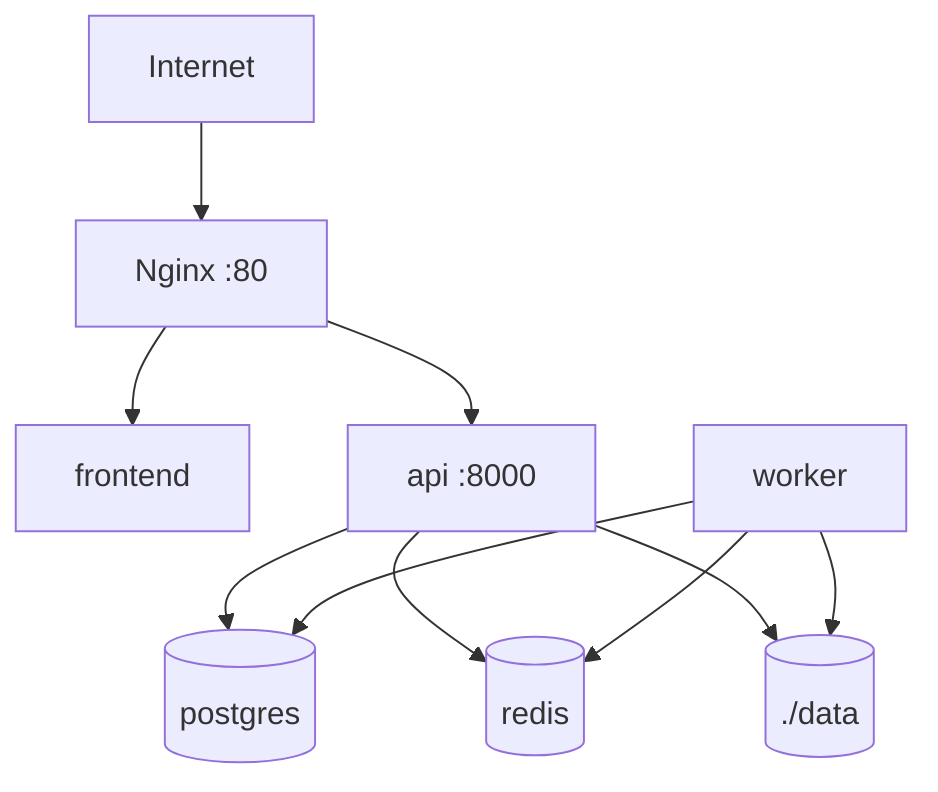

# Deployment

The initial deployment is designed for a single server with Docker Compose.

## Local Installation

1. Clone or open the repository.
2. Create the local configuration with `cp .env.example .env`.
3. Review passwords, paths and processor according to `docs/configuration.md`.
4. Start the services with `make up`.
5. Create the first admin with `make create-admin EMAIL=admin@example.org`.
6. Open the GUI at `http://localhost` or Swagger at `http://localhost/api/docs`.

Do not use real identifying or sensitive data in this initial version.



## Compneuro Worker

To run `compneuro-anatproc`, the worker is built with `worker/Dockerfile.compneuro`, derived from `compneurobilbaolab/compneuro-anatproc:1.1`. That container holds Celery, the platform code and the neuroimaging tools. Docker-in-Docker is not used.

No separate `compneuro-anatproc` container is started. The `worker` service is the container that inherits that base image and runs `src/apreproc_launcher.sh` directly.

If another script or a different image is used in the future, the pattern stays the same: the `worker` service must contain Celery, the platform code, the processor's dependencies and access to the `./data:/app/data` volume. The new command must be configured through environment variables and respect the expected result structure documented in `docs/processing-pipeline.md`.

Minimum variables:

```env
PROCESSOR_BACKEND=compneuro
PROCESSOR_NAME=compneuro-anatproc
PROCESSOR_VERSION=1.1
WORKER_DOCKERFILE=worker/Dockerfile.compneuro
ALLOWED_EXTENSIONS=.nii.gz
WORKER_REPLICAS=2
MAX_CONCURRENT_PROCESSING_JOBS=1
```

`MAX_CONCURRENT_PROCESSING_JOBS` must stay at `1` for `compneuro`, because each worker container manages an internal `/project` path. To increase parallelism, scale worker containers with `WORKER_REPLICAS=2` in `.env`, `make up WORKER_REPLICAS=2` or `make rebuild WORKER_REPLICAS=2`. The expected simultaneous capacity is the number of active replicas.

The `.env.compneuro.example` template is commented variable by variable. Use it as a deployment checklist: copy it to `.env`, review secrets, confirm compneuro paths/commands and then start with `make up`.

`api` and `worker` must share `./data:/app/data`, because the API prepares BIDS and the worker writes `output/Preproc`, logs, the technical PDF and the ZIP.

## Basic Production

- Change secrets in `.env`.
- Set `AUTH_SECRET_KEY` to your own value.
- Review all the variables described in `docs/configuration.md`.
- Restrict network access to the server.
- Add TLS in Nginx or Caddy.
- Run `make backup` to back up PostgreSQL and `data/studies`, and copy `backups/` off the server if recovery from disk loss is needed.
- Review the retention policy before using sensitive data.
