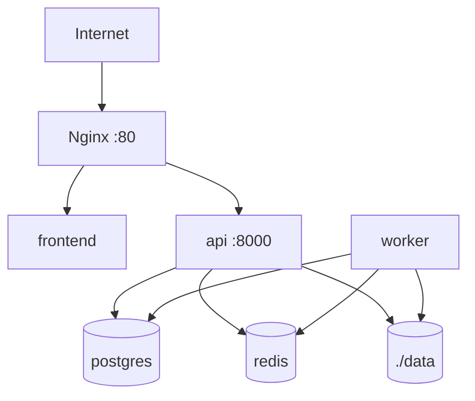
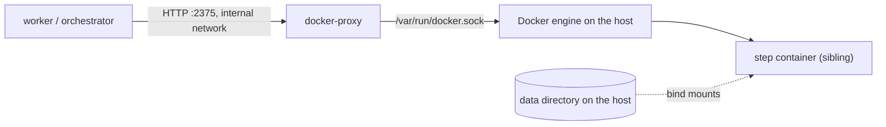
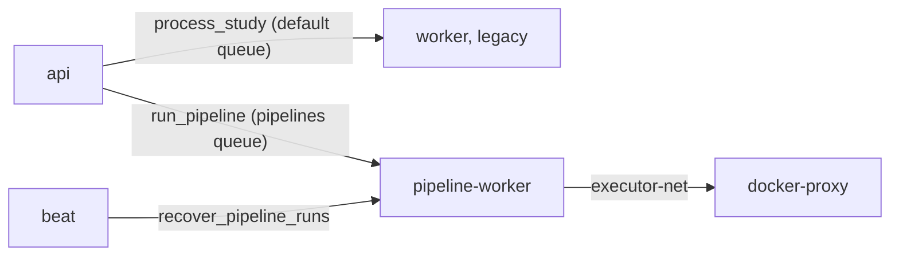

# Deployment

The initial deployment is designed for a single server with Docker Compose.

## Local Installation

1. Clone or open the repository.
2. Create the local configuration with `cp .env.example .env`.
3. Review passwords, paths and processor according to `docs/configuration.md`.
4. Start the services with `make up`.
5. Create the first admin with `make create-admin EMAIL=admin@example.org`.
6. Open the GUI at `http://localhost` or Swagger at `http://localhost/api/docs`.

Do not use real identifying or sensitive data in this initial version.



## Compneuro Worker

To run `compneuro-anatproc`, the worker is built with `worker/Dockerfile.compneuro`, derived from `compneurobilbaolab/compneuro-anatproc:1.1`. That container holds Celery, the platform code and the neuroimaging tools. Docker-in-Docker is not used.

No separate `compneuro-anatproc` container is started. The `worker` service is the container that inherits that base image and runs `src/apreproc_launcher.sh` directly.

If another script or a different image is used in the future, the pattern stays the same: the `worker` service must contain Celery, the platform code, the processor's dependencies and access to the `./data:/app/data` volume. The new command must be configured through environment variables and respect the expected result structure documented in `docs/processing-pipeline.md`.

Minimum variables:

```env
PROCESSOR_BACKEND=compneuro
PROCESSOR_NAME=compneuro-anatproc
PROCESSOR_VERSION=1.1
WORKER_DOCKERFILE=worker/Dockerfile.compneuro
ALLOWED_EXTENSIONS=.nii.gz
WORKER_REPLICAS=2
MAX_CONCURRENT_PROCESSING_JOBS=1
```

`MAX_CONCURRENT_PROCESSING_JOBS` must stay at `1` for `compneuro`, because each worker container manages an internal `/project` path. To increase parallelism, scale worker containers with `WORKER_REPLICAS=2` in `.env`, `make up WORKER_REPLICAS=2` or `make rebuild WORKER_REPLICAS=2`. The expected simultaneous capacity is the number of active replicas.

The `.env.compneuro.example` template is commented variable by variable. Use it as a deployment checklist: copy it to `.env`, review secrets, confirm compneuro paths/commands and then start with `make up`.

`api` and `worker` must share `./data:/app/data`, because the API prepares BIDS and the worker writes `output/Preproc`, logs, the technical PDF and the ZIP.

## Docker step executor and socket proxy

The `docker` executor (`orchestrator/executors/docker.py`, ADR-0003) runs each step attempt as a sibling container. The worker never mounts the Docker socket and never runs with Docker privileges: it reaches the engine only through the `docker-proxy` service (`tecnativa/docker-socket-proxy`, pinned by digest), which is in the `docker-executor` Compose profile and attached to an internal network:

```bash
docker compose --profile docker-executor up -d docker-proxy
```



Status: the executor is wired into the `pipeline-worker` service of the `pipelines` profile (see "Pipeline runs" below). The proxy alone is still available with `--profile docker-executor`.

### What the proxy restricts, and what it does not

The proxy enables only the API sections the executor needs: `CONTAINERS`, `IMAGES`, `POST` and `DELETE`. Exec, volumes, networks, build, commit, swarm, secrets, system and events answer `403`. The proxy filters by path and method, not by request body, so it cannot stop a caller from asking for a privileged container. That guarantee comes from the executor, which builds the container specification itself from a fixed template:

- the image must be on the allow-list given by the caller (the pipeline registry) and is checked before Docker is contacted; the local image must carry the pinned `repository@sha256:<digest>` and is started by its content ID;
- fixed contract command `/usr/local/bin/run --in /in --out /out --params /in/params.json` (the image's `ENTRYPOINT` and `CMD` are replaced);
- read-only root file system; `/in` and `/ref/<bundle>` read-only; `/out` and `/tmp` writable per-attempt directories; no other mounts;
- non-root numeric user (the worker's own UID by default), `--cap-drop ALL`, `no-new-privileges`, `--network none`, PID limit, CPU and memory limits with swap disabled, an init process so that `SIGTERM` reaches the step;
- cancel and timeout send `SIGTERM`, and the next `poll` after 30 seconds sends `SIGKILL`;
- the final state is saved under `<work_dir>/.executor/` and logs are copied to `<work_dir>/logs/step.log` (first and last 5 MiB if longer than 10 MiB) before the container is removed, so `poll`, `collect` and `cleanup` work from a persisted handle after a worker restart.

The worker is therefore trusted code. Anyone who can run arbitrary code in the worker, or reach port 2375 on the internal network, can start containers on the host. Do not publish the proxy port, and do not attach other services to `executor-net`.

### Configuration

`DockerExecutor.from_env(allowed_images)` reads:

| Variable | Default | Meaning |
|---|---|---|
| `DOCKER_PROXY_URL` | `http://docker-proxy:2375` | Base URL of the socket proxy |
| `DOCKER_EXECUTOR_HOST_PATH_MAP` | empty | `worker_path=host_path[,...]`: translates the worker's view of the data directory to the host's, because bind-mount sources are resolved by the engine on the host. Example: `/app/data=/srv/stroke/data` |
| `DOCKER_EXECUTOR_USER` | worker's UID:GID (`10001:10001` if the worker runs as root) | Numeric non-root user of the step container |
| `DOCKER_EXECUTOR_PIDS_LIMIT` | `512` | Maximum processes per step container |
| `DOCKER_EXECUTOR_PULL_MISSING` | `false` | Pull an allow-listed image that is absent on the host (needs registry access from the host); by default images must be pre-pulled |
| `DOCKER_EXECUTOR_ALLOW_GPUS` | `false` | Grant GPUs through device requests (not exercised in CI) |

The per-attempt directory (`work_dir`) must be on a path that exists on the Docker host (after mapping), and the container user must be able to traverse its parents.

### Tests

`tests/test_docker_executor.py` covers the executor against a fake engine API. `tests/test_docker_executor_integration.py` runs the template step image end to end through a real proxy; the `docker-executor` CI job builds the image, pushes it to a throw-away local registry to obtain a digest, starts the proxy and runs it. To run it locally, start the proxy with the settings of `docker-compose.yml` on a published loopback port, push `steps/template/Dockerfile`'s image to a registry, and set `STROKE_TEST_DOCKER_PROXY_URL` and `STROKE_TEST_STEP_IMAGE`.

## Pipeline runs (opt-in `pipelines` profile)

Pipeline runs are executed by the orchestrator (`run_pipeline`, `recover_pipeline_runs`). They are deployed behind the Compose profile `pipelines`. Without it, `docker compose config`, `make up` and every running service are exactly the legacy stack: `api`, `worker` (default queue, `process_study`), `postgres`, `redis`, `mailpit`, `frontend`, `reverse-proxy`.

Enable it by either of:

```bash
docker compose --profile pipelines up -d --build
# or, once, in .env (then `make up` includes the profile):
COMPOSE_PROFILES=pipelines
```

The profile adds three services:

| Service | Image | Role |
|---|---|---|
| `pipeline-worker` | `worker/Dockerfile` (slim, no processor inside) | Celery worker consuming **only** the `pipelines` queue. Attached to the default network (PostgreSQL, Redis) and to `executor-net` (to reach `docker-proxy`). Concurrency is `ORCHESTRATOR_WORKER_CONCURRENCY` (default `2`, one run per slot). |
| `beat` | `worker/Dockerfile` | Celery beat; every 5 minutes it enqueues `recover_pipeline_runs`. **Run exactly one instance**; do not scale it. |
| `docker-proxy` | pinned socket proxy | See above. Also part of the `docker-executor` profile. |

Queue separation: `worker.celery_app` routes `run_pipeline` and `recover_pipeline_runs` to the queue `pipelines`; every other task, including `process_study`, stays on the default queue. The legacy `worker` is started without `-Q` and keeps consuming only the default queue, so long pipeline runs cannot block legacy uploads. Messages for `pipelines` enqueued while no `pipeline-worker` runs wait in Redis until one starts.



Mounts of `pipeline-worker`: `./data:/app/data` (cases, work directories and reference bundles under `BUNDLE_ROOT`, default `/app/data/bundles`), `./pipelines:/app/pipelines:ro` and `./steps:/app/steps:ro` (registries read from `PIPELINES_DIR` and `STEP_MANIFESTS_DIR`).

### Host path mapping (required)

Step containers are created by the Docker engine on the host, which resolves bind-mount sources on the host file system, not inside the worker. Set `DOCKER_EXECUTOR_HOST_PATH_MAP` to the absolute host path of `./data`:

```env
DOCKER_EXECUTOR_HOST_PATH_MAP=/app/data=/srv/stroke/data
```

If it is empty or wrong, step containers start with missing or empty inputs. The path must exist on the host, and the step user must be able to traverse its parents. Reference bundles live under the same data directory, so one mapping covers both.

### Security note

`docker-proxy` mounts the host Docker socket (the `:ro` flag on the socket file does not limit the API). It exposes only container and image calls, but it cannot inspect request bodies. Whoever controls `pipeline-worker` (arbitrary code in it, a compromised dependency, or access to port 2375 on `executor-net`) can create containers on the host, which is equivalent to elevated access to the host. Therefore:

- keep the profile off on instances that do not run pipelines;
- never publish the proxy port and never attach another service to `executor-net`;
- pipelines and step manifests are mounted read-only, and the executor only starts images pinned by digest in the loaded pipelines (see the restrictions above);
- restrict who can edit `./pipelines`, `./steps` and the worker image.

### Variables

All variables are listed in `.env.example` and described in `docs/configuration.md` (section "Pipeline runs"). The orchestrator ones (`PIPELINES_DIR`, `STEP_MANIFESTS_DIR`, `BUNDLE_ROOT`, `ORCHESTRATOR_*`) are defined in `docs/processing-pipeline.md`.

### Enabling pipelines on a host (API side)

The `api` service reads pipelines and step manifests through its own variables, so that it behaves exactly as before while they are unset: `PIPELINES_DIR` and `STEP_MANIFESTS_DIR` of the `api` default to `/app/pipelines-disabled` and `/app/steps-disabled` (directories that do not exist), and `GET /api/v1/pipelines` answers an empty list. `./pipelines` and `./steps` are always mounted read-only into `api` (inert unless pointed at), `./data` (and so `BUNDLE_ROOT`, default `/app/data/bundles`) is the mount it already had, and `DEPLOYMENT_PROFILE` (default `research-public`) is passed through.

Steps, in order:

1. **Profile and API variables.** In `.env`: `COMPOSE_PROFILES=pipelines`, `API_PIPELINES_DIR=/app/pipelines`, `API_STEP_MANIFESTS_DIR=/app/steps`. Then `make up` (or `make rebuild`) and `make migrate`.
2. **Host path map.** Set `DOCKER_EXECUTOR_HOST_PATH_MAP` as described above.
3. **Pipelines and manifests.** `./pipelines/<id>/` must hold `pipeline.yaml` and `registry.yaml` with the **published image digests** (`python pipelines/stroke-lnm/registry.py materialize --digests FILE --out DIR`, then use `DIR` as the mounted `pipelines` tree), and `./steps` (or another directory mounted over `/app/steps`) must hold the `step.yaml` read from each image (`/opt/step/step.yaml`). The repository tree has placeholder digests and only the manifests of the steps built here, so a step whose manifest is missing is listed with `available: false`.
4. **Reference bundles.** Register each bundle the enabled steps need into the database store, from inside `api` (the bundle directory must be under `./data`, so the container sees it):

   ```bash
   docker compose exec api python -m orchestrator.bundles --store db --root /app/data/bundles register /app/data/incoming/<bundle-dir>
   docker compose exec api python -m orchestrator.bundles --store db --root /app/data/bundles list
   ```

5. **Seed the implementation settings** (once; safe to repeat):

   ```bash
   make seed-implementations PROFILE=deployment ARGS=--dry-run   # preview
   make seed-implementations PROFILE=deployment
   ```

   This runs `python -m app.cli.seed_implementations --profile deployment` in `api`. It reads `<PIPELINES_DIR>/<id>/registry.yaml` and writes one `slot_implementation_settings` row per allowed implementation, enabled as the profile says. Stubs and planned entries are never enabled under `deployment` (the command refuses a registry that does so). Existing rows are not touched, so changes an admin made with `PUT /api/v1/admin/implementations/...` survive a re-run; `--reset` overwrites every row with the profile. The command logs each row (`insert`, `update`, `unchanged`, `warning`) and warns about enabled implementations whose image digest is still a placeholder.
6. **Use `/api/v1`.** `GET /api/v1/pipelines` and `.../versions/<v>/slots` show what is enabled; admins refine it through `/api/v1/admin/implementations`; researchers create cases, upload inputs and start runs (`docs/api.md`). Restart `api` after changing the mounted pipelines or manifests: they are loaded once per process.

#### What is not available yet

Image digests in `pipelines/stroke-lnm/registry.yaml` are placeholders (64 zeros) until the step images are published (card F1-14). The executor only starts images pinned by digest and never pulls a placeholder, and run creation needs the step manifests. **A real deployment therefore cannot run stroke-lnm yet**: with the repository tree, listing and seeding work, but runs cannot complete. Also unavailable: functional disconnection (only a stub, enabled in `ci` only) and CT normalisation (planned, not merged), so the CT input set is refused.

The reference path is the CI one: the `e2e-stroke-lnm` workflow (`.github/workflows/e2e-stroke-lnm.yml`, `docs/processing-pipeline.md`) builds the steps, obtains digests from a throwaway registry, materialises the pipeline, registers toy bundles, seeds the `ci` profile and runs the pipeline on synthetic fixtures. Reproduce a deployment the same way by replacing the throwaway digests with the published ones.

### Validation

CI runs `docker compose config` with and without the profile, and `tests/test_deploy_wiring.py` checks the queue routing and the structure of the services. Neither starts containers.

## Basic Production

- Change secrets in `.env`.
- Set `AUTH_SECRET_KEY` to your own value.
- Review all the variables described in `docs/configuration.md`.
- Restrict network access to the server.
- Add TLS in Nginx or Caddy.
- Run `make backup` to back up PostgreSQL and `data/studies`, and copy `backups/` off the server if recovery from disk loss is needed.
- Review the retention policy before using sensitive data.
