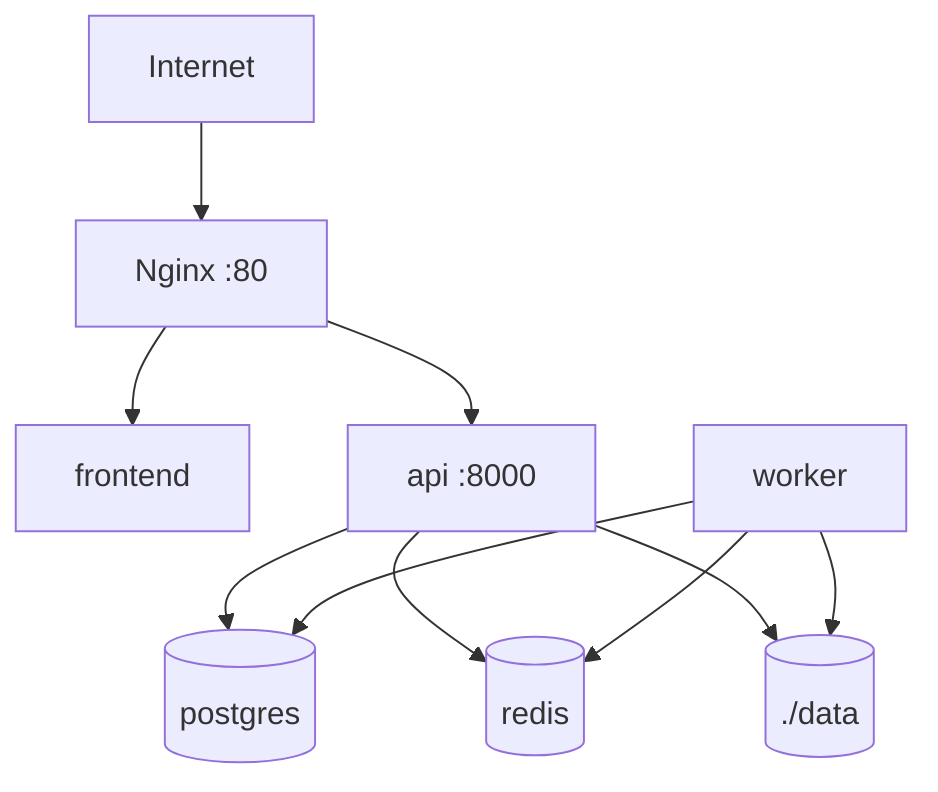
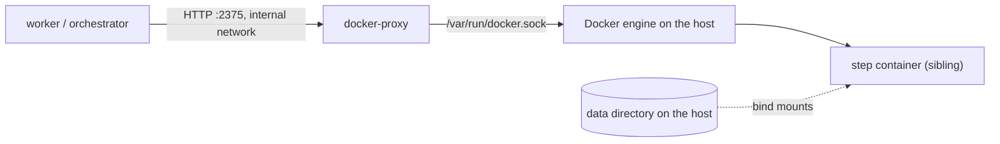

# Deployment

The initial deployment is designed for a single server with Docker Compose.

## Local Installation

1. Clone or open the repository.
2. Create the local configuration with `cp .env.example .env`.
3. Review passwords, paths and processor according to `docs/configuration.md`.
4. Start the services with `make up`.
5. Create the first admin with `make create-admin EMAIL=admin@example.org`.
6. Open the GUI at `http://localhost` or Swagger at `http://localhost/api/docs`.

Do not use real identifying or sensitive data in this initial version.



## Compneuro Worker

To run `compneuro-anatproc`, the worker is built with `worker/Dockerfile.compneuro`, derived from `compneurobilbaolab/compneuro-anatproc:1.1`. That container holds Celery, the platform code and the neuroimaging tools. Docker-in-Docker is not used.

No separate `compneuro-anatproc` container is started. The `worker` service is the container that inherits that base image and runs `src/apreproc_launcher.sh` directly.

If another script or a different image is used in the future, the pattern stays the same: the `worker` service must contain Celery, the platform code, the processor's dependencies and access to the `./data:/app/data` volume. The new command must be configured through environment variables and respect the expected result structure documented in `docs/processing-pipeline.md`.

Minimum variables:

```env
PROCESSOR_BACKEND=compneuro
PROCESSOR_NAME=compneuro-anatproc
PROCESSOR_VERSION=1.1
WORKER_DOCKERFILE=worker/Dockerfile.compneuro
ALLOWED_EXTENSIONS=.nii.gz
WORKER_REPLICAS=2
MAX_CONCURRENT_PROCESSING_JOBS=1
```

`MAX_CONCURRENT_PROCESSING_JOBS` must stay at `1` for `compneuro`, because each worker container manages an internal `/project` path. To increase parallelism, scale worker containers with `WORKER_REPLICAS=2` in `.env`, `make up WORKER_REPLICAS=2` or `make rebuild WORKER_REPLICAS=2`. The expected simultaneous capacity is the number of active replicas.

The `.env.compneuro.example` template is commented variable by variable. Use it as a deployment checklist: copy it to `.env`, review secrets, confirm compneuro paths/commands and then start with `make up`.

`api` and `worker` must share `./data:/app/data`, because the API prepares BIDS and the worker writes `output/Preproc`, logs, the technical PDF and the ZIP.

## Docker step executor and socket proxy

The `docker` executor (`orchestrator/executors/docker.py`, ADR-0003) runs each step attempt as a sibling container. The worker never mounts the Docker socket and never runs with Docker privileges: it reaches the engine only through the `docker-proxy` service (`tecnativa/docker-socket-proxy`, pinned by digest), which is in the `docker-executor` Compose profile and attached to an internal network:

```bash
docker compose --profile docker-executor up -d docker-proxy
```



Status: the executor is implemented and tested, but the worker image does not ship the orchestrator package yet; wiring it in is card F0-15. Until then the proxy is optional.

### What the proxy restricts, and what it does not

The proxy enables only the API sections the executor needs: `CONTAINERS`, `IMAGES`, `POST` and `DELETE`. Exec, volumes, networks, build, commit, swarm, secrets, system and events answer `403`. The proxy filters by path and method, not by request body, so it cannot stop a caller from asking for a privileged container. That guarantee comes from the executor, which builds the container specification itself from a fixed template:

- the image must be on the allow-list given by the caller (the pipeline registry) and is checked before Docker is contacted; the local image must carry the pinned `repository@sha256:<digest>` and is started by its content ID;
- fixed contract command `/usr/local/bin/run --in /in --out /out --params /in/params.json` (the image's `ENTRYPOINT` and `CMD` are replaced);
- read-only root file system; `/in` and `/ref/<bundle>` read-only; `/out` and `/tmp` writable per-attempt directories; no other mounts;
- non-root numeric user (the worker's own UID by default), `--cap-drop ALL`, `no-new-privileges`, `--network none`, PID limit, CPU and memory limits with swap disabled, an init process so that `SIGTERM` reaches the step;
- cancel and timeout send `SIGTERM`, and the next `poll` after 30 seconds sends `SIGKILL`;
- the final state is saved under `<work_dir>/.executor/` and logs are copied to `<work_dir>/logs/step.log` (first and last 5 MiB if longer than 10 MiB) before the container is removed, so `poll`, `collect` and `cleanup` work from a persisted handle after a worker restart.

The worker is therefore trusted code. Anyone who can run arbitrary code in the worker, or reach port 2375 on the internal network, can start containers on the host. Do not publish the proxy port, and do not attach other services to `executor-net`.

### Configuration

`DockerExecutor.from_env(allowed_images)` reads:

| Variable | Default | Meaning |
|---|---|---|
| `DOCKER_PROXY_URL` | `http://docker-proxy:2375` | Base URL of the socket proxy |
| `DOCKER_EXECUTOR_HOST_PATH_MAP` | empty | `worker_path=host_path[,...]`: translates the worker's view of the data directory to the host's, because bind-mount sources are resolved by the engine on the host. Example: `/app/data=/srv/stroke/data` |
| `DOCKER_EXECUTOR_USER` | worker's UID:GID (`10001:10001` if the worker runs as root) | Numeric non-root user of the step container |
| `DOCKER_EXECUTOR_PIDS_LIMIT` | `512` | Maximum processes per step container |
| `DOCKER_EXECUTOR_PULL_MISSING` | `false` | Pull an allow-listed image that is absent on the host (needs registry access from the host); by default images must be pre-pulled |
| `DOCKER_EXECUTOR_ALLOW_GPUS` | `false` | Grant GPUs through device requests (not exercised in CI) |

The per-attempt directory (`work_dir`) must be on a path that exists on the Docker host (after mapping), and the container user must be able to traverse its parents.

### Tests

`tests/test_docker_executor.py` covers the executor against a fake engine API. `tests/test_docker_executor_integration.py` runs the template step image end to end through a real proxy; the `docker-executor` CI job builds the image, pushes it to a throw-away local registry to obtain a digest, starts the proxy and runs it. To run it locally, start the proxy with the settings of `docker-compose.yml` on a published loopback port, push `steps/template/Dockerfile`'s image to a registry, and set `STROKE_TEST_DOCKER_PROXY_URL` and `STROKE_TEST_STEP_IMAGE`.

## Basic Production

- Change secrets in `.env`.
- Set `AUTH_SECRET_KEY` to your own value.
- Review all the variables described in `docs/configuration.md`.
- Restrict network access to the server.
- Add TLS in Nginx or Caddy.
- Run `make backup` to back up PostgreSQL and `data/studies`, and copy `backups/` off the server if recovery from disk loss is needed.
- Review the retention policy before using sensitive data.
