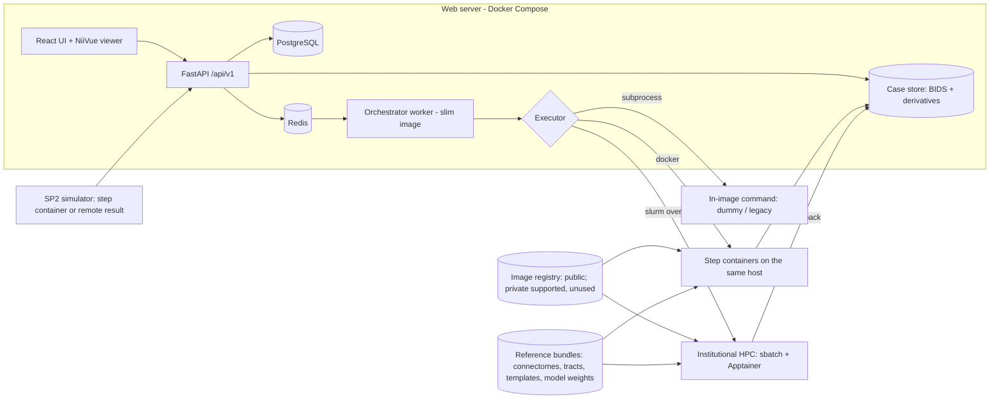
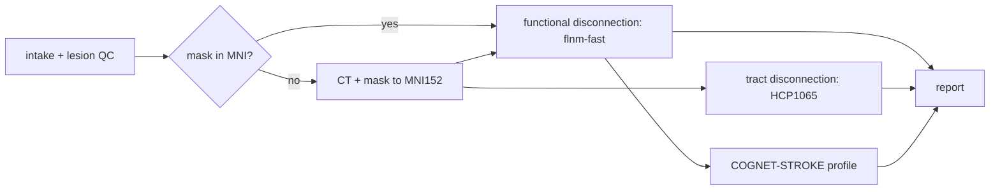
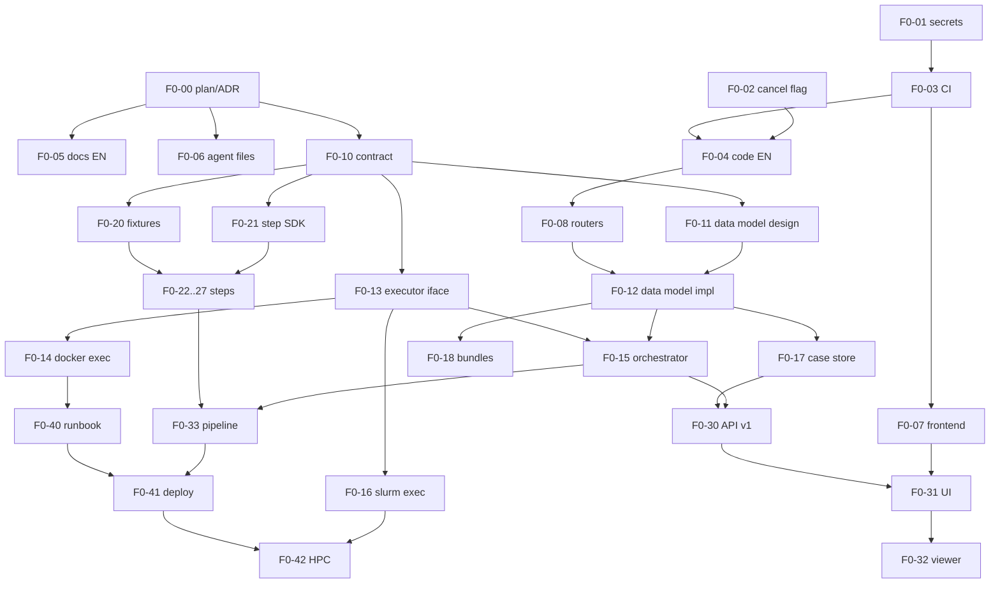

# Stroke-server platform and pipelines — implementation plan

Version 0.2 (public edition), 13 Nov 2026. Planner: Claude Fable. Approved by the project owner.
This is the public edition of the plan: internal inputs, institutional matters and the decision log are kept outside the repository.

How to use this document: sections 1-3 give the assessment, the target architecture and the phases. Section 5 holds the task cards; each card is handed to one agent together with the repository.

---

## 1. Current-state assessment

I read the code of `stroke-server-biobizkaia` (`develop`), `CTLesion2MNI152`, `lnm` and `COGNET-STROKE`. I did not run anything, and I have not seen the lab server, the HPC, flnm-fast's source, any segmentation code or the SP2 packages.

### 1.1 What is solid and should be kept

- **The web scaffolding.** FastAPI + SQLAlchemy 2 + Alembic (9 migrations), Celery/Redis, PostgreSQL, React/Vite, Nginx, Docker Compose, Makefile. Local auth with roles, per-owner visibility, quotas, audit events, admin dashboard, share links with hashed tokens, notifications, backup/restore, retention CLI. 61 tests, mostly API.
- **The boundary idea.** `processor_adapter` isolates the web app from the processing tool. The plan generalises this boundary; it does not remove it.
- **Operational discipline.** `make test/lint/check-docs/check-secrets`, pre-commit, Conventional Commits, a written roadmap.

### 1.2 What blocks the project's platform

| # | Finding (file) | Consequence |
|---|---|---|
| A1 | The worker image **is** the processor image (`worker/Dockerfile.compneuro` derives from `compneuro-anatproc`), and `process_study` branches on the backend name (`worker/tasks.py`). | One pipeline per worker build. A chain of tools with different toolchains (FSL/Elastix, MRtrix/ANTs, PyTorch, Python 3.12) cannot run. |
| A2 | `CompneuroAnatprocAdapter` takes a global file lock and repoints a `/project` symlink per job (`processor_adapter/adapter.py`). | One job per worker container; cannot be reused for other tools. |
| A3 | A `Study` is one uploaded file, one `ProcessingJob`, one PDF, one ZIP (`models/study.py`, `upload_study`). | No multi-file case (CT + mask), no steps, no typed artefacts, no model or reference-data versions. |
| A4 | Provenance is three strings on `Study` (`processor_name`, `processor_version`, `container_image`), set from environment variables. | The project's provenance record (digest, parameters, connectome and model versions) does not exist. |
| A5 | Everything runs on the web server. | No HPC path. |
| A6 | Cancellation is detected by matching a **Spanish string prefix** in `job.error_message` (`"Cancelación solicitada por el usuario"`, `worker/tasks.py`, `routes.py`). | Translating the code to English breaks cancellation unless this is fixed first. |
| A7 | BIDS preparation is T1w-only, single subject (`services/bids.py`). | No CT, no lesion mask, no derivatives. |
| A8 | The PDF is a hand-written PDF generator (`technical_pdf_report.py`, raw `zlib`/`struct`); PNGs come from FSL `slicer`. | Not a base for clinician reports; ties the platform core to FSL. |

### 1.3 Technical debt and hygiene

- **No CI.** Tests and lint only run when somebody runs them.
- **`develop` and `main` have divergent histories.** `AGENTS.md` requires `main` to be free of agent files, so commits are re-created on `main` with different hashes. This makes releases and hotfixes error-prone.
- **Frontend:** one 911-line `main.jsx`, no router, no tests, all dependencies pinned to `latest`, Spanish strings hard-coded.
- **Auth:** JWT in `localStorage` (the roadmap already flags it). No self-registration, no terms acceptance, no clinician or coordinator roles.
- **`routes.py` is 1,384 lines** holding every endpoint and helper.
- **`datetime.utcnow()`** everywhere (naive timestamps; deprecated).
- **Docs, UI, error messages, agent files and many identifiers' messages are in Spanish.** Agent rules also forbid things this plan needs ("do not add auth, roles, TLS…", "keep the GUI in Spanish").
- **A Tailscale-range IP** is the default `APP_PUBLIC_BASE_URL` in `docker-compose.yml`.

### 1.4 The stroke tools

| Tool | State | Work needed to become a platform step |
|---|---|---|
| `CTLesion2MNI152` | Works as CLI + Docker image; skull-based affine (FSL `flirt`) then B-spline (Elastix); optional ventricle removal by age. Uses `subprocess.call` without checking exit codes; no tests. | Wrapper with the step contract, exit-code checks, QC figure, fixture test. |
| `lnm` functional | Voxel-wise seed correlation over normative 4D fMRI + second-level model. Slow, needs the full normative fMRI. | Legacy. Not ported; replaced by flnm-fast. |
| `lnm` structural | Per-normative-subject FACT tractography seeded through the lesion (MRtrix, ANTs); tract disconnection by `tckedit -exclude` on HCP1065 tracts. Bash, no error handling, writes inside the normative data tree (not concurrency-safe). | Tract-wise disconnection is cheap and ports first. Voxel-wise structural needs a redesign around a precomputed normative tractogram set (HPC only). |
| `COGNET-STROKE` | `cdr.py` core is small and clean; report workflow exists; `pyproject.toml` pins ~110 packages including Jupyter, Flask and VTK; Python `==3.12.3`. | Slim runtime package + container, precomputed concept maps as a reference bundle, tests. |
| flnm-fast | Not seen. Docker Hub image v2.0.0. | Not mounted in the pipeline until its step wrapper exists; a stub with the same output schema is used in CI only. |
| Segmentation, prediction, spasticity, specificity nulls | Not found. | New steps; trained weights come from the lab. |

**Summary:** the web shell is roughly 70% of what a research platform needs; the processing core, data model and deployment model must be rebuilt around a step contract. Nothing in the project's platform objectives is "done" except generic items (queues, traceable storage in a basic sense, containerised deployment of the web app).

---

## 2. Target architecture

### 2.1 Components

### 2.2 Key decisions

**D1. Step contract.** Every processing tool is a *step*: a container image plus a manifest `step.yaml`.

- Entry point: `run --in /in --out /out --params /in/params.json`. Reads only `/in` and `/ref` (read-only), writes only `/out` and `/tmp`. No network. Runs as non-root. Must behave identically under Docker and Apptainer.
- `step.yaml` declares: name, semantic version, image reference, typed inputs and outputs (BIDS-style entities and suffixes, e.g. `space-MNI152NLin6Asym_res-2_label-lesion_mask.nii.gz`), a JSON Schema for parameters, required reference bundles, resources (CPU, memory, GPU, wall time), and its reference dataset with expected outputs and tolerances.
- Every run writes `/out/provenance.json`: step name and version, image digest, parameters, SHA-256 of each input, reference bundle IDs and checksums, model version, start/end, exit status, software versions.
- Exit codes: 0 success, 10 invalid input (user-facing message in `/out/error.json`), other = internal failure.
- *Rejected:* keeping per-tool adapter classes inside the web repo (does not scale, couples releases); BIDS Apps CLI as-is (no manifest, no typed outputs, no provenance), although the CLI shape is deliberately close to it.

**D2. Pipelines are small declarative DAGs run by our own orchestrator on Celery.** `pipeline.yaml` lists steps, wiring of outputs to inputs, and conditions (e.g. skip normalisation in mask-only mode). The orchestrator persists `PipelineRun` and `StepRun` rows, supports resume from the last successful step, cancel and retry per step.

- *Rejected:* Nextflow, Snakemake, Airflow, Prefect. Each adds a second scheduler and state store beside Celery/PostgreSQL, another large SOUP item for the IEC 62304 file, and features we do not need for 6-10 mostly linear steps. Revisit only if pipelines become wide or data-parallel inside the platform (cohort-scale batch processing stays outside the web platform, on the HPC, driven by lab scripts that call the same step containers).

**D3. Executors.** One interface, three backends, chosen per deployment and per step:

- `subprocess`: runs a command inside the worker image. Keeps the dummy processor and the existing anatproc integration alive during migration.
- `docker`: starts sibling containers through a socket proxy restricted to create/start/wait/logs/remove on allow-listed images. This is the on-premise hospital mode and the default on the lab server for light steps.
- `slurm`: stages `/in` to the HPC over SSH/rsync, submits `sbatch` wrapping `apptainer run`, polls `sacct` from a Celery beat task, pulls `/out` back, cleans the staging directory. The HPC never calls the web server.
- *Rejected:* running a Celery worker on HPC nodes (long-lived daemons on a batch cluster, outbound Redis access from the HPC); Kubernetes (no cluster, heavy for hospitals).
- Everything about the HPC (scheduler, Apptainer, reachability, shared filesystem, account) is unverified. The `slurm` executor is designed behind the interface so that these answers change configuration, not architecture.

**D4. Data model.** New entities; old ones are migrated, not deleted.

- `Case` (replaces the role of `Study`; pseudonymous subject ID, sex and age band as optional metadata, owner, deployment mode), `InputFile` (role: `ct`, `mri`, `lesion_native`, `lesion_mni`; checksum), `PipelineRun`, `StepRun` (executor, external job ID, digest, timings, exit code), `Artifact` (typed, checksum, path, producing step), `ReferenceBundle`, `ModelVersion` (locked flag, model card, calibration set ID), `Report`, `ReviewRecord` (who, when, what changed in the mask), later `SealedReport`, `Observation` (outcome scales), `Prediction`.
- Existing `Study`/`ProcessingJob` rows become `Case`/`PipelineRun` with a single legacy step. The old endpoints stay as thin aliases for one release.

**D5. Storage.** Filesystem behind the existing storage class. Per case: a BIDS raw tree (`sub-<id>/ses-acute/ct/…`) and `derivatives/<step>-<version>/…` with `dataset_description.json` (`GeneratedBy`) and the provenance file. *Rejected for now:* MinIO/S3 (no need on a single host; the storage class keeps the door open).

**D6. Reference bundles and models are data, not code.** Normative connectomes, tract atlases, templates, concept maps and model weights are versioned bundles (`bundle.yaml` with ID, version, licence, checksums) mounted read-only at `/ref`. They never live in Git. The platform records which bundle each run used. Whether a bundle may be shipped to other hospitals depends on its licence (HCP-Aging is under a data use agreement) — Q6.

**D7. Everything open for now (decided 13 Nov 2026).** All platform code, steps and pipeline definitions are public. The pipeline definition references steps by image name and digest, and the registry design still allows a private registry with a read-only pull credential, but nothing uses it now. *Stub* steps (same manifest and output schema, synthetic outputs) remain as CI fixtures and as placeholders for components whose code does not exist yet; they are never offered to users as real analyses.

**D15. Selectable implementations per pipeline slot (decided 13 Nov 2026).** A pipeline is a chain of *slots* (for example `segmentation`, `normalisation`, `functional-disconnection`, `prediction`), each defined by the artefact types it consumes and produces. Any step whose manifest declares `provides: <slot>` and matches the slot's I/O schema can fill it, including wrappers around external models or segmenters. An administrator enables implementations per deployment; the user picks one per slot when creating a run (with a deployment default), and the choice, image digest and model bundle are recorded in provenance. A slot with no enabled implementation is shown as unavailable and the pipeline runs without it when the slot is optional (for example, user-supplied masks when no segmenter is mounted). Nothing is built in-house where no lab code exists yet.

**D8. SP2 contract.** Two paths under one schema (`sp2-result/1.x`: simulated features, ranked routes with predicted gain, burden and uncertainty, model version, lock flag):

1. SP2's simulator packaged as a step container (preferred; runs on our HPC or on-premise);
2. a service-account endpoint `PUT /api/v1/cases/{id}/sp2-results` for results computed at the partner site, plus `GET /api/v1/cases/{id}/sp2-inputs` returning only derived, non-identifiable inputs (MNI lesion mask, disconnection features, permitted baseline variables).
A stub implementation exists from the first version so that platform work never waits for the partner group (SP2).

**D9. Sealed reports.** A sealed report is a canonical JSON + PDF pair whose SHA-256 is stored with a server timestamp in an append-only, hash-chained table; optionally also time-stamped by an external RFC 3161 authority. The treating-team role cannot read sealed content. A coordinator opens the envelope only after discharge outcomes are recorded; opening is audited. The clinician checklist (agreement / partial / discrepancy, reason, plausibility) is a structured form bound to the report hash.

**D10. Predictions are served from locked model versions.** A model release is a bundle: weights, feature spec, training-data fingerprint, model card (performance overall and by sex), and conformal calibration tables stratified by sex and age band. The serving step refuses models without a card. Observed outcomes entered later feed a calibration monitor; drift raises an alert and a *recalibration proposal* that a human approves as a new model version. No automatic retraining.

**D11. Frontend.** Split the single file into routed feature modules, move to TypeScript, pin dependencies, add `react-i18next` (English source strings; Spanish catalogue kept from the current UI; other languages later), and use **NiiVue** for viewing and editing lesion masks in the browser. *Rejected:* a custom WebGL viewer; Papaya (unmaintained).

**D12. Reports.** HTML templates (Jinja2) rendered to PDF (WeasyPrint), figures rendered with nilearn/matplotlib inside the report step. Every page carries "Research use only — not for clinical decisions". Two templates: neurologist/rehabilitation team, neuropsychologist. This removes FSL `slicer` and the hand-written PDF code from the platform core.

**D13. Security baseline before any public exposure.** HttpOnly cookie sessions + CSRF, OIDC (institutional and ORCID), TLS, rate limiting, upload scanning (type sniffing, size), secrets only in the server's environment, gitleaks in CI, dependency pinning and audit.

**D14. Deployment topologies.** One Compose project, three profiles:

| Profile | Inputs accepted | Executors | Notes |
|---|---|---|---|
| `research-public` | De-identified images or MNI masks from registered researchers | docker (light), slurm (heavy) | Defacing on arrival, deletion after processing, terms of use. Needs data-protection sign-off. External use of the HPC is a designed-for option, off by default. |
| `mask-only` | MNI lesion masks only | docker | Can be the first public mode because no images are received. |
| `on-premise` | Anything, inside the hospital | docker only | No outbound connections; images pulled from a release tarball or mirror. |

### 2.3 The first stroke pipeline (`stroke-lnm` v0)

Later versions insert: segmentation and browser review before normalisation; specificity diagnostics after D; structural voxel-wise disconnection; prediction with conformal intervals; spasticity risk; SP2 routes; sealing.

---

## 3. Phases

Dates before Sept 2027 are calendar dates; from then on, project months (M1 = Sept 2027).

| Phase | Window | Goal | Exit criterion (demonstrable) |
|---|---|---|---|
| **0. Foundations and first stroke pipeline** | 16 Nov 2026 – end Feb 2027 | English repo with CI; step contract; orchestrator with docker and slurm executors; `stroke-lnm` v0. | On the lab server, a user creates a case from a synthetic CT + mask (and from an MNI mask alone), the pipeline runs end to end with at least one step on the HPC, and the user downloads a report and a provenance record that names every image digest and bundle. CI is green on `develop`. |
| **1. Clinician in the loop and trustworthy outputs** | Mar – Aug 2027 | Browser mask review/edit; nnU-Net inference step and model registry; specificity diagnostics; prediction serving with conformal intervals; auth hardening; `mask-only` profile live. | A reviewer corrects an automatic mask in the browser and the correction is versioned and audited; a (lab-provided or stub) locked model produces a prediction with a sex- and age-stratified interval; mask-only instance reachable over TLS with OIDC login. |
| **2. Architecture and QMS documentation** | M1 – M12 | QMS skeleton and architecture file; DICOM intake with de-identification and defacing; calibration tracking; spasticity module; SP2 contract v1 with stub; sealed-report prototype for the pilot. | Deliverable set for the phase complete. |
| **3. Beta with SP2 API** | M13 – M24 | Public research instance with registration and terms; SP2 simulator integrated; two clinician reports; checklist; on-premise installer v0; Spanish/Basque UI; security review; Zenodo release. | External researcher registers, runs a case, gets both reports; SP2 routes appear in the report from a real SP2 image; Hospital Gorliz test installation. |
| **4. LesionBank and prospective use** | M25 – M36 | LesionBank bulk upload and connector; drift monitoring in prospective sealed-envelope use; segmentation model releases; SP2 silent-mode registry. | Project masks uploaded; a LesionBank lesion processed by our pipeline; drift dashboard fed by real entries (by lab staff). |
| **5. Validated release and dossier** | M37 – M44 | Verification and validation records, usability evaluation, manuals, in-house readiness dossier, v1.0. | Traceability matrix complete (requirement → test → result); dossier handed to HU Cruces and Hospital Gorliz for their go/no-go. |

---

## 4. Model assignment rules

- **opus**: contracts and schemas, the data model, orchestrator and executors (concurrency, cancellation, failure recovery), security-sensitive code (auth, sealed reports, de-identification), statistical method code (null models, conformal calibration, drift tests), regulatory documents, agent instruction files, and reviews of cards marked "Opus review".
- **sonnet**: everything else that is real implementation: endpoints, migrations from an approved design, step wrappers, containers, CI, frontend, reports, tests, documentation, translations (translation changes meaning if done carelessly, so not Haiku).
- **haiku**: only mechanical edits with a deterministic check: renames, dependency pin bumps, changelog entries, lint-only fixes. Two cards in Phase 0.

Each card is sized for one agent session and one PR.

---

## 5. Task cards

Common rules for every card (not repeated below):

- Never use, request or copy patient data. Fixtures are synthetic or public with a compatible licence.
- Branch `feat/<card-id>-<slug>` from `develop`; one PR; Conventional Commits; `make test`, `make lint`, `make check-docs`, `make check-secrets` and the frontend build must pass.
- Update the docs touched by the change in the same PR. English only.
- Do not deploy, push to `main`, run destructive migrations or touch the server unless the card says so and the PI has approved that deployment.
- "Touches" lists the only areas the card may modify. Parallel cards never share a "Touches" area.

### 5.1 Phase 0 — lane A: hygiene and English migration

**F0-00 Plan and ADR folder** · haiku (file moves, index) · Depends: none · Touches: `docs/plan/`, `docs/adr/`, `docs/README.md`
Copy this plan to `docs/plan/IMPLEMENTATION_PLAN.md`; create `docs/adr/` with a template and an index. Accept: `make check-docs` passes; plan linked from `docs/README.md`.

**F0-01 Remove tracked env file and add secret scanning** · sonnet · Depends: none · Touches: `.env.compneuro`, `.gitignore`, `.pre-commit-config.yaml`, `scripts/check-no-secrets.sh`, `docker-compose.yml` (default `APP_PUBLIC_BASE_URL` only), `docs/security.md`
`git rm --cached .env.compneuro`; ignore `.env.*` except `*.example`; add gitleaks to pre-commit; replace the hard-coded IP default with `http://localhost`. Do not rewrite Git history. Accept: gitleaks clean on the working tree; `make up` works from `.env.example`.

**F0-02 Cancellation flag instead of message matching** · sonnet, Opus review · Depends: none · Touches: `backend/app/models/processing_job.py`, new Alembic migration, `backend/app/api/routes.py` (cancel endpoint only), `worker/tasks.py`, `tests/test_worker.py`, `tests/test_api.py` (cancel tests)
Add `cancel_requested_at` (timestamp) to `ProcessingJob`; replace every check of the Spanish prefix in `error_message`; migration back-fills from existing rows. Accept: existing cancel tests pass unchanged in behaviour; a new test proves cancellation works with an arbitrary error message. **Must merge before F0-04.**

**F0-03 Continuous integration** · sonnet · Depends: F0-01 · Touches: `.github/workflows/`, `Makefile` (CI targets), `docs/testing.md`
Workflows: lint + pytest (Postgres service), frontend lint + build, docs and secrets checks, Docker image builds, and a Compose smoke test with the dummy processor (`make up`, `make smoke`, upload a seed file, wait for completion). Accept: all jobs green on a PR; total time under 15 minutes.

**F0-04 English migration: backend, worker, adapter, tests** · sonnet · Depends: F0-02, F0-03 · Touches: `backend/`, `worker/`, `processor_adapter/`, `external_processor/`, `tests/`, `scripts/`, `Makefile`
Translate user-facing messages, log messages, comments and docstrings. API error `detail` strings become English with stable machine-readable `code` fields added alongside (the frontend will key on codes). No behaviour change. Accept: tests green; `grep` for Spanish stop-words in these paths returns nothing outside test fixtures.

**F0-05 English migration: documentation** · sonnet · Depends: F0-00 · Touches: `README.md`, `docs/*.md` (not `docs/plan`, `docs/adr`), folder READMEs, `CHANGELOG.md`
Translate faithfully; drop TFM framing where it no longer applies but keep `docs/tfm-technical-summary.md` as a historical note; rename the product placeholder consistently (working name "stroke-server"). Accept: `make check-docs`; no Spanish prose left.

**F0-06 Agent instruction files in English, aligned with this plan** · opus (these files steer every later agent) · Depends: F0-00 · Touches: `AGENTS.md`, `CLAUDE.md`, `.claude/`, `.opencode/`, `opencode.json`, `docs/ai-development-rules.md`, `docs/agentic-workflow-audit.md`
Rewrite the rules: English everywhere; steps only through the step contract; no patient data; the list of forbidden features is replaced by "follow the plan's cards"; branch and review protocol from section 7; deployment only with PI approval. Remove the "GUI in Spanish" rule. Agent files live on both branches; `main` is a fast-forward of tagged `develop` commits. Accept: no rule contradicts this plan; an agent reading only `AGENTS.md` can find the plan and the step contract.

**F0-07 Frontend restructure, pinned dependencies, i18n scaffold** · sonnet · Depends: F0-03 · Touches: `frontend/`
Split `main.jsx` into routed feature modules (auth, cases, admin, notifications, shared API client); TypeScript; pin all versions and commit the lockfile; `react-i18next` with `en` (source) and `es` (current strings preserved); Vitest with tests for the API client and login flow. No visual redesign. Accept: build and tests in CI; every current screen still works against the unchanged API; language switch works.

**F0-08 Split `routes.py` into routers** · haiku for the move, with sonnet fallback if tests fail · Depends: F0-04 · Touches: `backend/app/api/`
Mechanical split into `auth`, `users`, `studies`, `shares`, `notifications`, `admin` routers; no signature or path changes. Accept: OpenAPI schema diff is empty; tests green.

### 5.2 Phase 0 — lane B: contract, data model, orchestration

**F0-10 ADRs and the step contract specification** · opus · Depends: F0-00 · Touches: `docs/adr/`, `docs/contracts/`, `contracts/` (JSON Schemas)
Write ADR-001…ADR-008 for decisions D1-D8, then the normative spec and JSON Schemas for `step.yaml`, `pipeline.yaml`, `provenance.json`, `bundle.yaml`, `error.json`, plus two worked examples (a real-looking normalisation step and a stub). Include a `contracts/validate.py` CLI. Accept: schemas validate the examples in CI; spec answers: I/O typing, parameters, resources, exit codes, Apptainer constraints, versioning and compatibility rules. **Everything in lanes B-D depends on this card; do it first.** *Added 13 Nov (D15):* the spec also defines slots (`provides:` in `step.yaml`, slot declarations and optional slots in `pipeline.yaml`, the per-run implementation selection in `provenance.json`) and ADR-015 for D15. *Added 13 Nov:* `provenance.json` and the executor request carry an optional `accounting` block (submitting identity, billed account/project).

**F0-11 Data model design** · opus · Depends: F0-10 · Touches: `docs/adr/`, `docs/data-model.md`
ER design for D4 with the migration strategy from `Study`/`ProcessingJob`, state machines for `PipelineRun` and `StepRun`, permission matrix per role. Design only. Accept: PI approval recorded in the ADR.

**F0-12 Data model implementation** · sonnet, Opus review · Depends: F0-11, F0-08 · Touches: `backend/app/models/`, `backend/app/schemas/`, `backend/alembic/versions/`, `tests/`
Models, migrations (forward and tested downgrade), back-fill of existing rows. Accept: migration test on a database seeded with the current schema; legacy endpoints still pass their tests.

**F0-13 Executor interface and `subprocess` executor** · opus · Depends: F0-10 · Touches: new `orchestrator/executors/`, `processor_adapter/` (wrapped, not deleted), `tests/`
Define `Executor` (`submit`, `poll`, `cancel`, `collect`, `cleanup`), implement `subprocess` by wrapping the current adapters, including process-group termination. Accept: dummy and anatproc paths run through the new interface with existing tests green. *Added 13 Nov:* the interface takes a `submit_as` policy and an `accounting` record per step run; only the `service-account` policy is implemented, `per-user` and `chargeback` are declared and raise `NotImplemented`.

**F0-14 `docker` executor** · sonnet, Opus review · Depends: F0-13 · Touches: `orchestrator/executors/docker.py`, `docker-compose.yml` (socket proxy service), `docs/deployment.md`, `tests/`
Sibling containers via a restricted socket proxy; image allow-list from the pipeline registry; read-only `/in` and `/ref`, writable `/out`; resource limits; log capture; digest recorded. Accept: integration test runs a stub step image end to end; a non-allow-listed image is refused.

**F0-15 Pipeline orchestrator** · opus · Depends: F0-12, F0-13 · Touches: `orchestrator/`, `worker/tasks.py`, `worker/celery_app.py`, `tests/`
Load and validate `pipeline.yaml`; create `PipelineRun`/`StepRun`; run steps in dependency order through executors; conditional steps; resume; per-step retry; cancellation using F0-02's flag; notifications on completion. Worker image becomes a slim Python image (no processor inside). Accept: tests for success, mid-pipeline failure and resume, cancellation during a running step, and a conditional branch; legacy single-step runs still work.

**F0-16 `slurm` executor** · opus · Depends: F0-13, human input (HPC details) · Touches: `orchestrator/executors/slurm.py`, `infra/hpc/` (sbatch templates), `docs/hpc.md`, `tests/`
Stage in, `sbatch` with `apptainer run`, poll, stage out, cleanup, cancel with `scancel`, timeouts, idempotent re-poll after a web-server restart. All HPC specifics in configuration. Tested against a fake SSH/Slurm shim in CI and against `docker`-based Slurm if feasible. Accept: shim tests green; a manual checklist for the first real run on the HPC (executed in F0-42). *Added 13 Nov:* runs under one generic service user; the Slurm account/project and a comment tag with the platform user are configurable per run and stored with usage (`sacct` core-hours, GPU-hours) so that later chargeback to the researcher can be built without schema changes. External researchers' jobs on the HPC stay behind a deployment flag that is off by default.

**F0-17 Case store: BIDS raw, derivatives and provenance** · sonnet · Depends: F0-10, F0-12 · Touches: `backend/app/services/storage.py`, `backend/app/services/bids.py`, `tests/test_bids.py`
Layout from D5; `dataset_description.json` with `GeneratedBy`; merge of step `provenance.json` into a run-level record with checksums; safe deletion per retention rules. Accept: produced trees pass the BIDS validator for raw and derivatives (validator run in CI).

**F0-18 Reference bundle registry** · sonnet · Depends: F0-10, F0-12 · Touches: `orchestrator/bundles.py`, `backend/app/models/` (bundle rows only), `scripts/bundles/`, `docs/reference-data.md`
CLI to register, verify (checksums) and list bundles; mount resolution for executors; refusal to run a step whose required bundle is missing or fails verification. Accept: tests with a synthetic bundle; tampered bundle is rejected.

### 5.3 Phase 0 — lane C: steps (each in its own repo or folder; highly parallel)

**F0-20 Synthetic fixture generator** · sonnet · Depends: F0-10 · Touches: new repo/folder `fixtures/`
Deterministic generator of: (a) "patient" CTs made by applying random affine + smooth deformation to the public high-resolution CT template already used by CTLesion2MNI152, with a hypodense ellipsoid lesion and its mask; (b) MNI-space lesion masks of varied volume and side; (c) a toy normative connectome bundle (public parcellation, random low-rank matrices for 20 synthetic participants with sex and age) in the format flnm-fast expects (format from F0-23's reading of the source; until then a documented placeholder); (d) a toy tract bundle. Seeds fixed; a few cases small enough to commit. Accept: regenerating gives identical checksums; licence note for every public ingredient.

**F0-21 Step SDK and template** · sonnet, Opus review · Depends: F0-10 · Touches: new repo `compneuro-step-sdk` (or `steps/sdk/`)
Python package that implements the contract side of a step: argument parsing, input validation against `step.yaml`, provenance writer, error file, logging; a cookiecutter-style template with Dockerfile, Apptainer build recipe, reference-dataset test and CI workflow. Accept: template step builds, runs under Docker and Apptainer, and passes contract validation.

**F0-22 Step: lesion intake and QC** · sonnet · Depends: F0-21, F0-20 · Touches: `steps/lesion-qc/`
Checks: NIfTI validity, binary mask, non-empty, declared space matches template grid (for MNI masks), volume, hemisphere, connected components; resamples to the pipeline's working grid; QC figure. Invalid input → exit 10 with a clear message. Accept: fixture tests including each failure mode.

**F0-23 Step: CT lesion to MNI152** · sonnet · Depends: F0-21, F0-20 · Touches: `CTLesion2MNI152` repo (new `step/` folder, wrapper only; algorithm unchanged)
Wrap the existing CLI; check every subprocess exit code; optional ventricle removal driven by an age parameter; outputs named per contract; registration QC overlay. Accept: fixture CT + mask → MNI mask with Dice ≥ 0.6 against the known synthetic ground truth (threshold to be tuned once and then frozen); reference-dataset test in CI.

**F0-24 Step: functional disconnection (flnm-fast)** · sonnet · Depends: F0-21, F0-20, human input (source location) · Touches: flnm-fast repo (public) `step/`; `steps/stubs/fdisconnection/` (CI fixture)
Wrap flnm-fast under the contract, with the normative cohort as a bundle and node-strength normalisation as a recorded parameter; expose sex-specific subset selection as a parameter. Build the stub with identical outputs. Do not change the algorithm. Accept: runs on the toy bundle in CI and the stub in public CI; output schema identical between both. *Changed 13 Nov:* no private repo or private CI; if the source is not available when the card is picked up, only the CI stub is built and the slot stays unmounted in deployments until the real step exists.

**F0-25 Step: tract-wise structural disconnection** · sonnet · Depends: F0-21, F0-20 · Touches: `lnm` repo `step/`
Port `lnm_tracts.sh` to a per-case, concurrency-safe step (no writes into the reference tree), HCP1065 tracts as a bundle, output a tidy TSV of per-tract disconnection. Voxel-wise structural disconnection is **not** in this card. Accept: toy tract bundle test; results equal to the old script on the same input.

**F0-26 Step: COGNET-STROKE** · sonnet · Depends: F0-21, F0-20 · Touches: `COGNET-STROKE` repo
Split a slim runtime package (numpy, nibabel, nilearn, pandas only) from the analysis environment; precomputed concept maps and nulls as a bundle; outputs a JSON profile (score and p-value per concept/domain) plus figure; unit tests for `compute_cdr` including edge cases (zero outside mean, empty masks). Accept: container under 1.5 GB; tests green; JSON validates against a schema added to `contracts/`.

**F0-27 Step: research report v0** · sonnet · Depends: F0-21, F0-26 (schema only) · Touches: `steps/report/`
Jinja2 + WeasyPrint; inputs are the artefacts and JSON outputs of previous steps plus the run provenance; lesion and disconnection figures with nilearn; English and Spanish templates; research-use banner on every page; a machine-readable `report.json` (canonical, for later sealing). Accept: golden-file test on fixture outputs; PDF contains provenance table with digests.

### 5.4 Phase 0 — lane D: product

**F0-30 Case and run API (`/api/v1`)** · sonnet, Opus review · Depends: F0-12, F0-15, F0-17 · Touches: `backend/app/api/v1/`, `backend/app/schemas/`, `tests/`
Create case with multiple inputs (CT + mask, or MNI mask only), choose pipeline and version, start run, per-step status and logs, artefact download, cancel, retry from failed step. Ownership and quotas as today. Legacy endpoints kept as aliases. Accept: API tests for each flow and each permission boundary; OpenAPI published. *Added 13 Nov (D15):* endpoints list the slots of a pipeline with their enabled implementations; run creation accepts a per-slot choice and validates it; admin endpoints enable or disable implementations.

**F0-31 Case and run UI** · sonnet · Depends: F0-07, F0-30 · Touches: `frontend/src/features/cases/`
Case creation wizard (two modes), run page with step timeline, logs, artefact list, report download. Accept: Playwright test for both modes against the Compose stack with stub steps. *Added 13 Nov (D15):* the wizard shows one selector per slot with the deployment default preselected, and marks unavailable slots; the run page shows which implementation ran.

**F0-32 Read-only viewer** · sonnet · Depends: F0-31 · Touches: `frontend/src/features/viewer/`
NiiVue view of template + lesion mask + disconnection map overlays with opacity and threshold controls. No editing yet. Accept: loads fixture artefacts; works offline (no CDN assets).

**F0-33 `stroke-lnm` v0 pipeline definition and registry** · sonnet · Depends: F0-15, F0-22…F0-27 · Touches: `pipelines/stroke-lnm/`, `docs/processing-pipeline.md`
`pipeline.yaml` for section 2.3 written with slots (D15), a registry of implementations per slot with image digests, and a `ci` configuration that fills every slot with stubs; end-to-end test in CI on fixtures. Slots without a real implementation are left unmounted in deployments. Accept: CI job "e2e-stroke-lnm" green; a run with a non-default implementation in one slot passes; provenance record lists every slot, step digest and bundle.

### 5.5 Phase 0 — lane E: deployment

**F0-40 Deployment design and runbook** · opus · Depends: F0-14, human input · Touches: `docs/deployment.md`, `docs/operations-manual.md`, `infra/`
Compose profiles from D14, image publishing (tags + digests), TLS termination, backup schedule, release and rollback procedure, smoke tests, what is logged. Accept: PI approval; a dry run on a clean VM by following only the runbook. *Added 13 Nov:* the lab server is a staging host but is built to production standard from the first deployment: TLS, backups with a tested restore, monitoring and log retention, non-root services, firewall rules, documented upgrade path, so that moving to the long-term host is a restore plus DNS change.

**F0-41 First deployment to the lab server** · sonnet, with explicit PI approval at the moment of deployment · Depends: F0-33, F0-40 · Touches: server only; `docs/operations-manual.md` (as-built notes)
Back up the current database and data, deploy the tagged release with the `docker` executor, run smoke tests and the synthetic end-to-end case, record versions. Rollback if any smoke test fails. Accept: exit criterion of Phase 0 except the HPC part. *Added 13 Nov:* includes the restore test and the monitoring checks from F0-40.

**F0-42 HPC enablement** · sonnet, Opus review of the first-run report · Depends: F0-16, F0-41, human input · Touches: `infra/hpc/`, `docs/hpc.md`
Convert step images to Apptainer, install bundles on the HPC filesystem, configure the service account, run the manual checklist, switch heavy steps to `slurm` in the server's pipeline registry. Accept: synthetic case runs with at least the normalisation and functional-disconnection steps on the HPC; staging directories are cleaned.

### 5.6 Phase 0 dependency graph and lanes

Suggested order:

1. **Week 1:** F0-00, F0-01, F0-02 in parallel; then F0-03; F0-10 starts on day 1 (critical path).
2. **Weeks 2-3:** lane A (F0-04 → F0-08; F0-05, F0-06, F0-07 in parallel); lane B design (F0-11) and F0-13; lane C foundations (F0-20, F0-21 in parallel).
3. **Weeks 4-7:** F0-12, F0-14, F0-15, F0-17, F0-18; all six step cards in parallel (they live in different repos/folders); F0-16 as soon as HPC details arrive.
4. **Weeks 8-11:** F0-30 → F0-31 → F0-32; F0-33; F0-40.
5. **Weeks 12-14:** F0-41, F0-42, fixes, Phase 0 review.

Maximum useful parallelism is about five agents (one per lane, plus extra step cards). The critical path is F0-10 → F0-11 → F0-12 → F0-15 → F0-30 → F0-33 → F0-41.

### 5.7 Phase 1 cards (Mar – Aug 2027), one level coarser

| ID | Card | Model | Depends | Notes |
|---|---|---|---|---|
| F1-01 | Session cookies + CSRF; remove JWT from `localStorage` | opus | F0-30 | Security review included. |
| F1-02 | OIDC login (institutional, ORCID) coexisting with local login | sonnet, Opus review | F1-01 | Provider details are a human input. |
| F1-03 | Roles: reviewer (clinician), coordinator, service account; permission matrix enforced and tested | opus | F0-12 | Needed by review and sealing. |
| F1-04 | Mask editing in the browser (NiiVue drawing), saved as a new mask version with `ReviewRecord` | sonnet | F0-32, F1-03 | Original automatic mask is never overwritten. |
| F1-05 | Review gate in the orchestrator: pipeline pauses after segmentation until a reviewer approves | opus | F0-15, F1-04 | New `StepRun` state `awaiting_review`. |
| F1-06 | Step: nnU-Net inference (CT; MRI optional) with model bundles; GPU on HPC, CPU fallback | sonnet | F0-21, human input (weights) | Public stub model trained on synthetic lesions for CI only. |
| F1-07 | nnU-Net training recipe container and model-release tooling (model card, fingerprints, per-sex metrics) | sonnet, Opus review | F1-06 | Run by lab staff on real data; agents test on synthetic. |
| F1-08 | Model registry: versions, locked flag, model cards in UI, per-run model pinning | sonnet | F0-18 | D10. |
| F1-09 | Step: specificity diagnostics (lesion-library nulls matched by volume and hemisphere, degree-controlled nulls, second connectome; percentile flags) | opus | F0-24, human input (method note) | Statistical method code; the null percentile threshold is a parameter recorded in provenance, set by the lab's pre-registration. |
| F1-10 | Step: prediction serving with split-conformal intervals stratified by sex and age band | opus | F1-08 | Works with any model bundle; ships with a synthetic demo model clearly labelled as such. |
| F1-11 | Step: voxel-wise structural disconnection on precomputed normative tractograms (HPC) | sonnet, Opus review | F0-25, human input (tractogram bundle) | Redesign of `lnm_structural.sh`. |
| F1-12 | `mask-only` profile hardened and deployed; terms-of-use acceptance; rate limits | sonnet | F1-01, F1-02 | First externally reachable mode. Needs data-protection review. |
| F1-13 | Batch case creation (many masks, one run each) | sonnet | F0-30 | Replaces roadmap phase 7. |
| F1-14 | Nightly reference-dataset CI across all steps; release workflow with image digests and Zenodo metadata | sonnet | F0-33 | Project commitment. |
| F1-15 | Fallback only: Elastix/ANTs-only normalisation path, validated against the current method on fixtures | opus | F0-23 | Not scheduled. |
| F1-16 | Threat model and security test pass for the mask-only deployment | opus | F1-12 | Output: findings list and fixes as follow-up cards. |

### 5.8 Later phases as epics (cards written at the start of each phase)

**Phase 2 (M1-M12)**
- E2-1 QMS skeleton in the repo (`qms/`): intended purpose, software development plan, risk management file, SOUP list generated from lockfiles, requirements with IDs, traceability matrix generated from test markers, change-control procedure. *opus* drafts; humans (quality unit) own the content.
- E2-2 DICOM intake: browser-side header stripping, server-side `dcm2niix`, CT and MRI defacing step, deletion policy per profile. *opus* for de-identification logic, *sonnet* for plumbing.
- E2-3 Observations and calibration tracking: enter post-rehabilitation scales, predicted-vs-observed log, drift statistics by sex, recalibration proposal workflow. *opus* for statistics, *sonnet* for UI.
- E2-4 Spasticity early-risk module as a model bundle + report section. *sonnet*; model from the lab.
- E2-5 SP2 contract v1: schema, stub step, service-account endpoints, conformance test suite that SP2 can run on its own image. *opus* for the contract, *sonnet* for the rest.
- E2-6 Sealed reports and unsealing workflow; clinician checklist form. *opus*.
- E2-7 Sex-disaggregated performance panel on every model card and report appendix. *sonnet*.

**Phase 3 (M13-M24)**
- E3-1 Public research instance: self-registration, identity checks, terms, quotas, abuse controls, defacing on arrival, deletion after processing.
- E3-2 SP2 simulator integration from SP2's real image; routes section in the report with uncertainty and "withheld" states.
- E3-3 Two report templates finalised with clinicians (neurologist/rehabilitation; neuropsychologist); Spanish and Basque catalogues.
- E3-4 On-premise installer v0 (offline image bundle, bundle installer, upgrade procedure) and test installation.
- E3-5 External security review and remediation.
- E3-6 Release 0.9 beta with Zenodo DOI; hands-on material for the M24 workshop.

**Phase 4 (M25-M36)**
- E4-1 LesionBank bulk exporter (de-identification checks, metadata mapping) and connector (pull a LesionBank lesion → run pipeline → return link). Depends on LesionBank's interface (human input).
- E4-2 SP2 silent-mode prediction registry (independent custody, opening after outcomes).
- E4-3 Drift monitoring in prospective use; segmentation model releases N+1 with per-centre fine-tuning support.
- E4-4 Streamline-based / degenerome step with M. Reisert's group.

**Phase 5 (M37-M44)**
- E5-1 Verification and validation records; usability evaluation support (task scripts, logging, questionnaire export).
- E5-2 Manuals (user, administrator, installation), in-house readiness dossier assembly, release 1.0.

---

## 6. Test data policy

| Need | Source | Used in |
|---|---|---|
| CT + lesion mask | Synthetic, from the public CT template with random deformation and an ellipsoid lesion (F0-20) | Unit, CI, e2e, demos |
| MNI lesion masks | Synthetic ellipsoids and blobs; optionally masks derived from public datasets whose licence permits redistribution of derivatives (decide per dataset, recorded in `fixtures/LICENCES.md`) | CI, nulls library for tests |
| Normative connectome | Toy bundle: public parcellation + random low-rank matrices with sex and age labels | CI for flnm-fast wrapper, nulls, sex-subset logic |
| Tracts | Toy bundle of a few synthetic tracts; the real HCP1065 bundle is installed by lab staff | CI |
| Models | Synthetic demo models, labelled "demo — not trained on patients" in the model card | CI, demos |
| Real data | **Never accessed by agents.** Lab staff run the same containers on the HPC. | Validation by humans |

Any failure that only appears on real data is reported by lab staff as an issue with logs stripped of identifiers; agents reproduce it on synthetic data before fixing.

---

## 7. Review, integration and deployment protocol

- **Branches.** `develop` is the integration branch. One branch and one PR per card. `main` receives release merges only. Agent files live on both branches.
- **Definition of done.** Acceptance criteria met and shown in the PR (commands and output); CI green; docs updated; no new Spanish text; no secrets; "Touches" respected; changelog entry.
- **Opus review** is mandatory where the card says so, and for any PR that changes: `contracts/`, `orchestrator/`, auth, migrations, de-identification, sealing, statistical code, or `AGENTS.md`. The reviewer gets the diff and the card, not the implementer's summary. Findings are fixed by the implementing agent in the same PR.
- **Hand-off.** Each PR description ends with: what was done, what was not, how it was verified, follow-ups proposed as new card stubs.
- **Contract changes** after F0-10 need a new ADR and a version bump; steps declare the contract version they implement.
- **Deployment.** Only from a tagged commit on `develop` (later `main`), only after the PI says so for that tag. Sequence: backup (`make backup`) → pull images by digest → migrate → smoke test → synthetic e2e case → record versions in `docs/operations-manual.md`. Rollback: previous tag + restore backup if a migration ran. Agents never deploy while real jobs are running; they check the queue first.
- **Server access.** A dedicated deploy account with the minimum rights; no agent reads or copies anything under the case store other than the synthetic case it created.
- **Humans in the loop.** The PI approves: ADRs, the data model, each deployment. Scientific correctness of method steps (F0-24, F1-09, F1-10, F1-11) is signed off by the responsible scientist on real data before the step is marked "validated" in the registry.

---

## 8. Risks specific to this plan

| Risk | Mitigation |
|---|---|
| HPC cannot be reached from the web server, or has no Apptainer | `docker` executor on the lab server covers Phase 0; `slurm` executor is isolated behind the interface; fallback is a pull model where an HPC-side cron fetches staged jobs (new ADR). |
| flnm-fast source or bundle format arrives late | CI stub keeps the pipeline and CI moving; the slot stays unmounted in deployments (D15) and F0-24's real half is the only blocked piece. |
| Scope creep from the old roadmap | The old roadmap is superseded by this plan in F0-05; its remaining items are mapped to cards or dropped explicitly. |
| Agents overwrite each other | "Touches" lists are disjoint within a lane wave; step cards live in separate repos/folders. |
| The single lab server is also production | A staging Compose project on a different port/prefix on the same host, used by F0-41 before switching. |

---

## 9. Inputs and open decisions

Inputs that only the project team can provide (infrastructure details, reference data, model weights, institutional approvals) and the record of the project owner's decisions are tracked outside this public repository. Cards that say "human input" wait for one of them.
