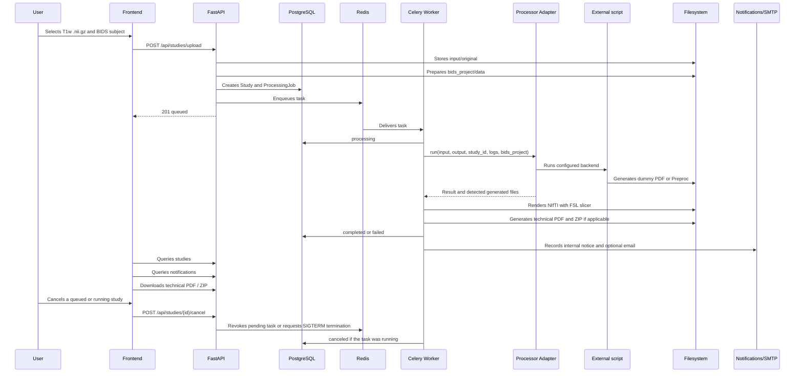
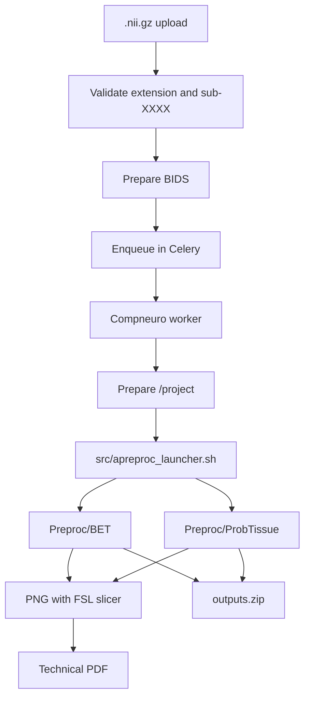

# Processing Pipeline

Processing takes between minutes and an hour, so it is never run inside the HTTP request. The API prepares data and enqueues; the worker runs the configured processor (legacy studies, diagram below) or the pipeline orchestrator (pipeline runs, [Pipeline Orchestrator](#pipeline-orchestrator)).



## Adapter Contract

Input:

- `input_dir`
- `output_dir`
- `study_id`
- `logs_dir`
- configured backend (`PROCESSOR_BACKEND`)

Output:

- success/error.
- exit code.
- PDF path, if the backend generates one or if the platform creates a technical PDF.
- paths of PNGs rendered from NIfTI, if applicable.
- list of generated files.
- ZIP path, if applicable.
- technical log.
- error message.
- duration.

The adapter is the stable boundary between the platform and any external processor. The API, the GUI and the queue must not depend on the specific script or on the Docker image used for processing. If `compneuro-anatproc` is replaced in the future, the change must be concentrated in the adapter, the configuration and, if needed, the worker's Dockerfile.

The adapter chooses the command according to `PROCESSOR_BACKEND`. The `dummy` backend runs `PROCESSOR_COMMAND` with placeholders:

```env
PROCESSOR_COMMAND=python /app/external_processor/dummy_processor.py --input {input_dir} --output {output_dir} --study-id {study_id}
```

The adapter validates the input, creates the output, captures stdout/stderr and stores logs. In `dummy` it checks that at least one PDF is generated. In `compneuro` it runs `COMPNEURO_COMMAND`, by default `bash /app/src/apreproc_launcher.sh`, checks exit code `0` and validates that `Preproc/BET` and `Preproc/ProbTissue` exist. The external command runs in its own process group so that it can be terminated if the user cancels a study that has already started.

For another script or container, the minimum interface expected by the platform is:

- read the data prepared by the platform, normally under `input_dir` or `/project/data` depending on the backend.
- write results to the expected output folder, preferably `output/Preproc` to reuse the current post-processing.
- finish with exit code `0` only if the results are complete.
- write enough stdout/stderr for diagnostics; the worker stores it in `logs/processor.log`.
- not generate `outputs.zip` as a main responsibility: the downloadable ZIP is created by the platform with `processor_adapter/output_packager.py`.

## Executor Interface

`orchestrator/executors/` defines how one step attempt runs on a backend ([ADR-0003](adr/0003-executors.md)). The pipeline orchestrator (next section) uses it for pipeline runs. Every backend implements `Executor` (`orchestrator/executors/base.py`):

| Method | Does |
|---|---|
| `submit(invocation) -> handle` | Stages `/in`, `/ref`, an empty `/out`, starts the attempt, returns at once. |
| `poll(handle) -> JobStatus` | `queued`, `running` or `finished` with an outcome. |
| `cancel(handle) -> bool` | `SIGTERM` to the whole process group, `SIGKILL` 30 s later. |
| `collect(handle) -> StepResult` | Outcome, exit code, output files, the step's `provenance.json` and `error.json` verbatim, log path, usage and the run-provenance `execution` block. |
| `cleanup(handle)` | Removes staging and scratch; keeps logs. |
| `adopt(invocation) -> handle or None` | Optional. Finds the job of exactly this attempt (same step run id, attempt and work directory) when `submit` was interrupted before its handle was recorded. Returns a handle (job running or finished), or `None` if there is no job to adopt (never started, or no longer known to the backend; partial staging is removed). Refuses (`ExecutorRefused`) a work directory recorded for another attempt. The default raises `NotImplementedError`. `subprocess`: the supervisor records its PID and start time in `.executor/supervisor.json` first thing; a directory with a request but no supervisor record is refused and left untouched (state unknown). `docker`: the container named `stepexec-<step run id>-a<attempt>` with matching labels; a container created but never started is removed. |

A `StepInvocation` carries the step identity, optional pinned image (`repo@sha256:…`), staged input files, effective parameters, bundle mounts, granted `Resources`, a timeout (default: granted wall time) and an `Accounting` record (`submitted_by`, `submit_as`, `billing_account`). Only `submit_as: service-account` is implemented; `per-user` and `chargeback` raise `NotImplementedError`. Outcomes: exit 0 `succeeded`, exit 10 `rejected`, other codes `failed`, killed by a signal the platform did not send `terminated` (recorded as `failed` in provenance), and `canceled` / `timed_out` when the platform stopped it (their `/out` is discarded).

Handles are plain JSON, so the orchestrator stores them and can poll, cancel, collect or clean up after a worker restart:

```python
from orchestrator.executors import (
    Accounting, ExecutorHandle, Resources, StepInvocation, SubprocessExecutor,
)

executor = SubprocessExecutor()
handle = executor.submit(StepInvocation(
    step_run_id="…", step_name="lesion-volume", step_version="1.0.0",
    resources=Resources(cpus=2, memory_mb=2048, wall_time_minutes=10),
    accounting=Accounting(submitted_by="user:8d2e6b1a"),
    work_dir=attempt_dir, inputs={"lesion_mask.nii.gz": mask_path},
    params={"threshold": 0.5},
))
stored = handle.to_dict()                # persist with the step run
...
handle = ExecutorHandle.from_dict(stored)
if executor.poll(handle).finished:
    result = executor.collect(handle)    # result.outcome, result.outputs, result.execution
    executor.cleanup(handle)
```

**`subprocess` executor.** Runs a local command (a step installed on the worker host, or a legacy adapter) on POSIX hosts. Contract paths are per-attempt directories under `work_dir` (`in/`, `out/`, `ref/`, `tmp/`, `logs/`); placeholders `{in_dir}`, `{out_dir}`, `{params}`, `{ref_dir}`, `{tmp_dir}` in the command are replaced by them, and without a command the contract command `/usr/local/bin/run --in … --out … --params …` is used. The environment is clean: `PATH` plus the contract variables (`HOME` and `TMPDIR` pointing to the attempt's `tmp/`, `TZ=UTC`, `STEP_CPUS` and the thread variables, `STEP_MEMORY_MB`, `STEP_GPUS`). Each attempt runs under a small supervisor process in its own session that starts the command in a new process group, writes stdout and stderr in order to `logs/step.log`, enforces the timeout, sends `SIGTERM` then `SIGKILL` to the whole group, kills anything left in the group when the command exits, and writes `.executor/status.json` with exit code and usage. `poll` reads that file, so it works from a persisted handle after the worker process restarts; if the host or container restarts, the attempt is lost and reported as `terminated`, and the step's process group is killed only if its leader is gone or is verified by the start time recorded in `child.json` (a reused PID is never signalled). No container isolation is applied (read-only root, network, UID, memory limit): steps that need it run under the docker or slurm executors.

**Legacy adapters.** `processor_adapter/executor_bridge.py` runs the unchanged `DummyProcessorAdapter` and `CompneuroAnatprocAdapter` through this executor: `legacy_invocation(...)` builds the invocation, `run_legacy(executor, invocation)` returns the usual `ProcessorResult`. Legacy commands see the worker's environment minus secrets (`*PASSWORD*`, `*SECRET*`, `*TOKEN*`, `*_KEY`, `DATABASE_URL`, `CELERY_*`, `SMTP_*`, `AUTH_*`, `REDIS_*`), plus the contract variables; the anatproc lock and `/project` symlink behave as before. Timeouts and cancellation are owned by the executor.

## Pipeline Orchestrator

`orchestrator/` runs declarative pipelines (`pipeline.yaml`, [docs/contracts/pipeline.md](contracts/pipeline.md), [ADR-0002](adr/0002-declarative-pipelines-own-orchestrator.md)) over the run tables of [docs/data-model.md](data-model.md) (`pipeline_runs`, `run_slots`, `run_slot_bundles`, `step_runs`, `artifacts`, `reports`). Two kinds of run exist side by side until the legacy aliases are removed (migration 0014):

| Run | Created by | Driven by | Worker task |
|---|---|---|---|
| Pipeline run (`pipeline_id` of a loaded `pipeline.yaml`) | `orchestrator.resolution.create_run` (called by the run API, F0-30) | `orchestrator.engine.Orchestrator` | `worker.tasks.run_pipeline(run_id)` |
| Legacy run (`pipeline_id = 'legacy'`, one `legacy` slot) | `POST /api/studies/upload` (alias over the case model since migration 0012) | the legacy flow above | `worker.tasks.process_study(study_id, job_id)`, with study id = case id and job id = attempt id |

### Modules

| Module | Role |
|---|---|
| `pipeline.py` | Loads and validates `pipeline.yaml` with `contracts/validate.py` (schema, wiring, static availability check); SHA-256 of the exact bytes; dependency order; input-set matching; M1-M5 slot matching of a step manifest. |
| `catalog.py` | `PipelineRegistry`, `StepCatalog` and `PresetRegistry` protocols, with interim directory implementations (`PIPELINES_DIR`, `STEP_MANIFESTS_DIR`) until the registry of F0-33 reads manifests from images. `DirectoryPresetRegistry` loads `presets/<id>.yaml` next to each pipeline and attaches a preset to every loaded version of its pipeline that its range accepts and against which rules P3-P7 hold (P8: duplicate identities and changed files with an unchanged version are refused). |
| `planning.py` | Run plans (pure, no database): `plan(pipeline, input_set, request, enablement) -> Plan \| PlanRefused` over `contracts.validate.plan_closure`, the implementation choice per slot (preset `fixed`, user, preset `default`, deployment default, pipeline default) and every refusal reason. See [Run plans](#run-plans). |
| `resolution.py` | `create_run`: matches the input set, resolves the plan request (none, a preset or free targets) with `planning.plan` against `slot_implementation_settings` and `preset_settings`, writes `plan_mode`, `preset_*` and `targets` on the run and `status`, `reason` (`condition_false`, `upstream_absent`, `no_implementation`, `not_requested`), `plan_role`, the chosen implementation and the manifest's `upstream` block on each slot, freezes effective parameters (defaults, literals, `case.sex`/`case.age_band` bindings, run seed) and resolves bundles. Refusals raise `RunRefused(code, message, slot, reasons)`. |
| `bundle_resolver.py` | The `BundleResolver` protocol (`resolve(requirements, selection) -> {name: ResolvedBundle}`) and `RegistryBundleResolver`, its implementation over the F0-18 registry (`orchestrator/bundles.py`, `reference_bundles` table). |
| `engine.py` | `Orchestrator.tick` / `drive`: the run state machine (below). `ExecutorRegistry` chooses the executor per step (deployment configuration). |
| `collection.py` | Checks a finished attempt against the contract (step-contract.md 4.1, provenance.md 2) and the registry's NIfTI constraints (grid, binary) and decides its final `outcome`. |
| `store.py` | Work directories and access to the F0-17 case store (`app.services.bids`): derivatives, step and run provenance, checksums. |
| `provenance.py` | `RunProvenance` built from the database (data-model.md section 8); used to initialise the run's provenance file and staged as the `run.provenance` source, in the form of the contract the consuming step declares (`run_provenance_for_step`). |
| `actions.py` | `cancel_run` and `resume_run` for the run API (data-model.md 7.3): compare-and-set transitions, idempotent repeats, refusal codes. |
| `events.py` | Audit events (`run_succeeded`, `run_failed`, `run_canceled`, `run_cancel_requested`, `run_resumed`) and notifications through the existing notification service. |
| `config.py` | Builds the worker's orchestrator from environment variables. |

### Run plans

A run is created from a pipeline plus a plan request ([ADR-0018](adr/0018-presets-free-mode-external-tools.md), [design](design/run-plans.md), [presets.md](contracts/presets.md)):

| Request | `plan_mode` | Plan |
|---|---|---|
| Neither a preset nor targets | `full` | Rule R0: every applicable slot, exactly as before plans existed (same statuses, implementations, `chosen_by`, and the same refusal code and slot; property-tested against the previous resolution in `tests/test_planning.py`). `targets` is `{}`. |
| A preset (`PresetRef(id, version=None)`, the highest attached version by default) | `preset` | The preset's targets; `preset_id`, `preset_version` and the SHA-256 of the preset file are recorded. The preset must be enabled in `preset_settings` and accept the run's input set. |
| Free targets (`TargetRequest(required, if_available)`) | `free` | The user's targets. Who may use free mode is the API's decision (`RUN_PLAN_POLICY`, card F1-21). |

The closure (`contracts.validate.plan_closure`) receives, per slot, exactly the implementation the choice rule selects (a preset's `fixed` choice, then the user's, then a preset's `default`, the deployment default, the pipeline default); slots outside the closure are `skipped` with reason `not_requested` and never get attempts; resume and retry act on the frozen `run_slots` only, so disabling a preset never blocks resume. A refusal lists every reason (`RunRefused.reasons`): `preset_and_targets`, `preset_not_found`, `preset_not_enabled`, `preset_input_set_mismatch`, `implementation_fixed_by_preset`, `implementation_not_enabled`, `unknown_target`, `ambiguous_target`, `target_not_applicable`, `target_not_guaranteed`, `conflicting_targets`, `empty_request`, `target_unreachable`, `no_implementation` (with `required_by`), `slot_unsatisfiable` (full plan only) and `step_contract_too_old` (below).

Run provenance: the record carries `plan` and the slots' `plan_role` (and declares contract 1.2) when every applicable slot row has a role, which is the case for every run created since F1-19; runs created earlier without roles are regenerated without a plan as contract 1.1 (data-model.md 8). A step that reads `run.provenance` gets the record of the contract its manifest declares: a step declaring an older version (a step written for 1.0 or 1.1) gets the record relabelled to that version, without `plan`, `plan_role`, `implementation.upstream` and `inputs[].origin`, because its image validates it against the schemas of its build. A preset or free plan has no truthful 1.0 or 1.1 form (slots outside the plan and preset choices cannot be written, and without its plan the record would read as a full run whose non-optional slots did not run), so every preset or free plan that selects a step reading `run.provenance` whose manifest declares a contract older than 1.2 is refused with `step_contract_too_old`. Full plans are never affected. The `stroke-lnm` report is not affected since `research-report` 0.3.0 (card F1-25), which declares contract 1.2 and reads the record unchanged: `stroke-lnm` 0.3.0 pins it, so every preset or free plan that includes the report runs. The refusal stays for any implementation of such a slot whose manifest declares an older contract.

### Driving a run

```mermaid
sequenceDiagram
  participant A as Run API (F0-30)
  participant D as PostgreSQL
  participant W as run_pipeline task
  participant E as Executor
  participant S as Case store
  A->>D: create_run: run queued, slots, inputs, bundles
  A->>W: enqueue run_pipeline(run_id)
  loop every ORCHESTRATOR_POLL_SECONDS
    W->>D: claim lease, read run, slots, attempts
    W->>D: queued -> running (resume: user_resume attempts)
    W->>D: new attempt (queued) for each slot whose inputs are available
    W->>E: submit (inputs, params, verified bundles); store handle
    W->>E: poll; on cancel request: cancel
    W->>E: collect; check contract
    W->>S: outputs to derivatives, provenance merged
    W->>D: attempt final, artefacts, auto retry if allowed
    W->>D: run succeeded / failed / canceled
  end
  W->>D: notifications (succeeded, failed)
```

Rules:

- Every tick re-derives the next action from the rows; nothing is kept in memory, so a restarted worker continues any run. One task drives a run at a time: `pipeline_runs.orchestrator_task_id` is the lease owner and `updated_at` its heartbeat; a task can take over only after `ORCHESTRATOR_LEASE_SECONDS` without heartbeat. The heartbeat is renewed at the start of a tick and around every long operation (before and after `submit`, after `collect` and storing results); a task that finds its lease gone stops the tick at once, and a job it has just submitted but could not record is canceled and cleaned up (best effort). `worker.tasks.recover_pipeline_runs` (Celery beat, every 5 minutes, effective only when a beat process runs) re-enqueues runs whose heartbeat stopped.
- Transitions are compare-and-set updates following the state machines of data-model.md section 7.
- A slot gets an attempt as soon as every port it stages is available (the first available source of each `from` list; a source of a selected slot that has not succeeded yet is waited for). Independent slots run concurrently.
- Inputs are staged as `<port><ext>`; `run.provenance` is the current run provenance file. Bundles recorded at creation are re-resolved before every attempt with their exact versions pinned; a missing, withdrawn or tampered bundle fails the attempt with `failure_code = 'bundle_unavailable'` before anything starts.
- Outcomes come from the executor (exit 0 / 10 / other, `canceled`, `timed_out`); the orchestrator only turns a success or a rejection into `contract_violation` when the files do not satisfy the contract (missing or undeclared outputs, symbolic links in `/out`, invalid or mismatching `provenance.json`, hash or bundle mismatch, rejection without a valid declared `error.json`).
- Output format checks (artefact-types.md section 3), after the hash checks, only for NIfTI types whose registry entry states constraints: the file must be a readable gzip NIfTI-1/2 image (`contract_violation_nifti_unreadable`); `nifti.grid` (`lesion_mask_mni` and `fdisconnection_map` on the 2 mm working grid `MNI152NLin6Asym-res2`, `ct_mni` on the 1 mm grid) needs the grid's shape and an affine within 1e-4 mm, read from the header only (`contract_violation_nifti_grid`); `nifti.binary` (the lesion mask types) needs every value, after the header's scaling, to be 0 or 1, checked in one streaming pass over the voxel data in 8 MiB chunks (`contract_violation_nifti_binary`). Other formats (JSON schemas, TSV columns, PDF/PNG signatures) are left to the step SDK.
- `failed` and `timed_out` attempts are retried automatically (`trigger = 'auto_retry'`) up to `ORCHESTRATOR_MAX_ATTEMPTS` attempts per start or resume; `rejected` and `contract_violation` never are. Of the submission failures, only the transient ones (`executor_error`, `lost_submission`) are retried. Any other final failure stops the run: no new attempt starts, running independent attempts finish, then the run is `failed` (`failure_code` `step_failed` or `input_rejected`, `failed_step_run_id`).
- Lost submissions: a driver that stopped between `submit` and recording the handle leaves the attempt `queued` with a used work directory. The next driver calls `executor.adopt` for that attempt. If the job exists it is adopted (`executor_state.adopted`) and polled, collected and checked like any other, so its real outcome counts; the inputs are re-resolved (artefacts are immutable, and the staged `run_provenance.json` of the attempt is reused) to record what the job received. If no job was started, or the executor cannot adopt, the attempt fails with `lost_submission` and is retried. A driver that loses its lease right after `submit` cancels the job it could not record; if the next driver adopts that job, its `canceled` outcome without a cancel request on the run is recorded as `lost_submission` (retried), not as a user cancellation. Every path that finishes a `queued` attempt without a handle (user cancel, pipeline gone, manifest gone) first adopts a job a lost submission may have left, so it is stopped and cleaned up rather than left running unseen. A job that is kept only to be stopped is recorded with `executor_state.abandon` (`{outcome, code, message}`): it is canceled, waited for and cleaned up like any attempt, and the attempt then gets exactly that outcome whatever the job did (for example `bundle_unavailable` when an adopted job's bundles can no longer be resolved). A job that could not be recorded at all (the attempt was canceled by the API while it was being submitted) is canceled and given `discard_wait_seconds` (10 s) to stop; if it is still stopping, its handle is kept in `executor_state.pending_cleanup` of the final attempt and later ticks of the run clean it up. `subprocess.adopt` refuses a work directory with a request but no supervisor record (a supervisor of an earlier release may still run there), leaving the files in place; the attempt is retried in a new directory.
- Pipeline no longer loaded (same id, version and SHA-256): without live attempts the run fails at once with `failure_code = 'pipeline_unavailable'`. With live attempts the condition may be transient (a worker with an outdated `PIPELINES_DIR`), so the task leaves the run (`LOST`) for `ORCHESTRATOR_PIPELINE_UNAVAILABLE_GRACE_SECONDS`, counted from the first tick that saw it (`executor_state.pipeline_unavailable_since`, cleared when a tick finds the pipeline again); the recovery task re-enqueues it in that time. After the grace the live attempts are canceled through their executor and recorded `failed` with `pipeline_unavailable` (their outputs cannot be checked without the slot definition, so they are discarded), and the run fails with the same code. The decision is recorded on each attempt (`executor_state.abandon`, code `pipeline_unavailable`) before its job is canceled, so a worker that has the pipeline again and reaches the attempt while the job is still stopping records it `failed` with `pipeline_unavailable` too (never `canceled`, never retried), and the run fails with that code. The workers that saw the pipeline missing are listed in `executor_state.pipeline_unavailable_seen_by` and in the log. **Risk:** the grace is measured in time, not in independent observations, so one misconfigured worker that keeps receiving the run for the whole grace can end a run that healthy workers could have finished (a healthy worker that takes the run in between resets the count). Requiring several distinct workers was not chosen because single-worker deployments would then never end such a run; keep `PIPELINES_DIR` identical on all workers, deploy pipeline changes before or together with the worker images, and raise the grace if rolling deployments are slow.
- A step name and version may be allowed in one slot only: the case store keys derivatives by step (`derivatives/<step>-<version>/`), so two slots running the same step version would overwrite each other's files. `load_pipeline` refuses such a pipeline (and `create_run` refuses it with `step_shared_by_slots` if a definition was built without the loader). Several implementations of one step inside one slot (configured variants) are allowed.
- The lease is claimed only on active (`queued`, `running`) non-legacy runs; legacy and final runs are never stamped with an orchestrator task id.
- Cancellation: the API sets `pipeline_runs.cancel_requested_at`; the orchestrator cancels queued attempts, calls `executor.cancel` on running ones (and records `step_runs.cancel_requested_at`; a failing `executor.cancel` is retried on later ticks until it is accepted once, `executor_state.cancel_sent`), waits until the executor reports them finished, then sets the run `canceled`. The Celery task is not revoked with a signal.
- Resume (API, `failed`/`canceled` -> `queued`): succeeded slots are kept; every slot whose latest attempt failed or was canceled gets a `user_resume` attempt; seed, choices, parameters and bundles stay those of the run.
- Notifications: `run_succeeded` to the case owner; `run_failed` to the owner and active admins; none for cancellation.

Files of a run (case store of F0-17): `<case>/runs/<run>/derivatives/<step>-<version>/` (outputs with BIDS names and the step's `provenance.json`), `<case>/runs/<run>/provenance.json` (`pipeline_runs.provenance_path`) and `checksums.json`. Executor work directories live outside the run tree in `<case>/work/<run>/<slot>/attempt-<n>/`; after collection only `logs/step.log` (`step_runs.log_path`) is kept.

### Configuration

| Variable | Default | Meaning |
|---|---|---|
| `PIPELINES_DIR` | `/app/pipelines` | Tree scanned for `pipeline.yaml`. |
| `STEP_MANIFESTS_DIR` | `/app/steps` | Tree scanned for `step.yaml` (interim). |
| `BUNDLE_ROOT` | `/app/data/bundles` | Reference bundle root. |
| `ORCHESTRATOR_EXECUTOR` | `docker` | Default executor (`docker`, `subprocess`). |
| `ORCHESTRATOR_STEP_EXECUTORS` | empty | Per-step overrides, `step-name=executor,...`. |
| `ORCHESTRATOR_POLL_SECONDS` | `5` | Poll interval. |
| `ORCHESTRATOR_MAX_ATTEMPTS` | `2` | Attempts per slot per start or resume. |
| `ORCHESTRATOR_LEASE_SECONDS` | `600` | Heartbeat age after which another task may take a run over. |
| `ORCHESTRATOR_PIPELINE_UNAVAILABLE_GRACE_SECONDS` | `3600` | How long live attempts of a run whose pipeline is not loaded are left alone before they are stopped and the run fails with `pipeline_unavailable`. |

The docker executor's allow-list is the set of images pinned in the loaded pipelines.

### Worker images

| Image | Contents | Use |
|---|---|---|
| `worker/Dockerfile` | Slim Python image: platform code only, no processor | Pipeline runs with steps in their own containers (docker executor) or on the HPC. Cannot process legacy studies. |
| `backend/Dockerfile` | Platform code plus the dummy development processor | Default development worker (legacy dummy backend and pipelines). |
| `worker/Dockerfile.compneuro` | `compneuro-anatproc` base image; platform dependencies in `/opt/platform-venv` | Legacy anatproc path (unchanged), plus pipeline runs. |

Select with `WORKER_DOCKERFILE`.

### Legacy runs

Since migration 0012 (legacy cut-over, data-model.md 10.1 stage 2) the legacy upload -> process -> PDF path keeps its behaviour but stores everything in the case model; `studies` and `processing_jobs` are frozen and nothing writes them.

- `POST /api/studies/upload` creates a case (profile `legacy`, hidden from `/api/v1` like the back-filled studies), its `legacy_upload` input file, a `legacy` run (run id = case id) with one `legacy` slot, and a queued first attempt; it enqueues `process_study(case id, attempt id)` and stores the Celery task id on the attempt (`orchestrator_task_id`). When the task starts the attempt it writes its own task id there, so that a cancel revokes the task that actually runs.
- `process_study` moves the run and the attempt from `queued` to `running` with a compare-and-set, runs the adapter in the worker process (dummy or compneuro-anatproc), renders PNGs, writes the technical PDF and ZIP and records them as `legacy` artefacts of the attempt (ids derived as in the back-fill, with size and SHA-256) plus a `legacy-technical` report; the upload's file name and the processor fields live in `cases.legacy_attributes` for this release.
- Cancellation is unchanged: the cancel alias sets `cancel_requested_at` on the run and on the running attempt and revokes the Celery task with `SIGTERM`; the worker's signal handler raises `ProcessorCanceled` and the attempt ends `canceled` only when the flag is set (otherwise `failed`). A queued run is canceled at once and its task revoked.
- Retry is a resume of the same run: a new attempt of the `legacy` slot with trigger `user_resume`.

- Recovery (`worker/legacy_recovery.py`): a queued attempt whose message was lost (for example queued before a deploy) is re-enqueued once, and a running attempt whose worker died is failed with `legacy_worker_lost`. It runs once after every legacy worker start, every 10 minutes where celery beat runs, and on demand with `python -m app.cli.legacy_recover [--execute]`.

Legacy runs are never driven by the orchestrator engine and the v1 run actions refuse them. The legacy endpoints serve only legacy-profile cases; cases created through `/api/v1` answer 404 there (data-model.md section 11, item 27).

### The `stroke-lnm` pipeline (v0)

`pipelines/stroke-lnm/` holds the first stroke pipeline, written with slots ([D15](adr/0015-selectable-implementations-per-slot.md), contract [pipeline.md](contracts/pipeline.md)); `PIPELINES_DIR` points at the `pipelines/` tree.

**Version 0.3.0** (card F1-25, a minor bump: implementation replaced by a new step version). The `report` slot pins `research-report` 0.3.0, which declares contract 1.2 (its image copies the 1.2 schemas) and reads run records of that contract unchanged, so presets and custom plans that include the report finish instead of being refused with `step_contract_too_old`. The report states the plan (full analysis, preset id and version with its file digest, or custom targets) and the role of every slot in it, says "not requested in this plan" for analyses outside the plan (instead of "input not provided"), lists the external tools of the run (the `upstream` block of the slot record: name, version, licence, citation, homepage; the run record carries no validation level of an implementation, so none is stated or inferred) and shows the origin of supplied inputs as "declared by the user". `report.json` is version 1.1 of its schema: the keys `plan`, `external_tools` and `declared_origins` (and two notes) exist only when the run record has the information, so the report of a full-plan run with a 1.0 or 1.1 record has the content of version 1.0 apart from the version fields. The four presets are `1.1.0` (minor bump, pipeline range widened to `>=0.2.0, <0.4.0`).

**Version 0.4.0** (card F1-23, a minor bump: implementation replaced by a new step version). The `functional-disconnection` slot pins `flnm-fast` 1.1.0, which declares contract 1.2 and the `upstream` block of the engine image it wraps (name, version, homepage, the image by digest, licence MIT); the engine, its digest and the step's behaviour are those of 1.0.0, including the known engine defect (lowest overlapped parcel dropped; the wrapper warns and refuses single-parcel lesions). The registry entry is the first with `origin: external`: it carries its licence review and a `reference-tested` validation status (see below), so runs that use it carry the upstream block in their slot record. The minimum is also applied when a plan is resolved: an implementation below the deployment's minimum counts as not enabled, so a user choice of one is refused with `implementation_not_validated` and the slot listings flag it. The four presets are `1.2.0` (minor bump, pipeline range widened to `>=0.2.0, <0.5.0`).

**Version 0.5.0** (card FLNM-02, a minor bump: implementation replaced by a new step version). The `functional-disconnection` slot pins `flnm-fast` 2.0.0, which wraps the engine image 2.1.0 (digest in `steps/flnm-fast/Dockerfile`, licence MIT) with the same ports, parameters and bundle layout as 1.x. Engine 2.1.0 weights every lesion-overlapped parcel; engine 1.0 left the lowest-numbered one out (and wrote an all-NaN map for a lesion within one parcel), so the step's warning `lowest_overlapped_parcel_omitted` and its rejection `lesion_single_parcel` no longer exist and the z-maps of 2.0.0 differ from those of 1.x. The four presets are `1.3.0`, written for `>=0.2.0, <0.6.0`.

**Version 0.6.0** (card FLNM-03, a minor bump: implementations added and the step replaced by a new version). The `functional-disconnection` slot pins `flnm-fast` 3.0.0, which has no parameters: the normative choice is the cohort only (no age or sex matching; age- or sex-matched normatives may come in a future version), so nothing is bound from the case and the parcellation is read from the bundle. The slot offers the same step image three times, each entry pinning one `normative-fc` bundle through `bundles` ([pipeline.md](contracts/pipeline.md#4-slots-and-implementations)): `flnm-fast-hcp-aging` (bundle `normative-fc-hcp-aging` 1.0.0, the default), `flnm-fast-hcp-ya` (`normative-fc-hcp-ya` 1.0.0, HCP Young Adult) and `flnm-fast-synthetic` (`synthetic-normative-fc` 1.0.0, CI only). The presets are `1.4.0`, written for `>=0.2.0, <0.7.0`.

**Version 0.7.0** (card MVP-01, a minor bump: implementations added and every digest replaced by the published one). The step images are the published ones (Docker Hub release runs `45356289386` and `45359587628`, merged with `registry.py pin`; `published: true`). The `tract-disconnection` and `cognet-profile` slots each gain an entry of the same step image that pins the lab's reference bundle (`lnm-tracts-hcp1065`: `hcp1065-tracts` 1.0.0; `cognet-stroke-concept-maps`: `cognet-concept-maps` 1.0.0), because a pin is part of the implementation entry and the contract has no per-profile pin; the unpinned entries stay for CI. Wiring, ports and parameters are unchanged. The `deployment` profile is now the lab's minimum pipeline (normalisation is not mounted in it) and the presets are `1.5.0`, written for `>=0.2.0, <0.8.0`; `mni-mask-analysis` now also requires `cognet-profile`, see below. Display-only additions that are not part of the contract: the registry's per-entry `title` and its `in_development` list (below).

**Version 0.2.0** (card F1-26, a minor bump by [versioning.md](contracts/versioning.md#4-pipelines): implementation replaced by a new step version). The `tract-disconnection` slot is now optional and the `report` slot's `tract_disconnection` port is `optional: true`, with `research-report` 0.2.0. A run whose tract-disconnection slot has no enabled implementation therefore no longer is refused: the slot is `unavailable` (`no_implementation`) and the report is a QC-only report whose tract section says that tract disconnection is not part of the analysis. Runs with the slot enabled (the default in both profiles) are unchanged. The run plans of [design/run-plans.md](design/run-plans.md) use this for the `lesion-qc-report` preset.

| Slot | Implementations | Notes |
|---|---|---|
| `lesion-intake` | `lesion-qc` (default) | `steps/lesion-qc`. |
| `normalisation` | `ct-lesion-to-mni152` (default) | Runs only for the CT input set. Step in the `CTLesion2MNI152` repository (`step/`), pinned by commit: skull-based affine (FSL `flirt`) then B-spline (elastix) registration of the CT to MNI152, carrying the lesion mask; writes `lesion_mask_mni` on the 2 mm working grid, `ct_mni` and a `qc_figure`. Binds `age_band` from the case (the matching ventricle template is subtracted from the lesion; a case without an age band skips that). Its templates ship inside the image, so no bundle is needed. The image contains FSL (non-commercial licence, see the step manifest). A deployment that leaves the slot unmounted refuses CT-mode runs (`no_implementation`). Known limitation, accepted for now: the B-spline stage shrinks the lesion, and the step's own regression floor on its reference case is Dice 0.40 (measured 0.465), a regression guard and not an accuracy claim. |
| `functional-disconnection` | `flnm-fast-hcp-aging` (default), `flnm-fast-hcp-ya`, `flnm-fast-synthetic` (ci only), `fdisconnection-stub` | Optional slot. External implementation (`origin: external`, step 3.0.0 since pipeline 0.6.0). `flnm-fast` (`steps/flnm-fast`) wraps the public engine image `compneurobilbaolab/flnm-fast` (no source repository; the digest is pinned in its `Dockerfile`) and writes a lesion network z-map (`fdisconnection_map`). The three `flnm-fast-*` entries are the same image and differ only in the pinned `normative-fc` bundle, which is the normative cohort: HCP Aging (default) or HCP Young Adult; every participant of the cohort is used, and the case's sex and age are not. Each bundle must be installed locally ([reference-data.md](reference-data.md#the-normative-fc-bundle)); a run whose bundle is not registered is refused (`bundle_unavailable`). The `deployment` profile enables the two cohort entries. The stub (`steps/stubs/fdisconnection-stub`, `stub: true`) writes a synthetic map and is enabled only in the `ci` profile, where it stays the default (the real-stack UI specs assert it) next to `flnm-fast-synthetic`, which keeps the real step under test on a small synthetic bundle. |
| `tract-disconnection` | `lnm-tracts` (default; CI), `lnm-tracts-hcp1065` (the `deployment` profile's, since 0.7.0) | Optional slot (since 0.2.0). The second entry is the same image pinned to the `hcp1065-tracts` 1.0.0 bundle. Step in the `lnm` repository (`step/`), pinned by commit. Needs a `tract-atlas` bundle: `labels.txt` and one `<tract>.tck` per tract. |
| `cognet-profile` | `cognet-stroke` (default; CI), `cognet-stroke-concept-maps` (the `deployment` profile's, since 0.7.0) | Optional slot. The second entry is the same image pinned to the `cognet-concept-maps` 1.0.0 bundle. Step in the `COGNET-STROKE` repository (`step/`), pinned by commit. Needs a `concept-maps` bundle and a functional disconnection map, so it is skipped (`upstream_absent`) where the functional slot is unmounted. |
| `report` | `research-report` (default), `research-report-es` | `steps/report` (0.2.0 accepts a run without the tract table; 0.3.0 declares contract 1.2, see above); the second entry is the same image with `language: es`. |

**Presets (card F1-20).** `pipelines/stroke-lnm/presets/` holds the reviewed presets ([presets.md](contracts/presets.md), [ADR-0018](adr/0018-presets-free-mode-external-tools.md)), all `1.5.0` (since MVP-01) and written for `>=0.2.0, <0.8.0`:

| Preset | Input sets | Required | If available | Plan (every slot mounted) |
|---|---|---|---|---|
| `full` | both | `tract-disconnection`, `report` | `functional-disconnection`, `cognet-profile` | The same slots, statuses, implementations and `chosen_by` as the full plan (rule R0) for every input set; only `plan_role` differs. It names `tract-disconnection` because the report no longer needs it. Unlike the full plan it refuses the run when no tract implementation is enabled. |
| `mni-mask-analysis` | `mni-mask` | `tract-disconnection`, `functional-disconnection`, `cognet-profile`, `report` | none | The lab's minimum pipeline: `lesion-intake` (upstream), functional disconnection with COGNET, tract disconnection and the report. The report is part of the preset (owner decision 4). Every analysis is required (since 1.5.0, COGNET included): a deployment without one refuses the run. |
| `ct-normalisation` | `ct-and-native-mask` | `lesion-intake`, `normalisation` | none | Intake and normalisation only; the other four slots are `not_requested`. Refused with `no_implementation` (slot `normalisation`) in a deployment that leaves normalisation unmounted, which the preset listing shows as unavailable. |
| `lesion-qc-report` | both | `lesion-intake`, `report` | none | Intake and report (plus `normalisation` in CT mode, which the report needs for `lesion_mask_mni`); no analysis slot. |

`registry.yaml` enables presets per profile (`profiles.<p>.presets: {enabled: [...], default: <id>}`; `ci` enables all four and defaults to `full`; `deployment` enables only `mni-mask-analysis`, its default, because the other three also accept the CT input set and need the normalisation slot, which the lab does not mount yet); `enabled_preset_settings(registry, profile, preset_ids)` gives the rows for `preset_settings` (`python -m app.cli.seed_implementations` writes them with the implementation rows, one per file in `presets/`; administrators change them afterwards with `PUT /api/v1/admin/presets/...`, card F1-21). Since `research-report` 0.3.0 declares contract 1.2 (card F1-25), every preset runs, including those that plan the report (`full`, `mni-mask-analysis`, `lesion-qc-report`; see [Run plans](#run-plans)).

Files:

- `pipeline.yaml`: the pipeline definition. Image digests are those of the published step images (`registry.py pin`); a step version that is not released yet would carry the placeholder (64 zeros).
- `registry.yaml`: per slot, the implementations (step, kind `real`, `stub` or `planned`, image, source and pinned commit) and the profiles. `deployment` enables only real implementations and a slot absent from `enabled` is left unmounted (since 0.7.0 that is `normalisation`: the lab's minimum pipeline starts from a lesion mask in MNI space); `ci` also enables the stub, which is the `ci` default of the functional slot, and runs the real normalisation step. `registry.py check` fails when the two files disagree, when a stub or a planned entry is enabled in `deployment`, or when an external source is not pinned to a commit.
- Registry fields of card F1-23 (all optional; `registry.py check` enforces them): `origin: internal|external` (an external entry needs `licence_review {code, weights, image_redistribution, notes, reviewed}`, a `validation` status, a step manifest of contract 1.2 with the `upstream` block, and a Dockerfile whose base images are pinned by digest, the upstream one equal to `upstream.image`), `validation {status: unvalidated|reference-tested|validated, record, notes}`, and `build: published|local` (`local` goes with `image_redistribution: forbidden`: the image is built by each deployment and never published). A `validated` status needs a `record` file in the repository. Every real entry needs an explicit `validation.status` (all current steps are `reference-tested`, none `validated`); stubs and planned entries are `unvalidated`. `licence_review.status` is `reviewed` (needs `reviewed` and `reviewed_by`) or `pending`; `validated` needs `validation.record` and `validation.reviewed_by`; an external step's `upstream.citation` is required. `build: local` entries are skipped by `registry.py build`, `fetch` and `sources`, and their `image` may not be on a public registry. No profile but `ci` enables anything below `reference-tested`. At run time `MIN_IMPLEMENTATION_VALIDATION` (docs/configuration.md) decides: the admin endpoint and `seed_implementations` refuse to enable an implementation below the deployment's minimum with `implementation_not_validated`. The checklist for a new external tool is in [steps/README.md](../steps/README.md#wrapping-an-external-tool).
- Registry display fields (card MVP-01; `registry.py check` validates them, none is part of the step contract): `title` on an implementation entry, the name the UI and the API show instead of the step manifest's title, which is the same for every entry of one step image (`flnm-fast · HCP Aging`, `flnm-fast · HCP Young Adult`; the pipeline schema has no title on implementation entries, so it lives here, and the frontend catalogue translates it by implementation id), and the top-level `in_development` list of stages the UI shows greyed, labelled "In development" and never selectable: an entry with `slot` names an existing slot and is listed only while the deployment has no enabled implementation for it (normalisation in the lab), an entry without `slot` is a stage that has no step yet (lesion segmentation, lesion bank, voxel-wise structural LNM, with `title` and `description`). They are not implementations, so no profile, seed or admin call can enable them. `GET /api/v1/pipelines/{id}/versions/{version}/in-development` serves the list (also `in_development` of the pipeline detail).
- `presets/<id>.yaml`: the presets above, one file each (adding or changing one never changes the pipeline's SHA-256).
- `registry.py`: `check` (also validates every preset against the pipeline by contract rules P1 and P3-P7, requires the id to equal the file name, and checks that the profiles enable only existing presets with a default among them), `materialize` (writes a pipeline and registry with real digests, from a JSON map `step@version -> image@sha256:...`, and copies the preset files unchanged, since runs record their SHA-256), `fetch` and `build` (CI). `enabled_settings(registry, profile)` gives the rows for `slot_implementation_settings` and `enabled_preset_settings` those for `preset_settings`.
- `ci/ct_reference.sh`: CI only. Builds the CT reference case with the step's own scripts at the pinned commit: it downloads the public High Resolution CT Template (2020, derived from the public CQ500 scans, CC BY-NC-SA 4.0, de-identified research data) at a pinned commit with SHA-256 checks (the step's fetch script), warps it to MNI152, inserts a lesion defined in MNI space and applies a known random affine and smooth deformation (fixed seed; the transform code is the fixture generator of this repository). The data is used for non-commercial test purposes only, is cached between CI runs, and is never committed, put in an image or bundled. Caveat: the registration target of the step derives from the same template, so this checks recovery of a known transform on real CT anatomy, not generalisation to other scanners or patients.
- `tests/test_presets.py`: offline tests of the presets: validity through `registry.py check` and `DirectoryPresetRegistry`, the plan of `full` equal to the full plan for both input sets and both profiles, the plan statuses and roles of each preset against the design table, the unmounted-slot refusals, and that no preset is refused with `step_contract_too_old` now that the report declares contract 1.2.
- `tests/test_lab_profile.py`: offline tests of the lab's minimum pipeline (MVP-01): what the `deployment` profile enables, the minimum preset and its plan, the CT refusal while normalisation is unmounted, the bundle pins, the published digests, the registry titles and the `in_development` list with their checks.
- `tests/test_e2e_stroke_lnm.py`: the end-to-end test.

The `e2e-stroke-lnm` workflow (`.github/workflows/e2e-stroke-lnm.yml`) fetches the external steps at the pinned commits, builds every step, pushes the images to a throwaway `registry:2` to obtain digests, materialises the pipeline with them, extracts each `step.yaml` from its image into `STEP_MANIFESTS_DIR`, registers the bundles (`toy-normative-connectome` for the stub, `toy-tract-atlas`, the synthetic `normative-fc` bundle written by the flnm-fast step's own reference generator, and the synthetic concept maps generated by the pinned COGNET-STROKE step's own reference generator) through `orchestrator/bundles.py`, and drives runs with the merged orchestrator and the docker executor through the socket proxy on the MNI-mask fixture and, for CT mode, on the reference case above. It checks that a default run, a run with a non-default implementation in one slot (`report` -> `research-report-es`) and a run with the real functional disconnection step requested in its slot (`flnm-fast-synthetic`: the same step pinned to the synthetic normative bundle) succeed, that the tract table equals the reference computed from the fixture atlas, that the z-map of the real step equals the reference computed independently on the synthetic normative bundle, that a CT-mode run through the real normalisation step succeeds (registered lesion Dice against the known ground truth at least 0.40, `ct_mni` and QC figure written, the tract table computed from the registered lesion equals the reference on the fixture atlas, the case age band reaches the step), that CT mode is refused when a deployment leaves normalisation unmounted, that a run whose tract-disconnection slot has no enabled implementation succeeds with a QC-only report (tract section absent, slot `unavailable`), and that the run provenance record (`build_run_provenance`, validated with `contracts/validate.py`) lists every slot, the image digest of every step and every bundle with its content digest. For presets it runs `ct-normalisation` on the CT reference case to a finished run (the plan record names the preset, version and file SHA-256; intake and normalisation succeed; the other four slots are `not_requested` and have no attempts; the registered lesion meets the same Dice floor), checks that this preset is refused when normalisation is unmounted, and runs `mni-mask-analysis`, `full` (both input sets) and `lesion-qc-report` (both input sets) to finished runs: the record is validated, the report step reads it as contract 1.2, and `report.json` states the preset and its version, with all sections available for `mni-mask-analysis` and `full`, and the three analysis sections `not_requested` for `lesion-qc-report`.

## BIDS Per Study

```text
data/studies/{study_id}/
  input/original/{original_file}.nii.gz
  bids_project/data/sub-XXXX/anat/sub-XXXX_T1w.nii.gz
  bids_project/data/participants.tsv
  bids_project/data/dataset_description.json
  runtime_project/data -> ../bids_project/data
  runtime_project/Preproc -> ../output/Preproc
  output/Preproc/BET
  output/Preproc/ProbTissue
  output/rendered_png
  output/reports/technical_report.pdf
  output/outputs.zip
  logs/processor.log
  logs/rendering.log
```

`compneuro-anatproc` uses hardcoded paths under `/project`. The platform creates an isolated `runtime_project` per study and the compneuro worker points `/project` to that folder through a managed symlink. This avoids Docker-in-Docker and avoids modifying the external scripts.

## Compneuro Flow



`src/apreproc_launcher.sh` is the external script used today. In the compneuro worker image it is located at `/app/src/apreproc_launcher.sh`, copied during the build from the `compneuro-anatproc` repository. It is not part of the platform's own code.

## Technical Post-Processing

After a successful `compneuro` run, the worker looks for `.nii` and `.nii.gz` files inside `output/Preproc`, with a limit configurable through `NIFTI_RENDER_MAX_FILES`. Each file is rendered with FSL `slicer` using the conceptual pattern `slicer input.nii.gz -a output.png` and saved in `output/rendered_png/`.

The PDF is saved by default in `output/reports/technical_report.pdf` and includes the study metadata, BIDS subject, processing flow used, list of results, the name of each NIfTI and the rendered PNG image. If there is no NIfTI or a conversion fails, the PDF is still generated with technical warnings. These warnings are not internal traces and may be shown in the GUI.

The document is a technical report of generated artefacts. It does not interpret images and is not a validated medical report. By default, each study is marked `technical_only`; administration can change the mark to `reviewed` or `validated` only as internal review traceability.

## Closing Notifications

When the worker confirms `completed` or `failed`, it first stores the final state of the study/job and then creates notifications. This order prevents an SMTP error from affecting the main result of the processing run.

Current rules:

- `completed`: internal notification to the owner and an email if their preference allows it.
- `failed`: internal notification to the owner and to active admins; email if their preferences allow it.
- Emails do not attach PDF, ZIP, logs or heavy data; only text and a link to the platform configured with `APP_PUBLIC_BASE_URL`.
- In Docker Compose, the default SMTP server is Mailpit (`mailpit:1025`) with a `noreply@<sender-domain>` sender; the local inbox is at `http://localhost:8025`.
- If SMTP fails, `email_status=failed` and `email_error` are recorded on the notification, but the study keeps its real state.
