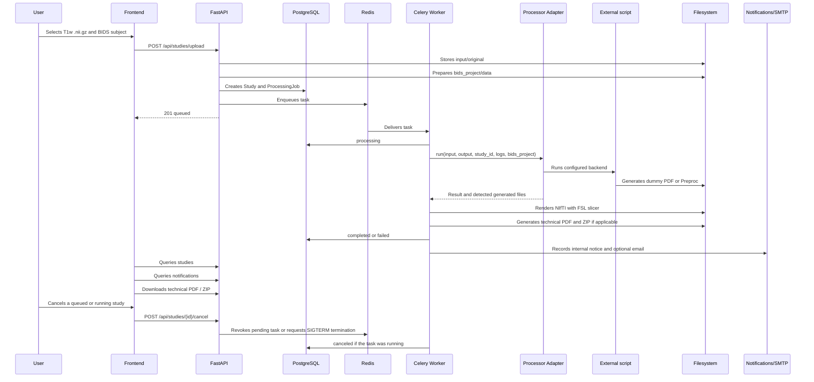
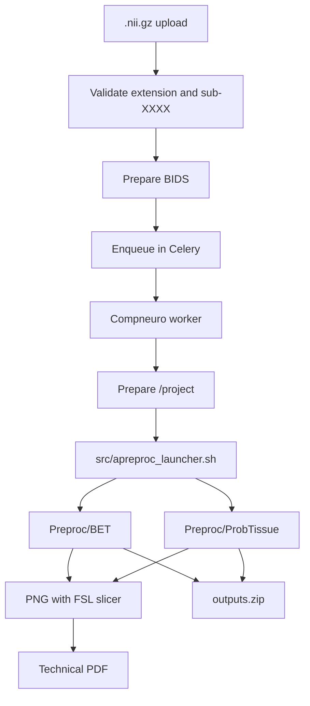

# Processing Pipeline

Processing takes between minutes and an hour, so it is never run inside the HTTP request. The API prepares data and enqueues; the worker runs the configured processor (legacy studies, diagram below) or the pipeline orchestrator (pipeline runs, [Pipeline Orchestrator](#pipeline-orchestrator)).



## Adapter Contract

Input:

- `input_dir`
- `output_dir`
- `study_id`
- `logs_dir`
- configured backend (`PROCESSOR_BACKEND`)

Output:

- success/error.
- exit code.
- PDF path, if the backend generates one or if the platform creates a technical PDF.
- paths of PNGs rendered from NIfTI, if applicable.
- list of generated files.
- ZIP path, if applicable.
- technical log.
- error message.
- duration.

The adapter is the stable boundary between the platform and any external processor. The API, the GUI and the queue must not depend on the specific script or on the Docker image used for processing. If `compneuro-anatproc` is replaced in the future, the change must be concentrated in the adapter, the configuration and, if needed, the worker's Dockerfile.

The adapter chooses the command according to `PROCESSOR_BACKEND`. The `dummy` backend runs `PROCESSOR_COMMAND` with placeholders:

```env
PROCESSOR_COMMAND=python /app/external_processor/dummy_processor.py --input {input_dir} --output {output_dir} --study-id {study_id}
```

The adapter validates the input, creates the output, captures stdout/stderr and stores logs. In `dummy` it checks that at least one PDF is generated. In `compneuro` it runs `COMPNEURO_COMMAND`, by default `bash /app/src/apreproc_launcher.sh`, checks exit code `0` and validates that `Preproc/BET` and `Preproc/ProbTissue` exist. The external command runs in its own process group so that it can be terminated if the user cancels a study that has already started.

For another script or container, the minimum interface expected by the platform is:

- read the data prepared by the platform, normally under `input_dir` or `/project/data` depending on the backend.
- write results to the expected output folder, preferably `output/Preproc` to reuse the current post-processing.
- finish with exit code `0` only if the results are complete.
- write enough stdout/stderr for diagnostics; the worker stores it in `logs/processor.log`.
- not generate `outputs.zip` as a main responsibility: the downloadable ZIP is created by the platform with `processor_adapter/output_packager.py`.

## Executor Interface

`orchestrator/executors/` defines how one step attempt runs on a backend ([ADR-0003](adr/0003-executors.md)). The pipeline orchestrator (next section) uses it for pipeline runs. Every backend implements `Executor` (`orchestrator/executors/base.py`):

| Method | Does |
|---|---|
| `submit(invocation) -> handle` | Stages `/in`, `/ref`, an empty `/out`, starts the attempt, returns at once. |
| `poll(handle) -> JobStatus` | `queued`, `running` or `finished` with an outcome. |
| `cancel(handle) -> bool` | `SIGTERM` to the whole process group, `SIGKILL` 30 s later. |
| `collect(handle) -> StepResult` | Outcome, exit code, output files, the step's `provenance.json` and `error.json` verbatim, log path, usage and the run-provenance `execution` block. |
| `cleanup(handle)` | Removes staging and scratch; keeps logs. |
| `adopt(invocation) -> handle or None` | Optional. Finds the job of exactly this attempt (same step run id, attempt and work directory) when `submit` was interrupted before its handle was recorded. Returns a handle (job running or finished), or `None` if there is no job to adopt (never started, or no longer known to the backend; partial staging is removed). Refuses (`ExecutorRefused`) a work directory recorded for another attempt. The default raises `NotImplementedError`. `subprocess`: the supervisor records its PID and start time in `.executor/supervisor.json` first thing. `docker`: the container named `stepexec-<step run id>-a<attempt>` with matching labels; a container created but never started is removed. |

A `StepInvocation` carries the step identity, optional pinned image (`repo@sha256:…`), staged input files, effective parameters, bundle mounts, granted `Resources`, a timeout (default: granted wall time) and an `Accounting` record (`submitted_by`, `submit_as`, `billing_account`). Only `submit_as: service-account` is implemented; `per-user` and `chargeback` raise `NotImplementedError`. Outcomes: exit 0 `succeeded`, exit 10 `rejected`, other codes `failed`, killed by a signal the platform did not send `terminated` (recorded as `failed` in provenance), and `canceled` / `timed_out` when the platform stopped it (their `/out` is discarded).

Handles are plain JSON, so the orchestrator stores them and can poll, cancel, collect or clean up after a worker restart:

```python
from orchestrator.executors import (
    Accounting, ExecutorHandle, Resources, StepInvocation, SubprocessExecutor,
)

executor = SubprocessExecutor()
handle = executor.submit(StepInvocation(
    step_run_id="…", step_name="lesion-volume", step_version="1.0.0",
    resources=Resources(cpus=2, memory_mb=2048, wall_time_minutes=10),
    accounting=Accounting(submitted_by="user:8d2e6b1a"),
    work_dir=attempt_dir, inputs={"lesion_mask.nii.gz": mask_path},
    params={"threshold": 0.5},
))
stored = handle.to_dict()                # persist with the step run
...
handle = ExecutorHandle.from_dict(stored)
if executor.poll(handle).finished:
    result = executor.collect(handle)    # result.outcome, result.outputs, result.execution
    executor.cleanup(handle)
```

**`subprocess` executor.** Runs a local command (a step installed on the worker host, or a legacy adapter) on POSIX hosts. Contract paths are per-attempt directories under `work_dir` (`in/`, `out/`, `ref/`, `tmp/`, `logs/`); placeholders `{in_dir}`, `{out_dir}`, `{params}`, `{ref_dir}`, `{tmp_dir}` in the command are replaced by them, and without a command the contract command `/usr/local/bin/run --in … --out … --params …` is used. The environment is clean: `PATH` plus the contract variables (`HOME` and `TMPDIR` pointing to the attempt's `tmp/`, `TZ=UTC`, `STEP_CPUS` and the thread variables, `STEP_MEMORY_MB`, `STEP_GPUS`). Each attempt runs under a small supervisor process in its own session that starts the command in a new process group, writes stdout and stderr in order to `logs/step.log`, enforces the timeout, sends `SIGTERM` then `SIGKILL` to the whole group, kills anything left in the group when the command exits, and writes `.executor/status.json` with exit code and usage. `poll` reads that file, so it works from a persisted handle after the worker process restarts; if the host or container restarts, the attempt is lost and reported as `terminated`. No container isolation is applied (read-only root, network, UID, memory limit): steps that need it run under the docker or slurm executors.

**Legacy adapters.** `processor_adapter/executor_bridge.py` runs the unchanged `DummyProcessorAdapter` and `CompneuroAnatprocAdapter` through this executor: `legacy_invocation(...)` builds the invocation, `run_legacy(executor, invocation)` returns the usual `ProcessorResult`. Legacy commands see the worker's environment minus secrets (`*PASSWORD*`, `*SECRET*`, `*TOKEN*`, `*_KEY`, `DATABASE_URL`, `CELERY_*`, `SMTP_*`, `AUTH_*`, `REDIS_*`), plus the contract variables; the anatproc lock and `/project` symlink behave as before. Timeouts and cancellation are owned by the executor.

## Pipeline Orchestrator

`orchestrator/` runs declarative pipelines (`pipeline.yaml`, [docs/contracts/pipeline.md](contracts/pipeline.md), [ADR-0002](adr/0002-declarative-pipelines-own-orchestrator.md)) over the run tables of [docs/data-model.md](data-model.md) (`pipeline_runs`, `run_slots`, `run_slot_bundles`, `step_runs`, `artifacts`, `reports`). Two kinds of run exist side by side until card F0-30:

| Run | Created by | Driven by | Worker task |
|---|---|---|---|
| Pipeline run (`pipeline_id` of a loaded `pipeline.yaml`) | `orchestrator.resolution.create_run` (called by the run API, F0-30) | `orchestrator.engine.Orchestrator` | `worker.tasks.run_pipeline(run_id)` |
| Legacy run (`pipeline_id = 'legacy'`, one `legacy` slot) | `POST /api/studies/upload` (legacy tables) | the unchanged legacy flow above | `worker.tasks.process_study(study_id, job_id)` |

### Modules

| Module | Role |
|---|---|
| `pipeline.py` | Loads and validates `pipeline.yaml` with `contracts/validate.py` (schema, wiring, static availability check); SHA-256 of the exact bytes; dependency order; input-set matching; M1-M5 slot matching of a step manifest. |
| `catalog.py` | `PipelineRegistry` and `StepCatalog` protocols, with interim directory implementations (`PIPELINES_DIR`, `STEP_MANIFESTS_DIR`) until the registry of F0-33 reads manifests from images. |
| `resolution.py` | `create_run`: matches the input set, evaluates slot conditions, marks `skipped` (`condition_false`, `upstream_absent`) and `unavailable` (`no_implementation`) slots, chooses implementations (user choice, deployment default, pipeline default; enablement from `slot_implementation_settings`), freezes effective parameters (defaults, literals, `case.sex`/`case.age_band` bindings, run seed) and resolves bundles. Refusals raise `RunRefused(code, message, slot)`. |
| `bundle_resolver.py` | The `BundleResolver` protocol (`resolve(requirements, selection) -> {name: ResolvedBundle}`) and `RegistryBundleResolver`, its implementation over the F0-18 registry (`orchestrator/bundles.py`, `reference_bundles` table). |
| `engine.py` | `Orchestrator.tick` / `drive`: the run state machine (below). `ExecutorRegistry` chooses the executor per step (deployment configuration). |
| `collection.py` | Checks a finished attempt against the contract (step-contract.md 4.1, provenance.md 2) and the registry's NIfTI constraints (grid, binary) and decides its final `outcome`. |
| `store.py` | Work directories and access to the F0-17 case store (`app.services.bids`): derivatives, step and run provenance, checksums. |
| `provenance.py` | `RunProvenance` built from the database (data-model.md section 8); staged as the `run.provenance` source and used to initialise the run's provenance file. |
| `actions.py` | `cancel_run` and `resume_run` for the run API (data-model.md 7.3): compare-and-set transitions, idempotent repeats, refusal codes. |
| `events.py` | Audit events (`run_succeeded`, `run_failed`, `run_canceled`, `run_cancel_requested`, `run_resumed`) and notifications through the existing notification service. |
| `legacy.py` | Dual writing of legacy studies into the run tables (data-model.md 10.1 stage 1b). |
| `config.py` | Builds the worker's orchestrator from environment variables. |

### Driving a run

```mermaid
sequenceDiagram
  participant A as Run API (F0-30)
  participant D as PostgreSQL
  participant W as run_pipeline task
  participant E as Executor
  participant S as Case store
  A->>D: create_run: run queued, slots, inputs, bundles
  A->>W: enqueue run_pipeline(run_id)
  loop every ORCHESTRATOR_POLL_SECONDS
    W->>D: claim lease, read run, slots, attempts
    W->>D: queued -> running (resume: user_resume attempts)
    W->>D: new attempt (queued) for each slot whose inputs are available
    W->>E: submit (inputs, params, verified bundles); store handle
    W->>E: poll; on cancel request: cancel
    W->>E: collect; check contract
    W->>S: outputs to derivatives, provenance merged
    W->>D: attempt final, artefacts, auto retry if allowed
    W->>D: run succeeded / failed / canceled
  end
  W->>D: notifications (succeeded, failed)
```

Rules:

- Every tick re-derives the next action from the rows; nothing is kept in memory, so a restarted worker continues any run. One task drives a run at a time: `pipeline_runs.orchestrator_task_id` is the lease owner and `updated_at` its heartbeat; a task can take over only after `ORCHESTRATOR_LEASE_SECONDS` without heartbeat. The heartbeat is renewed at the start of a tick and around every long operation (before and after `submit`, after `collect` and storing results); a task that finds its lease gone stops the tick at once, and a job it has just submitted but could not record is canceled and cleaned up (best effort). `worker.tasks.recover_pipeline_runs` (Celery beat, every 5 minutes, effective only when a beat process runs) re-enqueues runs whose heartbeat stopped.
- Transitions are compare-and-set updates following the state machines of data-model.md section 7.
- A slot gets an attempt as soon as every port it stages is available (the first available source of each `from` list; a source of a selected slot that has not succeeded yet is waited for). Independent slots run concurrently.
- Inputs are staged as `<port><ext>`; `run.provenance` is the current run provenance file. Bundles recorded at creation are re-resolved before every attempt with their exact versions pinned; a missing, withdrawn or tampered bundle fails the attempt with `failure_code = 'bundle_unavailable'` before anything starts.
- Outcomes come from the executor (exit 0 / 10 / other, `canceled`, `timed_out`); the orchestrator only turns a success or a rejection into `contract_violation` when the files do not satisfy the contract (missing or undeclared outputs, symbolic links in `/out`, invalid or mismatching `provenance.json`, hash or bundle mismatch, rejection without a valid declared `error.json`).
- Output format checks (artefact-types.md section 3), after the hash checks, only for NIfTI types whose registry entry states constraints: the file must be a readable gzip NIfTI-1/2 image (`contract_violation_nifti_unreadable`); `nifti.grid` (`lesion_mask_mni` and `fdisconnection_map` on the 2 mm working grid `MNI152NLin6Asym-res2`, `ct_mni` on the 1 mm grid) needs the grid's shape and an affine within 1e-4 mm, read from the header only (`contract_violation_nifti_grid`); `nifti.binary` (the lesion mask types) needs every value, after the header's scaling, to be 0 or 1, checked in one streaming pass over the voxel data in 8 MiB chunks (`contract_violation_nifti_binary`). Other formats (JSON schemas, TSV columns, PDF/PNG signatures) are left to the step SDK.
- `failed` and `timed_out` attempts are retried automatically (`trigger = 'auto_retry'`) up to `ORCHESTRATOR_MAX_ATTEMPTS` attempts per start or resume; `rejected` and `contract_violation` never are. Of the submission failures, only the transient ones (`executor_error`, `lost_submission`) are retried. Any other final failure stops the run: no new attempt starts, running independent attempts finish, then the run is `failed` (`failure_code` `step_failed` or `input_rejected`, `failed_step_run_id`).
- Lost submissions: a driver that stopped between `submit` and recording the handle leaves the attempt `queued` with a used work directory. The next driver calls `executor.adopt` for that attempt. If the job exists it is adopted (`executor_state.adopted`) and polled, collected and checked like any other, so its real outcome counts; the inputs are re-resolved (artefacts are immutable, and the staged `run_provenance.json` of the attempt is reused) to record what the job received. If no job was started, or the executor cannot adopt, the attempt fails with `lost_submission` and is retried. A driver that loses its lease right after `submit` cancels the job it could not record; if the next driver adopts that job, its `canceled` outcome without a cancel request on the run is recorded as `lost_submission` (retried), not as a user cancellation.
- Pipeline no longer loaded (same id, version and SHA-256): without live attempts the run fails at once with `failure_code = 'pipeline_unavailable'`. With live attempts the condition may be transient (a worker with an outdated `PIPELINES_DIR`), so the task leaves the run (`LOST`) for `ORCHESTRATOR_PIPELINE_UNAVAILABLE_GRACE_SECONDS`, counted from the first tick that saw it (`executor_state.pipeline_unavailable_since`, cleared when a tick finds the pipeline again); the recovery task re-enqueues it in that time. After the grace the live attempts are canceled through their executor and recorded `failed` with `pipeline_unavailable` (their outputs cannot be checked without the slot definition, so they are discarded), and the run fails with the same code.
- A step name and version may be allowed in one slot only: the case store keys derivatives by step (`derivatives/<step>-<version>/`), so two slots running the same step version would overwrite each other's files. `load_pipeline` refuses such a pipeline (and `create_run` refuses it with `step_shared_by_slots` if a definition was built without the loader). Several implementations of one step inside one slot (configured variants) are allowed.
- The lease is claimed only on active (`queued`, `running`) non-legacy runs; legacy and final runs are never stamped with an orchestrator task id.
- Cancellation: the API sets `pipeline_runs.cancel_requested_at`; the orchestrator cancels queued attempts, calls `executor.cancel` on running ones (and records `step_runs.cancel_requested_at`; a failing `executor.cancel` is retried on later ticks until it is accepted once, `executor_state.cancel_sent`), waits until the executor reports them finished, then sets the run `canceled`. The Celery task is not revoked with a signal.
- Resume (API, `failed`/`canceled` -> `queued`): succeeded slots are kept; every slot whose latest attempt failed or was canceled gets a `user_resume` attempt; seed, choices, parameters and bundles stay those of the run.
- Notifications: `run_succeeded` to the case owner; `run_failed` to the owner and active admins; none for cancellation.

Files of a run (case store of F0-17): `<case>/runs/<run>/derivatives/<step>-<version>/` (outputs with BIDS names and the step's `provenance.json`), `<case>/runs/<run>/provenance.json` (`pipeline_runs.provenance_path`) and `checksums.json`. Executor work directories live outside the run tree in `<case>/work/<run>/<slot>/attempt-<n>/`; after collection only `logs/step.log` (`step_runs.log_path`) is kept.

### Configuration

| Variable | Default | Meaning |
|---|---|---|
| `PIPELINES_DIR` | `/app/pipelines` | Tree scanned for `pipeline.yaml`. |
| `STEP_MANIFESTS_DIR` | `/app/steps` | Tree scanned for `step.yaml` (interim). |
| `BUNDLE_ROOT` | `/app/data/bundles` | Reference bundle root. |
| `ORCHESTRATOR_EXECUTOR` | `docker` | Default executor (`docker`, `subprocess`). |
| `ORCHESTRATOR_STEP_EXECUTORS` | empty | Per-step overrides, `step-name=executor,...`. |
| `ORCHESTRATOR_POLL_SECONDS` | `5` | Poll interval. |
| `ORCHESTRATOR_MAX_ATTEMPTS` | `2` | Attempts per slot per start or resume. |
| `ORCHESTRATOR_LEASE_SECONDS` | `600` | Heartbeat age after which another task may take a run over. |
| `ORCHESTRATOR_PIPELINE_UNAVAILABLE_GRACE_SECONDS` | `3600` | How long live attempts of a run whose pipeline is not loaded are left alone before they are stopped and the run fails with `pipeline_unavailable`. |

The docker executor's allow-list is the set of images pinned in the loaded pipelines.

### Worker images

| Image | Contents | Use |
|---|---|---|
| `worker/Dockerfile` | Slim Python image: platform code only, no processor | Pipeline runs with steps in their own containers (docker executor) or on the HPC. Cannot process legacy studies. |
| `backend/Dockerfile` | Platform code plus the dummy development processor | Default development worker (legacy dummy backend and pipelines). |
| `worker/Dockerfile.compneuro` | `compneuro-anatproc` base image; platform dependencies in `/opt/platform-venv` | Legacy anatproc path (unchanged), plus pipeline runs. |

Select with `WORKER_DOCKERFILE`.

### Legacy runs

The legacy upload -> process -> PDF path is unchanged in behaviour: `process_study` still runs the adapter in the worker process, renders PNGs, writes the technical PDF and ZIP and updates `studies` and `processing_jobs`, which stay authoritative. After the legacy state is committed (when processing starts and when it ends) `orchestrator.legacy.mirror_safely` upserts the study into the run tables with the ids and mapping of the 0011 back-fill: case, input file, a `legacy` run with one `legacy` slot, one attempt per job (`initial`, then `user_resume`), and the PDF and ZIP as `legacy` artefacts with a `legacy-technical` report. A mirror failure is logged and never changes the legacy result. Legacy runs are never driven by the orchestrator engine and the run actions refuse them.

### The `stroke-lnm` pipeline (v0)

`pipelines/stroke-lnm/` holds the first stroke pipeline, written with slots ([D15](adr/0015-selectable-implementations-per-slot.md), contract [pipeline.md](contracts/pipeline.md)); `PIPELINES_DIR` points at the `pipelines/` tree.

| Slot | Implementations | Notes |
|---|---|---|
| `lesion-intake` | `lesion-qc` (default) | `steps/lesion-qc`. |
| `normalisation` | `ct-lesion-to-mni152` (planned) | Runs only for the CT input set. The step is not merged, so no profile mounts it and CT-mode runs are refused (`no_implementation`). |
| `functional-disconnection` | `fdisconnection-stub` | Optional slot. No real implementation yet; the stub (`steps/stubs/fdisconnection-stub`, `stub: true`) writes a synthetic map and is enabled only in the `ci` profile. |
| `tract-disconnection` | `lnm-tracts` (default) | Step in the `lnm` repository (`step/`), pinned by commit. Needs a `tract-atlas` bundle: `labels.txt` and one `<tract>.tck` per tract. |
| `cognet-profile` | `cognet-stroke` (default) | Optional slot. Step in the `COGNET-STROKE` repository (`step/`), pinned by commit. Needs a `concept-maps` bundle and a functional disconnection map, so it is skipped (`upstream_absent`) where the functional slot is unmounted. |
| `report` | `research-report` (default), `research-report-es` | `steps/report`; the second entry is the same image with `language: es`. |

Files:

- `pipeline.yaml`: the pipeline definition. Image digests are placeholders (64 zeros): there is no registry yet.
- `registry.yaml`: per slot, the implementations (step, kind `real`, `stub` or `planned`, image, source and pinned commit) and the profiles. `deployment` enables only real implementations and leaves slots without one unmounted; `ci` also enables the stub. `registry.py check` fails when the two files disagree, when a stub or a planned entry is enabled in `deployment`, or when an external source is not pinned to a commit.
- `registry.py`: `check`, `materialize` (writes a pipeline and registry with real digests, from a JSON map `step@version -> image@sha256:...`), `fetch` and `build` (CI). `enabled_settings(registry, profile)` gives the rows for `slot_implementation_settings`.
- `tests/test_e2e_stroke_lnm.py`: the end-to-end test.

The `e2e-stroke-lnm` workflow (`.github/workflows/e2e-stroke-lnm.yml`) fetches the external steps at the pinned commits, builds every step, pushes the images to a throwaway `registry:2` to obtain digests, materialises the pipeline with them, extracts each `step.yaml` from its image into `STEP_MANIFESTS_DIR`, registers the bundles (`toy-normative-connectome`, `toy-tract-atlas`, and the synthetic concept maps generated by the pinned COGNET-STROKE step's own reference generator) through `orchestrator/bundles.py`, and drives runs with the merged orchestrator and the docker executor through the socket proxy on the MNI-mask fixture. It checks that a default run and a run with a non-default implementation in one slot (`report` -> `research-report-es`) succeed, that the tract table equals the reference computed from the fixture atlas, that CT mode is refused while normalisation is unmounted, and that the run provenance record (`build_run_provenance`, validated with `contracts/validate.py`) lists every slot, the image digest of every step and every bundle with its content digest.

## BIDS Per Study

```text
data/studies/{study_id}/
  input/original/{original_file}.nii.gz
  bids_project/data/sub-XXXX/anat/sub-XXXX_T1w.nii.gz
  bids_project/data/participants.tsv
  bids_project/data/dataset_description.json
  runtime_project/data -> ../bids_project/data
  runtime_project/Preproc -> ../output/Preproc
  output/Preproc/BET
  output/Preproc/ProbTissue
  output/rendered_png
  output/reports/technical_report.pdf
  output/outputs.zip
  logs/processor.log
  logs/rendering.log
```

`compneuro-anatproc` uses hardcoded paths under `/project`. The platform creates an isolated `runtime_project` per study and the compneuro worker points `/project` to that folder through a managed symlink. This avoids Docker-in-Docker and avoids modifying the external scripts.

## Compneuro Flow



`src/apreproc_launcher.sh` is the external script used today. In the compneuro worker image it is located at `/app/src/apreproc_launcher.sh`, copied during the build from the `compneuro-anatproc` repository. It is not part of the platform's own code.

## Technical Post-Processing

After a successful `compneuro` run, the worker looks for `.nii` and `.nii.gz` files inside `output/Preproc`, with a limit configurable through `NIFTI_RENDER_MAX_FILES`. Each file is rendered with FSL `slicer` using the conceptual pattern `slicer input.nii.gz -a output.png` and saved in `output/rendered_png/`.

The PDF is saved by default in `output/reports/technical_report.pdf` and includes the study metadata, BIDS subject, processing flow used, list of results, the name of each NIfTI and the rendered PNG image. If there is no NIfTI or a conversion fails, the PDF is still generated with technical warnings. These warnings are not internal traces and may be shown in the GUI.

The document is a technical report of generated artefacts. It does not interpret images and is not a validated medical report. By default, each study is marked `technical_only`; administration can change the mark to `reviewed` or `validated` only as internal review traceability.

## Closing Notifications

When the worker confirms `completed` or `failed`, it first stores the final state of the study/job and then creates notifications. This order prevents an SMTP error from affecting the main result of the processing run.

Current rules:

- `completed`: internal notification to the owner and an email if their preference allows it.
- `failed`: internal notification to the owner and to active admins; email if their preferences allow it.
- Emails do not attach PDF, ZIP, logs or heavy data; only text and a link to the platform configured with `APP_PUBLIC_BASE_URL`.
- In Docker Compose, the default SMTP server is Mailpit (`mailpit:1025`) with a `noreply@<sender-domain>` sender; the local inbox is at `http://localhost:8025`.
- If SMTP fails, `email_status=failed` and `email_error` are recorded on the notification, but the study keeps its real state.
