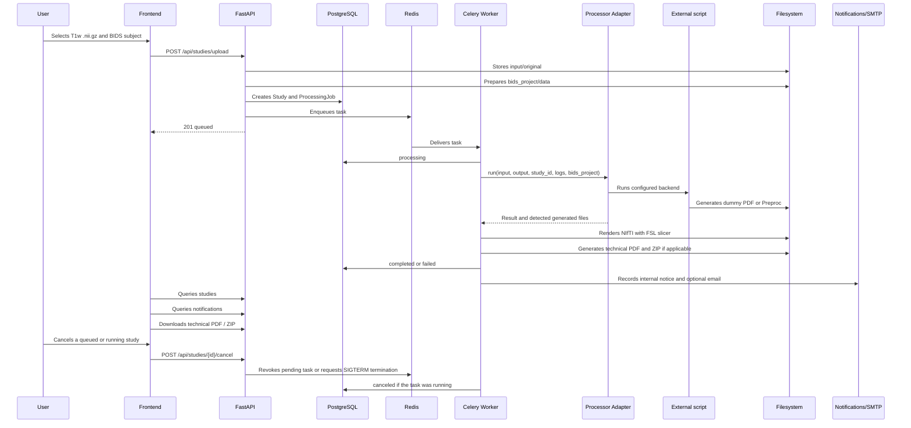
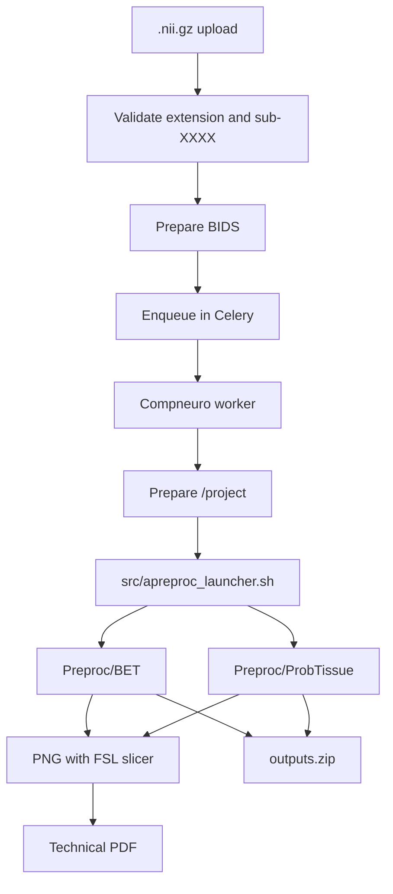

# Processing Pipeline

Processing takes between minutes and an hour, so it is never run inside the HTTP request. The API prepares data and enqueues; the worker runs the configured processor.



## Adapter Contract

Input:

- `input_dir`
- `output_dir`
- `study_id`
- `logs_dir`
- configured backend (`PROCESSOR_BACKEND`)

Output:

- success/error.
- exit code.
- PDF path, if the backend generates one or if the platform creates a technical PDF.
- paths of PNGs rendered from NIfTI, if applicable.
- list of generated files.
- ZIP path, if applicable.
- technical log.
- error message.
- duration.

The adapter is the stable boundary between the platform and any external processor. The API, the GUI and the queue must not depend on the specific script or on the Docker image used for processing. If `compneuro-anatproc` is replaced in the future, the change must be concentrated in the adapter, the configuration and, if needed, the worker's Dockerfile.

The adapter chooses the command according to `PROCESSOR_BACKEND`. The `dummy` backend runs `PROCESSOR_COMMAND` with placeholders:

```env
PROCESSOR_COMMAND=python /app/external_processor/dummy_processor.py --input {input_dir} --output {output_dir} --study-id {study_id}
```

The adapter validates the input, creates the output, captures stdout/stderr and stores logs. In `dummy` it checks that at least one PDF is generated. In `compneuro` it runs `COMPNEURO_COMMAND`, by default `bash /app/src/apreproc_launcher.sh`, checks exit code `0` and validates that `Preproc/BET` and `Preproc/ProbTissue` exist. The external command runs in its own process group so that it can be terminated if the user cancels a study that has already started.

For another script or container, the minimum interface expected by the platform is:

- read the data prepared by the platform, normally under `input_dir` or `/project/data` depending on the backend.
- write results to the expected output folder, preferably `output/Preproc` to reuse the current post-processing.
- finish with exit code `0` only if the results are complete.
- write enough stdout/stderr for diagnostics; the worker stores it in `logs/processor.log`.
- not generate `outputs.zip` as a main responsibility: the downloadable ZIP is created by the platform with `processor_adapter/output_packager.py`.

## BIDS Per Study

```text
data/studies/{study_id}/
  input/original/{original_file}.nii.gz
  bids_project/data/sub-XXXX/anat/sub-XXXX_T1w.nii.gz
  bids_project/data/participants.tsv
  bids_project/data/dataset_description.json
  runtime_project/data -> ../bids_project/data
  runtime_project/Preproc -> ../output/Preproc
  output/Preproc/BET
  output/Preproc/ProbTissue
  output/rendered_png
  output/reports/technical_report.pdf
  output/outputs.zip
  logs/processor.log
  logs/rendering.log
```

`compneuro-anatproc` uses hardcoded paths under `/project`. The platform creates an isolated `runtime_project` per study and the compneuro worker points `/project` to that folder through a managed symlink. This avoids Docker-in-Docker and avoids modifying the external scripts.

## Compneuro Flow



`src/apreproc_launcher.sh` is the external script used today. In the compneuro worker image it is located at `/app/src/apreproc_launcher.sh`, copied during the build from the `compneuro-anatproc` repository. It is not part of the platform's own code.

## Technical Post-Processing

After a successful `compneuro` run, the worker looks for `.nii` and `.nii.gz` files inside `output/Preproc`, with a limit configurable through `NIFTI_RENDER_MAX_FILES`. Each file is rendered with FSL `slicer` using the conceptual pattern `slicer input.nii.gz -a output.png` and saved in `output/rendered_png/`.

The PDF is saved by default in `output/reports/technical_report.pdf` and includes the study metadata, BIDS subject, processing flow used, list of results, the name of each NIfTI and the rendered PNG image. If there is no NIfTI or a conversion fails, the PDF is still generated with technical warnings. These warnings are not internal traces and may be shown in the GUI.

The document is a technical report of generated artefacts. It does not interpret images and is not a validated medical report. By default, each study is marked `technical_only`; administration can change the mark to `reviewed` or `validated` only as internal review traceability.

## Closing Notifications

When the worker confirms `completed` or `failed`, it first stores the final state of the study/job and then creates notifications. This order prevents an SMTP error from affecting the main result of the processing run.

Current rules:

- `completed`: internal notification to the owner and an email if their preference allows it.
- `failed`: internal notification to the owner and to active admins; email if their preferences allow it.
- Emails do not attach PDF, ZIP, logs or heavy data; only text and a link to the platform configured with `APP_PUBLIC_BASE_URL`.
- In Docker Compose, the default SMTP server is Mailpit (`mailpit:1025`) with a `noreply@<sender-domain>` sender; the local inbox is at `http://localhost:8025`.
- If SMTP fails, `email_status=failed` and `email_error` are recorded on the notification, but the study keeps its real state.
